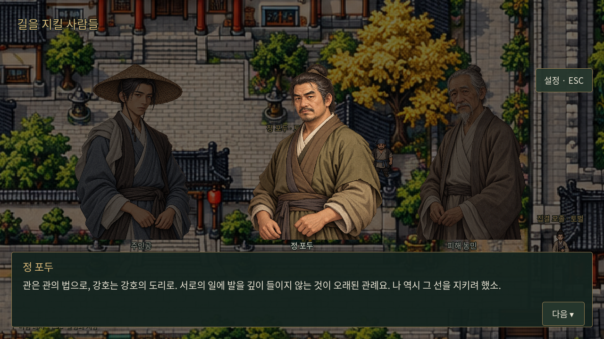
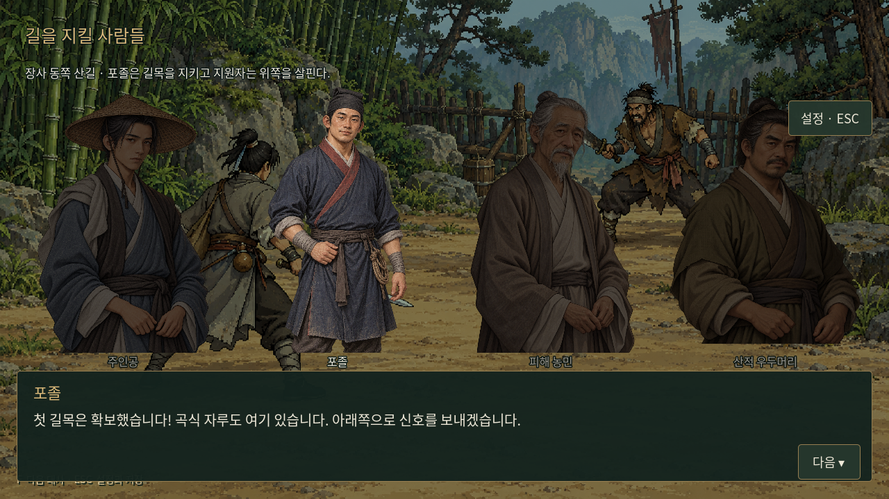
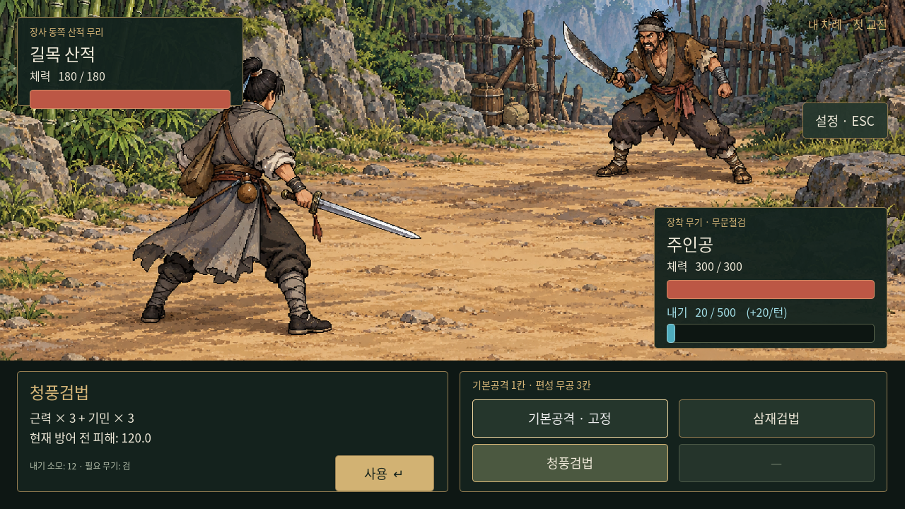
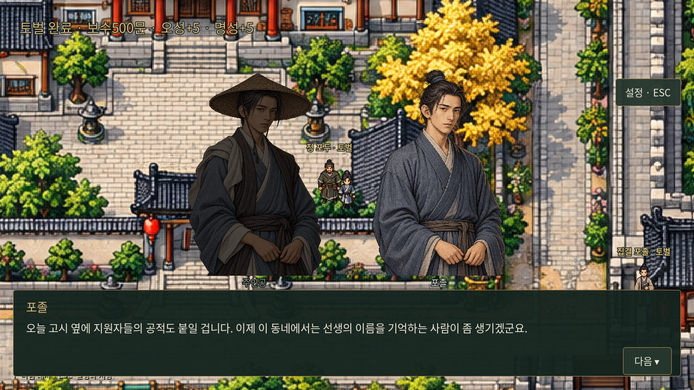

# 장사 산적 토벌 — 「길을 지킬 사람들」

사용자 채택 전제: 이류에 도달하고 무공을 하나 이상 배운 주인공에게 관의 토벌 지원 이야기가 자동으로 시작된다. 관무불가침의 관례 때문에 관은 원래 무림과 협력을 꺼리지만 주민 피해를 더는 방치할 수 없다. 정파 문파들도 사파 견제에 인력이 묶여 있어, 관은 개별 무림인의 자원을 받는다. 주인공은 지원해 산적과 싸우고 보수와 작은 명성을 얻는다.

「길을 지킬 사람들」은 이번 사건의 작업용 이름이다. 1장 안의 에피소드로 연결하며 아직 미정인1장 전체 제목은 바꾸지 않는다. 관무불가침은 이 작품의 강호 관례로 다루며 명대의 실제 성문법이라고 단정하지 않는다.

## 시작 조건

- 0장을 마쳐1장 포목상 도입 대화를 끝냈고, 장사에서 자유 조작 가능한 상태다.
- 다섯 스탯 합계가 **101 이상**이다(이류 달성). 이미 상위 경지로 성장한 캐릭터도 놓치지 않는다.
- **시작 삼재검법 외에 새 무공1종 이상**을 실제로 배웠다. 기본공격·기본방어이나 보유한 돈만으로는 조건을 채우지 않는다. 새 무공을 편성했는지는 별도 조건으로 요구하지 않는다.
- 조건을 모두 충족하면 다음 안전한 자유 탐험 시점에 모집 소식이 한 번 자동 재생된다. 대화·전투·거래·설정·지도·장 표시를 끊지 않는다.
- 기존 옷감/그릇/농기구 의뢰 완료나 특정0장 분기를 선행 조건으로 추가하지 않는다. 도시 자유 탐방 미리보기에서는 자동 시작하지 않는다.

## 이야기의 중심

관아의 포두 **정원석(정 포두)**은 주민 보호와 일손 부족 사이에서 고민한다. 원칙을 버리는 대신 협력의 범위를 분명히 정한다. 관은 민가 보호·길목 봉쇄·포로 호송·피해품 반환·후속 순찰에 책임지고, 지원 무림인은 험한 산길의 수색과 교전을 맡는다. 정파가 주민을 무시했다고 몰아가지 않고 현재 다른 대치 때문에 파견할 인력이 모자란 사정으로 설명한다.

피해 농민은 거창한 관례보다 내년 종자와 생활이 급하다. 주인공은 관과 강호가 서로 선을 지키는 동안 그 사이의 사람들이 버텨왔음을 알게 된다. 첫 공적은 무림 전체를 뒤흔드는 위명이 아니라, 장사에서 이 낭인의 이름을 기억하는 사람이 생기는 정도다.

정원석이라는 이름과 구체 대사는 이번 창작안이다. 주인공은 혼자 싸우는 기존 전투 형식을 유지하고 포졸이 전투 파티원으로 추가되지는 않는다.

## 진행 트리

```text
이류 이상 + 새 무공1종 + 1장 도입 완료
  └─ 장사 자유 탐험 중 모집 소식 자동 재생(1회)
      └─ 관아 앞 정 포두에게 F → 피해·관례·정파 사정 설명 → 지원
          └─ 장비/영약/무공 편성을 자유롭게 정비
              └─ 동문 밖 집결 포졸에게 F → 출발 설명
                  └─ 길목 산적과 전투1
                      ├─ 패배 → 포졸 도움으로 철수 → 정비 → 동문에서 재도전
                      └─ 승리 → 회수한 곡식 확인·산적 우두머리 대화
                          └─ 산적 우두머리와 전투2(체력/내기 새로 시작)
                              ├─ 패배 → 철수·정비 → 2연전 처음부터 재도전
                              └─ 승리 → 항복자 인계·민생 보호 책임 확인
                                  └─ 동문으로 귀환 → 관아 앞 정 포두에게 완료 보고
                                      └─ 마지막 보고 대사 종료 시 보상1회
                                          └─ 공적 안내·작은 명성 → 자유 탐험 복귀
```

모집 소식은 자동으로 시작하지만 관아에 가거나 정비를 마치는 시각은 플레이어가 정한다. 별도 제한시간·강제 순간이동·추가 분기를 넣지 않는다. 동문 포졸에게 말을 걸어 출발한 뒤의 산길 이동은 대화와 전투 장면으로 처리한다. 독립된 산길 탐험 맵은 이번에 추가하지 않았다.

관아와 집결지는 기존 장사 맵의 보행 가능한 길가에 주민으로 배치했다. 토벌 목표가 활성화되는 동안 기존 미니맵의 목표/화살표로 안내하고 완료 뒤에는 이전에 추적하던 일반 의뢰로 돌아간다.

## 토벌 대상과 전투

대상은 장사 동쪽의 작은 산적 무리다. 녹림삼십육채의 실제 탐험 거점을 새로 만들거나 기존 세 주요 채주를 이 사건에서 소모하지 않는다. 기존 녹림과의 구체적인 상하 관계도 확정하지 않는다.

기존 피해·무기·내기·기본공격·무공 편성을 그대로 사용한다. 산길용 전투 배경을 추가했다. 전투 수치는 이 사건을 실행하기 위한 임시 조정값이며 기존 주요 인물의 공식 스탯이 아니다.

| 상대 | 체력 | 근골 | 내공 | 행동 |
|---|---:|---:|---:|---|
| 길목 산적 | 180 | 10 | 6 | 기본공격·거친 도질·방어 |
| 산적 우두머리 | 240 | 15 | 8 | 기본공격·내려찍기·방어 |

고정 공격 피해를 폐지하고 플레이어와 공통 피해·내기 규칙을 사용한다. 공격 예정은 플레이어 선택 전에 예고한다. [수치와 초회 난이도 검증](../systems/combat-actions-and-icons.md).

첫 교전 승리 보상은 따로 지급하지 않는다. 두 전투는 각각 최대 체력300과 플레이어 내공만큼의 시작 내기로 초기화한다. 패배하면 주민을 보호하던 포졸이 철수를 돕고, 돈/영약을 강제로 빼앗거나 명성을 깎지 않는다. 다시 출발하면 첫 전투부터 진행한다. 이 패배 처리는 이번 토벌 사건용이다.

## 완료 보상

| 항목 | 지급량 | 의미 |
|---|---:|---|
| 보수 | 500문 | 메인 퀘스트 보수, 사용자 지정 |
| 오성 | +5 | 기존 의뢰 성장 규칙, 상한100 |
| 명성 | +5 | 이번 창작의 초기 수치안, 장사 일대에 알려진 첫 공적 |

보수500문은 메인 퀘스트에 대한 사용자 확정이며 오성은 기존 의뢰 보상 방향을 따른다. 명성5는 ‘다소 상승’을 표현한 초기 수치안이다. 명성은 다섯 기본 스탯과 별개이며 경지·피해·학습 조건에 더하지 않는다. 문파 가입·관직·전국적 명성·상점 할인·세력 호감도를 자동 부여하지 않는다.

승리 직후가 아니라 **관아 완료 보고 대화의 마지막 줄 뒤**에 지급한다. 지급 상태·진행 단계·명성을 함께 저장하고, 완료 후 방문이나 대화 재생으로 중복 지급하지 않는다. 상한 때문에 실제 오성 상승분이 줄어들면 완료 안내에 실제 상승량을 표시한다.

상단 소지금 HUD에 명성을 함께 표시하고, 완료 안내와 이후 정 포두의 대사로 작은 인지도를 표현한다. [전체 대화 원고](chapter-01-bandit-dialogues.md)를 참고한다.

## 저장·재개와 검증

수동 저장schema3에 선택 필드bandit_story를 추가했다. 예전schema3에 이 필드가 없어도 미시작으로 호환한다. progress.fame 역시 과거 저장에 없으면0으로 시작한다. 전투에는 적ID를 보관해 기존0장 수적과 두 토벌 상대를 구분하고 최대 체력/배경을 복원한다.

모집·지원·출발·전투 사이·철수·보고·지급 직후 대화에서 저장/불러오기를 지원한다. 새 콜백을 저장 허용 목록에 등록했으며 임의 코드를 저장하지 않는다. 새 게임은 토벌 상태와 명성을 초기화한다.0장 자동 체크포인트는 장사 도입 재개용으로 유지하며 토벌 이후에는 수동 저장을 사용한다.

`godot/data/changsha_bandit_story.json`에 대화·조건·보상·임시 적 수치를, `scripts/bandit_story.gd`에 진행 상태를 분리했다. `tests/bandit_story.gd`로100/101경계·시작 무공 제외·메뉴 중 보류·실제 두 전투·패배 재도전·저장/재개·중복 지급 방지·이전 목표 복원을 검증한다. 캡처용 성장 수치는 tests/capture_bandit_story.gd의 테스트 데이터이며 새 게임에 지급하지 않는다.





