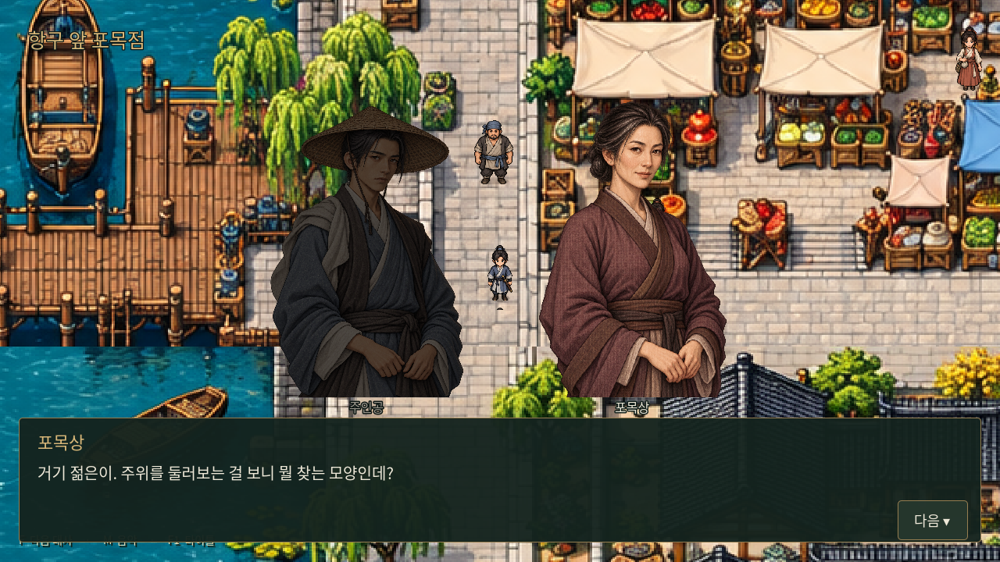

# 1장 도입 — 제목 미정

최신 사용자 요청: 0장 마지막 항구 독백 뒤 바로 자유 탐험으로 넘기지 않는다. **포목상이 먼저 말을 거는 기존 도입 대화 → 첫 연계 의뢰 수락 → 화면 중앙 ‘1장’ 한 번 표시 → 이동 재개** 순서로 연결한다. 장의 제목은 사용자가 추후 정하므로 부제나 이름을 추가하지 않는다. 이 도입 대화부터 내부 장 번호도 1이다.

## 실행 내용

- 기존 「맡겨 둔 옷감」의 포목상 대화 12줄을 연결했다. 0장의 마지막 혼잣말을 다시 재생하거나 접근/수락 버튼을 기다리지 않는다. 대화는 F키 또는 다음 버튼으로 넘긴다.
- 포목상은 동문에서 **항구 앞 포목 노점 `[330,485]`**으로 옮겼다. 길 가운데를 피하고 기존 건물 장애물과 겹치지 않도록 배치했다. 항구에서 대화를 시작하는 상황에 맞춰 첫마디와 자리를 비우기 어렵다는 설명 두 줄만 조정했다.
- 대화가 끝나면 `chapter_one.accepted_quests.changsha_cloth`에 `status=active`, `stage=deliver`로 실제 수락 상태를 기록하고 미니맵은 객잔 점소이를 안내한다.
- 화면 중앙에는 **‘1장’만** 표시한다. 0.45초 페이드인 → 1.4초 유지 → 0.55초 페이드아웃 뒤 이동·미니맵·목표 HUD를 넘긴다. 표시 중에는 이동·지도 열기·대화 입력을 막고 F1 초기화는 허용한다.
- 세 연계 의뢰를 동시에 수락하지 않는다. 옷감 → 식기 → 농기구의 기존 순서를 유지하고 첫 의뢰만 받은 상태로 시작한다. 배달·완료 판정과 다음 두 의뢰의 실제 수락/수행은 이번 범위에 구현하지 않았다. 첫 의뢰 수락·목표 안내를 전체 퀘스트 시스템 완성으로 설명하지 않는다.
- 별도 보상 수치·성장 조건·1장 본편 이야기는 정하지 않는다. 기존 0장의 3,000문/보수 없음 차이를 유지한다.

## 저장 호환과 반복 방지

기존 `user://chapter_00.json`의 버전을 2로 올려 도입 완료·장 표시 여부·첫 의뢰 수락 상태를 함께 기록한다. 이전 버전 1의 0장 완료 저장을 불러오면 보수와 분기 결과를 유지한 채 포목상 대화로 이어진다. 도입 대화 중 종료했다면 도입부터 다시 진행한다. 첫 의뢰를 받은 이후에는 수락 상태·목표를 복원하고 대화와 ‘1장’을 반복하지 않는다. 장 표시 중 종료해도 다시 표시하지 않는다. F1 초기화는 진행 중인 페이드 콜백을 취소해 타이틀에서 갑자기 이동 상태로 바뀌지 않게 한다.

타이틀의 별도 ‘장사 자유 탐방’은 기존처럼 스토리·의뢰 없는 지도 확인용 진입점으로 유지한다.

구현: `godot/scripts/chapter_one.gd`, `godot/data/chapter_one_intro.json`. 대화 원고는 `docs/quests/changsha-dialogues.md`이며 `python scripts/export_prologue_dialogue.py`로 JSON을 갱신한다. 검증은 `tests/chapter_one.gd`와 갱신된 `tests/prologue.gd`다. 실제 전투를 포함한 양쪽 경로 캡처는 `tests/capture_prologue.gd`를 따른다.

