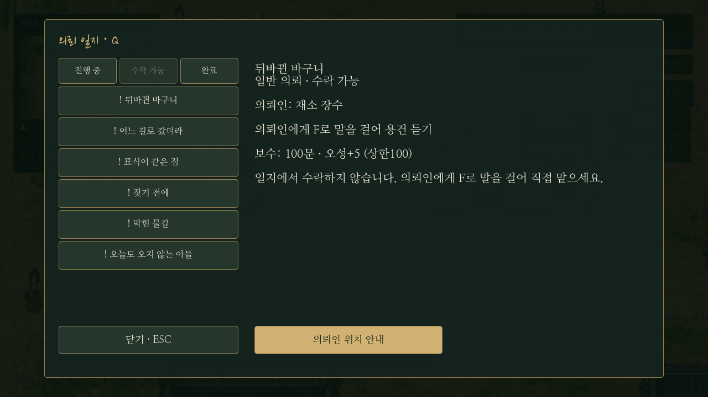
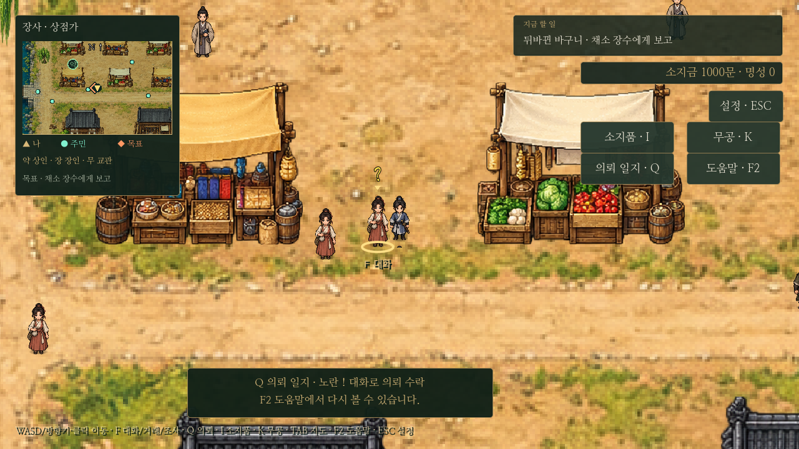
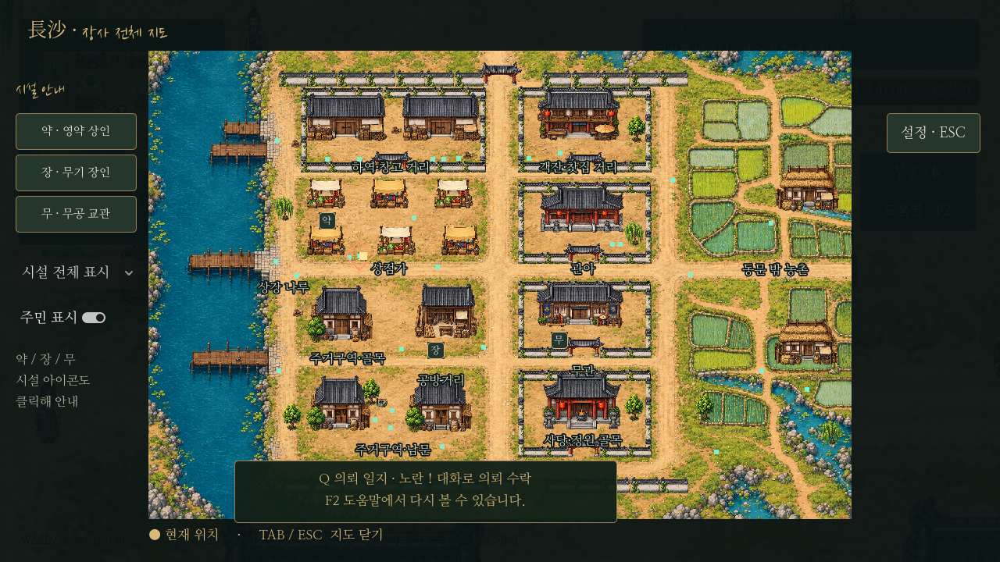
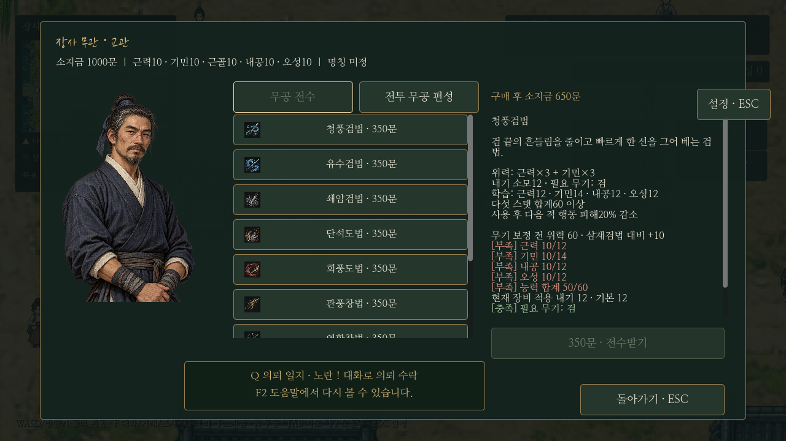
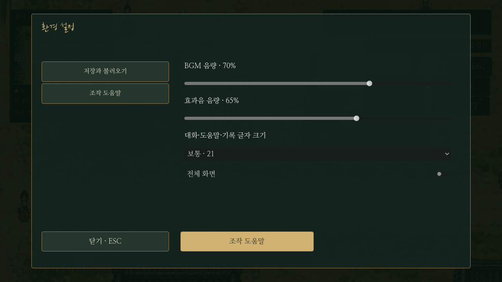
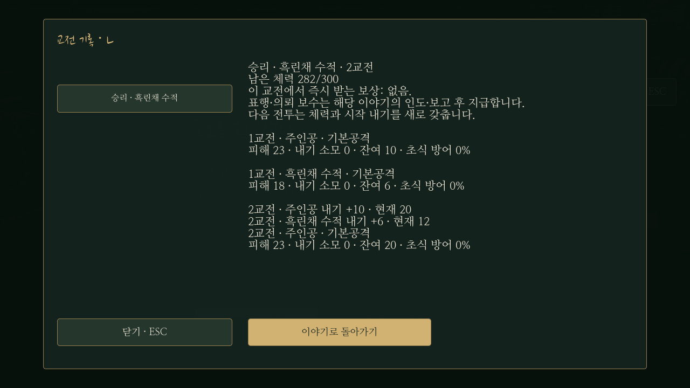

최신 변경: [전역 의뢰·2배 표식·지도 의뢰 표시](quest-world-update.md)를 따른다.

# 플레이 편의 기능 8종과 일반 의뢰

2026-10-24 사용자 채택안 적용. **Q는 의뢰 일지**, **F는 NPC·시설·조사 상호작용**이다. 기존 가격·무공/무기 수치·전투 계산·보상을 변경하지 않았다.

| 기능 | 입구와 동작 |
| --- | --- |
| 의뢰 일지 | Q 또는 HUD 버튼. 0장은 현재 이야기/선택 결과를 읽기 전용 기록으로 보여 주고, 장사 의뢰는 진행 중/수락 가능/완료, 의뢰인·단계·달성 수·보수 표시. 수락 가능 의뢰는 의뢰인 위치로 안내하고, 진행 중 의뢰는 목표를 추적한다. 수락 자체는 NPC에게 한다. |
| 상호작용 강조 | 실제 F키 대상의 발밑 금색 표시. F 대화/거래/조사를 발 아래에 표시해 !/?와 겹치지 않게 한다. 근거리에서 거리가 비슷하면 의뢰·거래 대상을 일반 주민보다 약간 우선한다. 벽 너머 대상은 제외한다. |
| 장비·무공 비교 | 거래/I/K 상세에 현재 장비와 공격·방어·창법 내기 보정 차이, 삼재검법 대비 무기 보정 전 위력, 실제 적용 내기 비용, 학습 조건의 현재/필요 수치 표시. 부족 조건은 붉게 표시하고 구매 후 소지금을 별도 표시한다. |
| 시설 지도 | 미니맵·TAB 지도에 약(상인)/장(장인)/무(교관). 시설 종류·주민 표시 필터, 시설 버튼/아이콘 클릭으로 안내. 화면 밖 방향 화살표를 재사용한다. 의뢰 추적으로 돌아오면 시설 안내를 해제한다. |
| 교전 기록·결산 | L 또는 전투 버튼. 실행된 기술·피해·소모/남은 내기·적용 초식 방어·실제 내기 회복만 기록한다. 승패 직후 결과와 다음 진행 안내를 표시한다. 미래 행동은 기록하지 않는다. |
| 도움말 | F2 또는 HUD/환경 설정. 이동·의뢰·거래·I/K·교전·성장·저장을 게임 안에서 확인한다. 처음 쓰는 기능의 짧은 안내는 한 번만 표시하며 F2에서 다시 확인한다. |
| 환경 설정 | ESC → 환경 설정·도움말. BGM/효과음 독립 음량, 전체 화면/창 모드, 대화·도움말·기록 글자 18/21/24. 큰 글자는 대화창 높이와 초상화 영역을 조정한다. |
| 알림·효과음 | 의뢰 수락/갱신/완료, 구매·습득·복용·장비·편성에 공통 알림. 짧은 알림은 큐로 순서대로 표시한다. 결정·구매·의뢰·무공 습득·피격·방어의 원본 합성 효과음 6종을 추가했다. |

## !와 ? — 확인 결과와 실제 연결

기존 일반 의뢰6종은 원고·보상·목표 기획만 있고 수락/달성/완료와 머리 위 표식은 연결되지 않은 상태였다. 이번에 `ordinary_quests.gd`와 `normal_quests.json`으로 실행했다.

- **수락 가능:** 의뢰인 머리 위 노란 `!`. F 대화 후 **맡는다 / 나중에 온다**를 1/2 또는 버튼으로 고른다.
- **진행 중:** 수락 가능 `!`를 지우고 진행 중 대사를 한다. 수행 대상은 `◆`로 구분하며 중복 수락하지 않는다.
- **조건 달성:** 노란 `?`로 바뀐다. 조건 달성만으로 돈/오성을 주지 않는다.
- **완료:** 의뢰인의 완료 대화를 끝내면 보상을 한 번 지급하고 표식을 지운다. 재방문 시 실제 만난 주민의 완료 후 대사를 재생한다.
- 자동 수락 도입3종은 기존 상인→장인→교관 흐름이다. 일반6종에는 서로의 선행 조건이 없다.
- 포두는 토벌 모집 후 `!`, 보고 대기 시 `?`. 집결 포졸은 출발 가능할 때 `!`다. 무관한 주민/전달 상대 모두에게 표식을 붙이지 않는다.

실행한 의뢰는 뒤바뀐 바구니(교환), 어느 길로 갔더라(탐문·보따리), 표식이 같은 짐(확인·운반), 젖기 전에(낱장3장), 막힌 물길(조사3곳), 오늘도 오지 않는 아들(안부·전달 방식2종)이다. 기존 [원고](../quests/changsha-dialogues.md)와 [보상](../quests/changsha-rewards.md)을 사용했다. 일반6종 합계는 **800문·오성12**, 도입까지 합치면 **1,250문·오성18**이며 오성 상한100의 실제 상승분만 지급한다. 안부의 두 전달 방식은 같은 보상이다. 비 예감은 연출이며 시간제한을 추가하지 않았다.

조사 지점은 새 도시 오브젝트의 충돌을 피한 위치에 배치하고, F 대상·일지·미니맵이 같은 위치를 가리킨다. 수행 물품은 판매/소모 가능한 새 아이템을 추가하지 않고 의뢰의 달성 상태로 관리한다.

## 저장·입력·호환

새 수동 저장에는 선택적인 `ordinary_quests`(상태·달성 목표·안부 선택)와 `navigation.facility`를 함께 보관한다. schema1~3의 기존 저장은 계속 읽으며 새 필드가 없으면 일반 의뢰 미수락/시설 안내 없음으로 복원한다. 일반 의뢰 보상을 받은 후 재방문/불러오기로 중복 지급하지 않는다. 분기 전 저장으로 되돌아가 다른 선택을 하는 것은 정상 진행이다.

대화·거래·전투 중 저장 금지는 유지하고, 일지·도움말·기록·의뢰 선택창을 닫은 뒤 저장한다. 일반 메뉴는 세계를 일시 정지하고 키보드 포커스를 창 안에 유지하며, 승패 결산은 기존 후속 대화를 준비한 상태에서 입력을 가려 표시한다. 닫기 전에는 플레이어 입력으로 후속 대사가 넘어가지 않는다. 전투 시작 시 모션·체력·내기는 기존처럼 초기화한다.

환경 설정과 최초 안내 확인은 `user://preferences.cfg`에 보관해 이야기 저장과 분리한다. BGM은 Music 버스, 효과음은 Effects 버스다. 효과음은 외부 녹음 없는 원본 PCM이며 [제작 안내](../../godot/assets/sfx/README.md)를 참고한다. 교전 기록은 현 실행에서 최근10전, 각 전투 최근400건이며 과거 저장으로 되돌아가면 이후의 기록을 지운다.

## 실제 Godot 화면

추가: [느낌표](../../godot/screenshots/adventure-quest-offer-marker.png), [진행 일지](../../godot/screenshots/adventure-journal-active.png), [장비 비교](../../godot/screenshots/adventure-weapon-comparison.png), [도움말](../../godot/screenshots/adventure-help.png), [전투 중 기록](../../godot/screenshots/adventure-combat-log.png).

## 코드와 검사

- `adventure_ui.gd`: 공통 일지·도움말·선택·설정·알림·결산. `ordinary_quests.gd`: 일반 의뢰 상태와 표식. `item_comparison.gd`: 계산 변경 없이 비교. `game_options.gd`: 환경/오디오 설정. `interaction_indicator.gd`: 실제 대상 강조.
- `tests/adventure_features.gd`: Q·수락/보류·실제 !/?·실제 위치의 F 대상, 일반6종 전체 진행·정확한 보상·안부 양쪽 분기, 저장/복원/중복 방지, 일지 추적·시설 안내, 조건/금액 비교, 음량 분리·큰 글자·메뉴 입력, 실제 전투 기록/결산을 검사한다. 기존·일반 대사 전체를 가장 큰 글자로 렌더링해 잘림도 검사한다.
- 기존 `onboarding_menus`, `bandit_story`, `saves`, `save_restrictions`, `quest_navigation`, `layered_city`, `conversation_tools`, `combat_updates`를 관련 회귀 검사로 실행한다. 실제 사용자 저장과 분리된 XDG 폴더를 사용한다.
- `tests/capture_adventure.gd`: 실행 화면 캡처. 배포 EXE를 추가 생성하지 않았다.

검증 결과: `adventure_features`의 일반6종 실제 F 동선·!/?·보상·분기·저장·실제 환경 설정 위젯·큰 글자/메뉴 입력 검사가 통과했다. 관련 `onboarding_menus`, `bandit_story`, `saves`, `save_restrictions`, `quest_navigation`, `layered_city`, `conversation_tools`, `ink_ui`, `combat_updates`(110비교)도 통과했다. 실제 실행에서 지도 배지·일지 탭·조작 안내의 겹침을 확인하고 수정했다.
