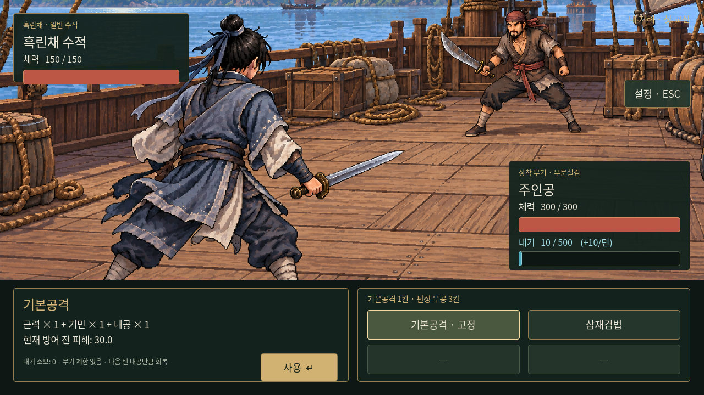

# 고정 기본공격

- 전투 선택지 4칸 중 첫 칸은 기본공격으로 고정한다. 나머지 3칸이 무공 편성용이며 초기에는 삼재검법과 빈칸 2개다.
- 방어 전 피해량 = **근력×1 + 기민×1 + 내공×1**. 사용자가 말한 ‘내력’은 기존 내공 스탯으로 해석한다. 현재 쌓인 내기량으로 위력이 달라지지 않는다.
- 내기 소모 **0**. 검/도/창/맨손 모두 사용 가능하며 별도 학습 조건이 없다. 무기 종류별 무공 피해 보너스를 기본공격에 더하지 않는다. 장착 무기의 기존 방어 효과는 유지한다.
- 공격은 한 턴을 소비하고 적도 반격한다. 다음 주인공 턴에 기존 규칙대로 내공만큼 내기가 회복된다. 별도 추가 회복은 없다. 최대 500을 유지한다.

시작 능력치가 모두 10이면 기본공격의 방어 전 피해는 **30**이다. 근골5인 초기 적에게 기존 공식과 버림을 적용하면 `floor((30−5)×100/105) = 23` 피해를 준다. 내기10에서 기본공격 후 다음 주인공 턴에는20, 다시 사용하면30이 된다. 삼재검법의 피해50·비용10은 그대로다. 내기가0이어도 기본공격할 수 있다.

선택한 행동은 다음 턴에도 유지되며 수동 저장/불러오기에 포함한다. 예전 슬롯의 `selected=true`는 삼재검법 선택으로 복원한다. 선택하지 않은 상태에서 F/Enter를 누르면 기본공격 설명을 먼저 열고, 다시 눌러 실행한다.

검증: `godot --headless --audio-driver Dummy --path godot --script res://tests/basic_attack.gd`. 실제 전투에서 무기 제한 없음·내기0 실행·기존 피해 공식·중복 입력 방지·회복과 상한·선택 유지·저장 호환을 확인한다.

