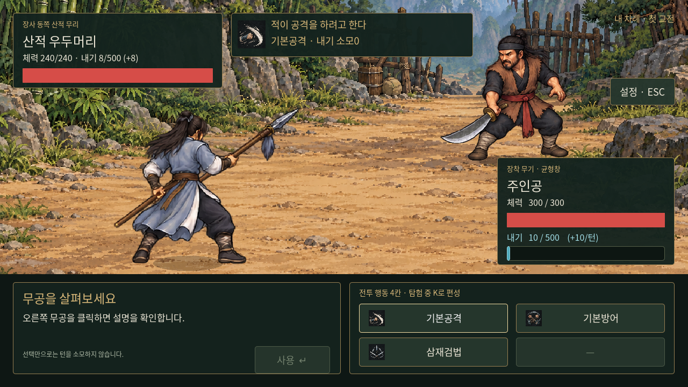
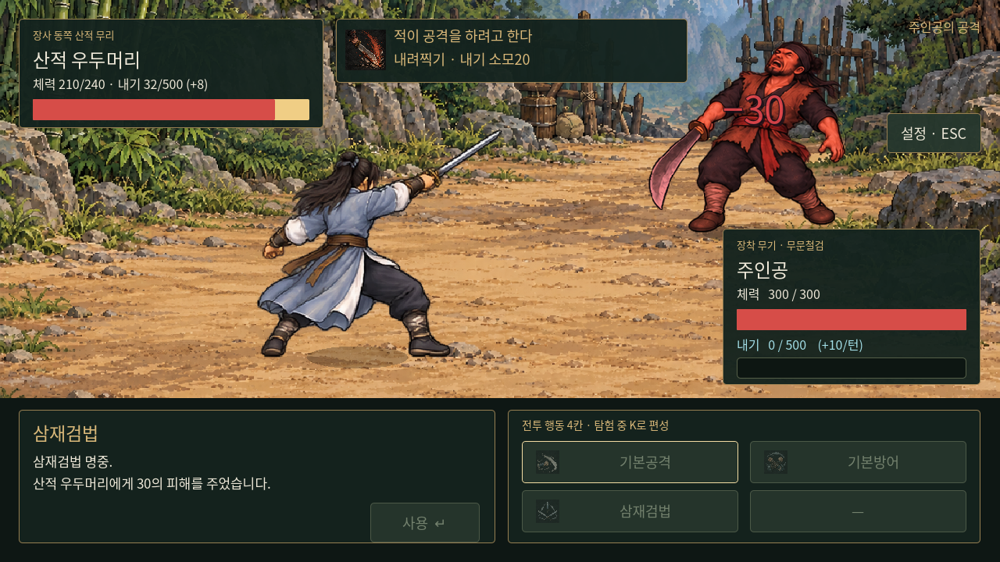
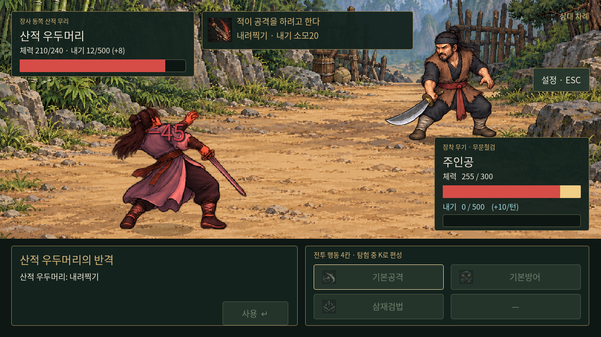

# 무기별 전투 모습과 공격·피격 연출

전투 배경에 함께 그려져 있던 인물을 분리하고, 실제로 움직이는 독립 캐릭터로 바꾸었다. 전투 수치와 턴 규칙은 유지한다.

## 무기와 모션

- 플레이어는 실제 장착한 **검·도·창·맨손**에 맞는 전투 이미지를 사용한다. 같은 종류의 무기 등급들은 같은 기본 자세를 공유한다. 맨손으로 바꾸면 무기도 사라진다.
- 적도 실제 무기 종류에 맞는 이미지를 사용한다. 현재 수적과 산적은 도를 든다. 적의 검·창·맨손 자세도 준비했다.
- 양쪽 모두 준비·공격 예비·타격·피격의4개 자세를 사용한다. 무기4종×자세4종×양쪽으로32개 전투 이미지가 있다.
- 공격할 때 몸을 뒤로 당겼다가 상대에게 접근해 베기·도 휘두르기·창 찌르기·주먹 지르기를 하고 원래 자리로 돌아온다. 공격에 맞으면 뒤로 밀리며 붉게 점멸한 뒤 준비 자세로 돌아온다.
- 대기 중에는 작은 호흡 움직임을 준다. 기본방어는 예비 자세와 푸른 빛으로 표현한다. 실제 피해가0이면 피격 동작과 피해 숫자를 발생시키지 않는다.

선박 갑판과 산길의 배경은 인물이 없는 새 버전으로 연결했다. 기존 원본은 보존한다. 공격 예고를 상단 중앙으로 이동해 왼쪽 인물을 가리지 않게 했다.

## 공격·피격 효과음

검·도·창·맨손의 출수음4종을 추가했다. 양측 모두 타격 자세 전환 시 공격음, 실제 피해 확정 시 피격음을 재생한다. 피해0은 차단음으로 구별하며 예고·선택만으로 소리를 내지 않는다. 기록 UI와 재생 경로를 분리해 중복음을 방지하고 기존 Effects 음량/음소거를 따른다. [효과음 자산·재생성](../../godot/assets/sfx/README.md).

## 피해 숫자와 체력바

체력이 감소하면 맞은 인물 근처에 **붉은 피해 숫자**를 띄워 위로 이동하며 사라지게 한다. 외곽선으로 밝은 배경에서도 읽을 수 있게 했다.

체력바는 실제 남은 체력을 빨강으로 즉시 표시하고, 방금 잃은 체력은 밝은 금색 구간으로 약0.20초 남겨둔다. 이어0.38초 동안 현재 체력까지 줄인다. 체력 수치와 실제 판정은 처음부터 감소한 값이며, 뒤따르는 구간은 시각 효과다. 내기 바는 이 효과를 쓰지 않는다.

추가 피해가 들어오면 표시 중인 손실 구간을 보존하여 새 체력까지 이어 줄인다. 회복·재전투·불러오기는 해당 값으로 즉시 맞춰 잘못된 잔여 피해가 보이지 않게 한다. 치명타 피해도 전투 결과로 넘어가기 전에 잔여 구간이 줄어든다.

## 중단과 저장

공격 중 입력·무기 교체는 기존처럼 차단한다. 설정으로 일시정지하면 타이머와 모션도 함께 멈춘다. 재시작·불러오기에서는 이전 공격·피격·숫자·체력바의 애니메이션을 취소한다. 저장 데이터에는 일시적인 모션을 넣지 않으며, 기존 저장의 무기ID·체력으로 모습을 복원한다.

## 자산과 구현

- `godot/assets/battle/`: 배경2장, 투명 캐릭터 시트2장, 자세별 표시 영역·발 위치 메타데이터`frames.json`.
- 캐릭터 시트의 원본 픽셀은 보존하며, `AtlasTexture`로 각 인물의 표시 영역을 지정한다. 무기 끝이 인접 칸에 걸쳐도 이웃 자세의 조각이 섞이지 않도록 인물별 영역을 사용하고 발의 높이를 맞췄다. 시트를 바꾸면 메타데이터도 함께 갱신해야 한다.
- `battle_actor.gd`: 무기별 이미지, 준비/공격/피격/방어, 전진·복귀·점멸·대기 동작.
- `damage_health_bar.gd`: 체력 즉시 반영과 손실 구간의 지연 감소.
- `battle.gd`: 실제 명중·반격 시점에 모션과 UI 연결. 기존 피해·내기·AI·턴 대기는 동일하다.

## 확인

`tests/battle_motion.gd`에서 무기4종 외형 전환, 준비→타격→복귀, 실제 플레이어·적 피격, 붉은 피해 숫자, 지연 체력바, 연속 손실·회복, 저장 복원, 처리 중 재시작, 치명 피해 표시를 확인했다.

기존 기본공격·0장 진행·수동 저장·내기·창법 화면·거래·110개 산적전 사례도 검사했다. 병렬 실행 시 시간 제한이 발생한 기본공격과0장 검사는 단독으로 다시 실행하여 통과했다. 실제 화면은 `tests/capture_battle_motion.gd`로 캡처한다. 테스트는 별도 XDG 사용자 폴더에서 실행하여 실제 저장과 분리한다.

