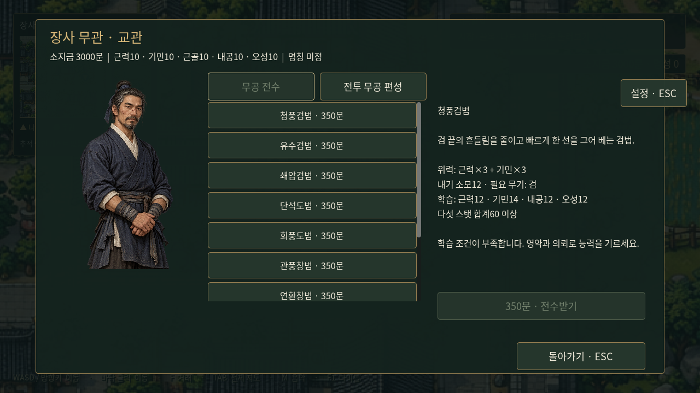
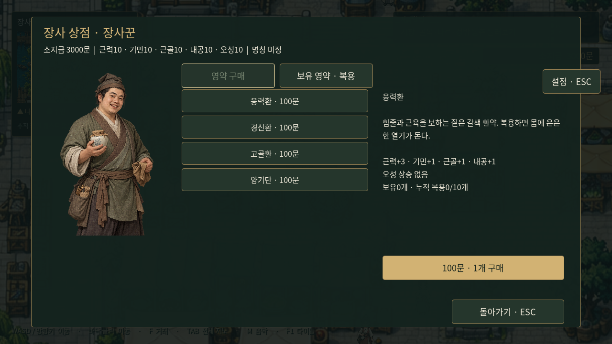

# 장사 NPC 거래

도시의 기존 장사꾼·장인·교관을 사용한다. 가까이 가서 **F**로 대화하면 시설 창이 열린다. 도시 대화 중 배경과 탐험HUD는 검정55% 오버레이로 어둡게 한다. 인물·대화창은 선명하게 유지하고 말하지 않는 사람은 기존처럼 어둡게 표시한다. 대화가 끝나 거래 창으로 전환되면 대화용 배경 어둡게 처리는 해제한다. 각 NPC의 전용 일러스트는 거래 창 왼쪽에도 표시한다.

| NPC·위치 | 첫 탭 | 둘째 탭 |
|---|---|---|
| 장인·공방거리 | 무기9종 구매: 등급별300/500/700문 | 보유 무기 장착·맨손 전환 |
| 교관·무관 앞 | 무공10종 전수: 각350문 | 습득 무공3칸 편성·칸 비우기 |
| 장사꾼·상점가 | 영약4종 구매: 각100문 | 보유 영약 복용 |

품목을 고르면 설명과 가격/조건을 표시한다. 아래 실행 버튼을 눌러 거래하고 **ESC**로 탐험에 돌아간다. 부족한 금액이나 학습 조건을 표시하며 실패한 거래는 돈이나 물품을 소모하지 않는다. 동일 무기·무공은 중복 구매하지 않는다. 구매한 무기는 자동 장착하지 않으며 영약도 자동 복용하지 않는다.

무공 학습에는 기존 개별 스탯과 총합 조건을 모두 만족해야 한다. 배운 무공은 교관의 편성 탭에서 배치할 칸을 고른 뒤 편성한다. 이미 배치한 무공을 옮기면 예전 칸은 비운다. 고정 기본공격은 편성 대상이 아니며 항상 남는다. 무기 장착 여부는 학습과 별개로 전투 사용 시 검사한다. 권/장은 무기 해제가 필요하다.

영약은 종류별 평생10개이며 보유량+복용량이10개면 추가 구매를 막는다. 복용 시 오성을 제외한 네 스탯이 기존 설계대로 오르고100을 넘지 않는다. 전부 상한이면 약을 소비하지 않는다. 네 종류를10개씩 복용하면 시작 스탯10에서 네 스탯70·오성10이 된다. 전투 시작 내기와 턴 회복, 공격과 방어 계산에도 성장한 기본 스탯을 적용한다.

## 저장과 기존 진행

수동 저장schema3에 기본 스탯·보유 무기·습득/편성·영약 재고/복용량을 포함한다. 장착 무기·남은 내기·선택한 새 무공도 복원한다. schema1/2는 기존 진행과 돈을 유지하고 신규 성장 항목만 시작 상태로 보충한다. 저장 검증을 통과하기 전에는 현재 진행을 초기화하지 않는다.

이전0장 자동 체크포인트는 장사 도입을 다시 시작하는 기능으로 유지한다. **거래 이후 진행을 보존하려면 설정의 수동 저장을 사용한다.** 도시 탐방 미리보기는0문이며 자동 체험 자금을 주지 않는다. 기존 귀물 경로의3,000문 등 보유 자금으로 거래한다. 장사9개 의뢰의 실제 완료·보상 지급 기능은 아직 후속 작업이다. 매각·제작·수리는 구현하지 않았다.

## 검증

- `tests/trading.gd`: 금전/학습 조건 부족, 중복 거래, 구매와 장착 분리, 무기 해제, 영약 성장과40개 한도, 무공 전수/편성, 새 무공 실제 전투, 전체 상태 저장/이전 형식 호환.
- `tests/city_services.gd`: 기존 도시의 NPC 배치, F 대화, 일러스트 참여자, 거래창·탭·ESC·초기화.
- `tests/capture_trading.gd`: 실제 대화와 거래 화면을세 시설 각각 캡처한다. 캡처에서만3,000문을 부여하며 게임 시작 자금에는 영향이 없다.

## 도시별 무기 판매 목록

장사 장인은 정련검·후배도·균형창3종(각300문)만 판매한다. 무창의9종과 영약/무공 판매는 유지한다. `city_weapon_stock.json`을 표시와 실제 거래에서 함께 검증하며 기존 소유 무기의 장착은 유지한다. [최신 구현](quest-world-update.md).
