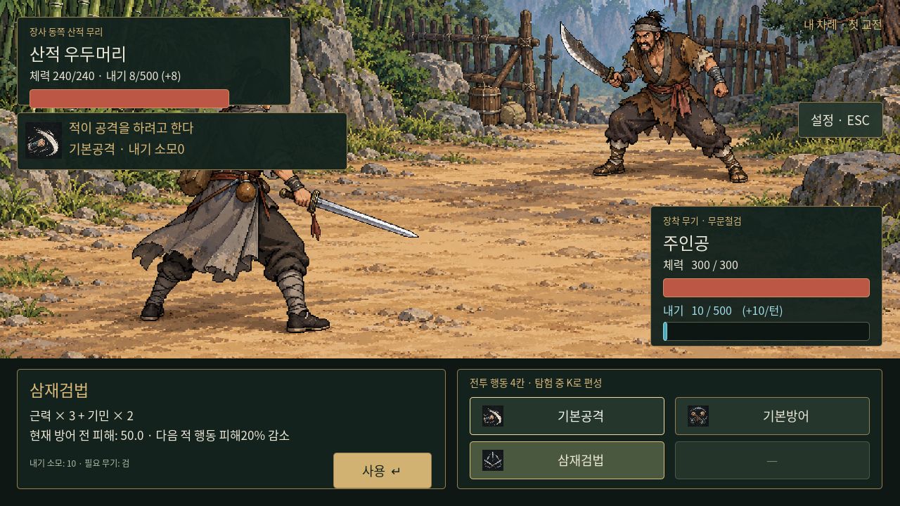
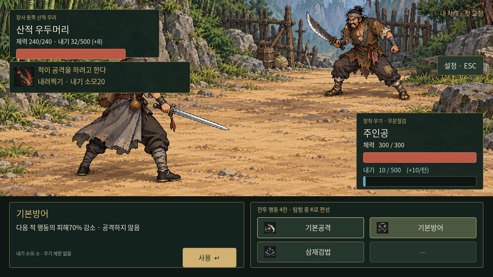
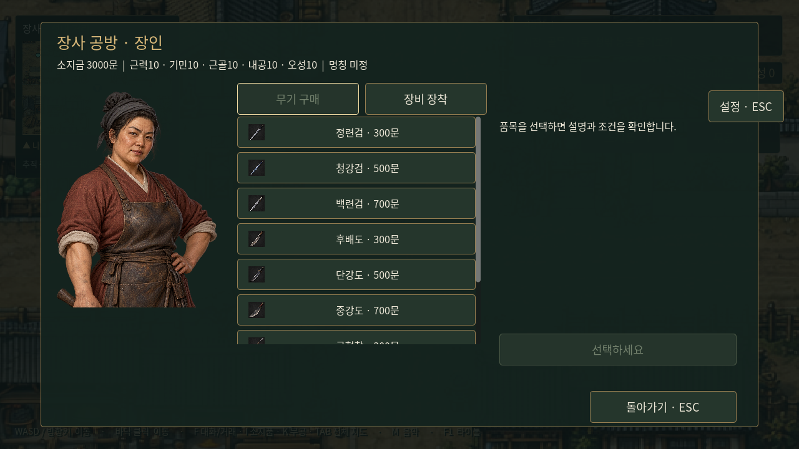

# 행동 선택·공통 내기·콘텐츠 이미지

2026-10-23 적용. 검토안과 달리 이 문서는 실제 Godot 동작을 설명한다.

## 이미지

기존 무공 11종, 기본공격·기본방어, 무기 10종, 영약 4종, 입문 의뢰 물품 3종에 검토한 이미지를 적용했다. 산적의 신규 전용 무공 2종도 새 이미지를 생성했다. 전투의 4칸, 적 행동 예고, I 소지품, K 무공, 거래 화면에서 표시한다.

`godot/data/icon_manifest.json`은 ID와 아틀라스의 칸을 연결하고 `catalog_icons.gd`가 네이티브 AtlasTexture로 표시한다. 상위 등급용 미등록 예시는 원본 이미지에 보존하지만 실제 콘텐츠로 등록하지 않았다. 원본 크기를 유지하여 새 페이지로 확장한다.

앞으로 새 아이템·무공 작업에는 **이미지 생성·등록·실제 표시 확인을 함께 수행**한다. 이 지속 작업 규칙을 `godot/AGENTS.md`에 기록했다. 실행 중인 게임이 외부 이미지 생성 API를 호출한다는 의미는 아니다. 전체 카탈로그의 이미지 누락은 `tests/combat_updates.gd`에서 검출한다.

## 플레이어 편성·방어

새 게임 편성은 `기본공격 / 기본방어 / 삼재검법 / 빈칸`. K와 교관의 편성 탭에서 네 칸 모두 바꾸거나 비울 수 있다. 기본 행동은 습득 무공 수로 계산하지 않는다.

- 기본공격: 기존 근력+기민+내공, 내기 0.
- 기본방어: 공격 없이 다음 적 행동의 피해70% 감소, 내기 0. 일반 턴 회복만 적용.
- 검법 4종: 공격과 함께 다음 적 행동의 피해20% 감소. 기존 비용 유지.
- 무기의 피해 감소와 선택 행동의 방어를 곱하고 마지막에 한 번 버린다. 기본방어와 검법 방어를 합산하지 않는다.
- 방어는 해당 교전의 적 행동에만 적용된다. 다음 턴이나 다음 전투에 남지 않는다.
- 장비 불일치·내기 부족·빈 편성으로 네 칸 모두 사용할 수 없으면 첫 칸에 **임시 기본공격**을 표시한다. 편성을 덮어쓰지 않으며 정상 행동이 가능해지면 사라진다.

## 적의 행동

플레이어·적은 `combat_actions.gd`의 동일 피해·무기·기본 행동 규칙과 `inner_qi.gd`의 내기를 사용한다. 최대500, 전투 시작 시 내공만큼, 교전이 끝나 살아 있으면 내공만큼 회복한다. 예고·미리보기·저장 불러오기는 내기를 주거나 빼지 않는다.

적은 플레이어 입력 전에 행동을 확정한다. 초반 적은 예측 가능한 주기로 세 번째 교전마다 방어해 내기를 모으고, 다른 교전에는 감당할 수 있는 무공 중 기본공격보다 강한 기술을 사용한다. 부족하면 기본공격을 한다. 플레이어의 선택을 보고 대응을 바꾸지 않는다.

공격 예정이면 **‘적이 공격을 하려고 한다’**만 표시한다. 무공명·소모 내기·전용 아이콘·툴팁은 예고에서 숨긴다. [최신 UI와 화면](wuxia-ui-style.md). 방어 예정이면 별도의 방어 태세 문구를 표시한다. 적의 체력·현재 내기도 보인다. 적의 기본방어는 예고된 교전의 플레이어 공격부터 적용되므로 방어 예고에 맞춰 내기를 아낄 수 있다. 향후 적이 검법을 쓰는 경우에도 공격을 마친 뒤부터 다음 플레이어 공격에20% 방어가 적용되며, 기본방어와 중첩하지 않는다.

| 적 | 체력 | 근력/기민/근골/내공/오성 | 무기·전용 무공 |
|---|---:|---|---|
| 0장 수적 | 150 | 12/12/5/6/5 | 후배도·거친 도질 |
| 길목 산적 | 180 | 12/10/10/6/8 | 후배도·거친 도질 |
| 산적 우두머리 | 240 | 14/12/15/8/10 | 후배도·내려찍기 |

거친 도질은 근력×2+기민×1, 내기12. 내려찍기는 근력×3+기민×2, 내기20. 적도 자신의 무공 학습 조건을 충족한다. 적 전용 데이터에 두어 교관 판매 목록에는 추가하지 않았다.

매 전투 체력·내기가 초기화된다. 산적 패배 시 기존 준비 복귀를 유지하고, 0장 전투 패배에는 다시 도전 버튼을 제공한다. 보상500문은 바꾸지 않았다.

## 저장 호환

기존 3칸 저장은 고정 기본공격을 앞에 추가하여 기존 무공을 보존한다. 새 저장은4칸이다. 기존 schema1~3을 계속 읽는다. 적의 현재 내기·확정된 행동·직전 검법의 방어 효과를 저장하여 재불러오기로 행동을 바꿀 수 없다. 옛 저장에 적 상태가 없으면 시작 내공만큼의 내기를 배정하고 해당 교전의 행동을 결정한다.

## 난이도 검증과 한계

`tests/combat_updates.gd`는 현재 게임의 공통 계산 함수를 그대로 사용한다. 무공10종의 최소 학습 조건을 채우고 합계100에 도달한 캐릭터로 해당 무기의 모든 등급을 비교한다. 기본공격과 사용 가능한 공격 중 단순히 강한 기술을 고르는 방식, 공격 예고에 기본방어하는 방식 모두 점검한다. 추가로 신체 능력은 초기값인 채 오성으로만 절정을 만든 극단적인 기본공격 전용 사례도 비교한다.

총110사례가 승리했다. 정상 무공 성장안의 최저 잔여 체력은125/300이다. 최약 기본공격 전용 사례도 우두머리전에서69/300이 남았다. 매 전투300으로 시작하므로 연전으로 누적 소모되지 않는다. 일반 성장안(근력12·기민14·근골12·내공14·오성55, 정련검·청풍검법)으로 실제 자동 모집→두 전투→관아 보고→500문 지급까지 불러오기·철수 없이 진행하는 통합 테스트도 통과했다. 결과 원본은 `docs/reviews/combat-balance-applied.json`이다.

이는 정의한 성장·행동 사례의 결정론적 검증이며 모든 가능한 플레이를 보장하지 않는다. 계속 방어만 하거나 장비를 잘못 고른 경우까지 무조건 승리하도록 만들지는 않았다. 미구현 일반 의뢰의 완성·성장 재화 동선은 별도 과제이며 이번 검증은 전투 진입 시점의 성장 상태를 기준으로 한다.

재현: 별도 XDG_DATA_HOME을 지정하고 `godot --headless --path godot --script res://tests/combat_updates.gd`. 테스트는 분리된 사용자 폴더에 결과 JSON을 저장한다. 이미지 표시·4칸 편성·내기 지불·예고 고정·저장 복원·0장 재도전도 함께 검증한다.

## 실제 적용 화면

아래 두 전투 캡처는 기세만 표시하도록 바꾸기 전 화면이다. 최신 화면은 [무협 UI](wuxia-ui-style.md)를 참고한다.

