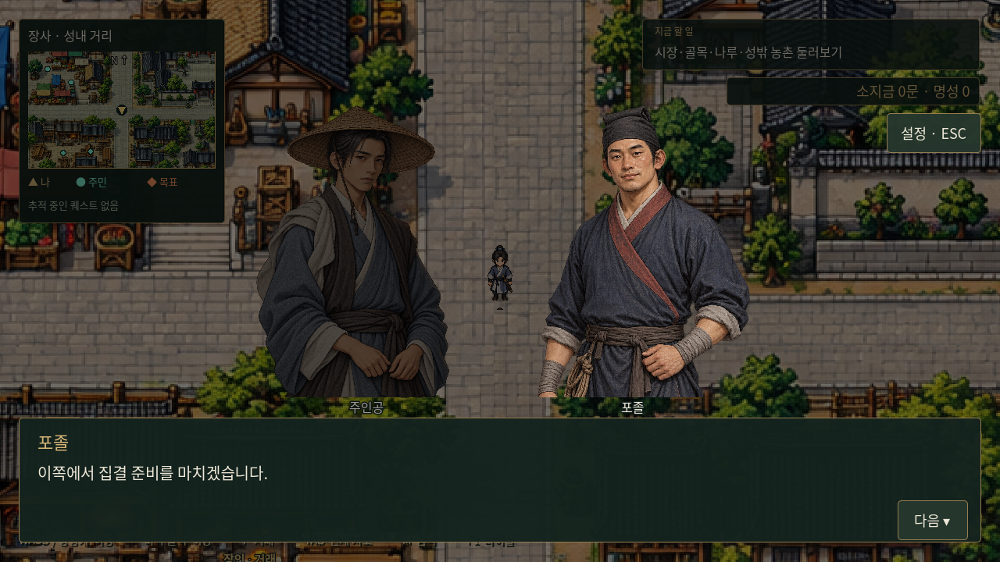
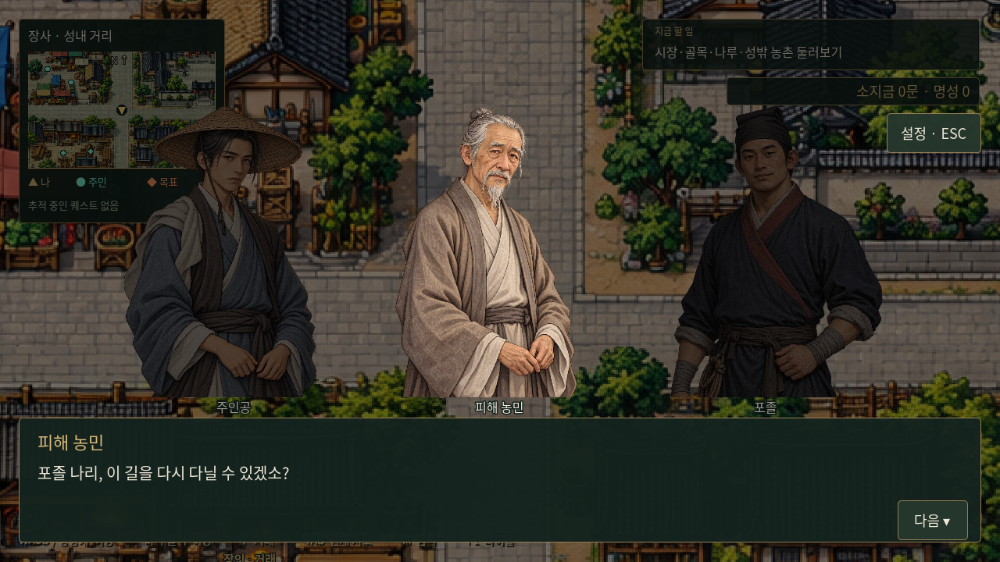

# 대화 일러스트 비율과 시선

플레이어 일러스트를 기준으로 현재 게임에서 사용하는 11종(주인공·공용 6종·거래 인물 3종·포졸)의 눈높이와 얼굴 크기, 상반신 표시 범위를 맞췄다. 체격과 머리 장식의 차이는 유지한다. 원본 PNG는 수정하지 않고 대화창과 거래창에서 표시할 때 확대·이동·잘라내기를 적용한다. 포졸은 무릎까지 보이던 원본 대신 허리 부근까지 표시된다.



## 대사에 따른 방향

두 사람은 기본적으로 서로를 바라본다. 여러 사람이 있으면 청자는 발언자를 바라보고, 발언자는 기본적으로 주인공을 바라본다. 주인공의 답변은 직전 발언자를 향하며, 첫 발언이나 직전 발언자도 주인공인 경우 가장 가까운 상대를 향한다. 발언자의 밝기와 청자 어둡게 처리는 그대로 유지한다. 방향이 바뀌어도 인물의 자리는 이동하지 않는다.

세 번째 항목으로 상대를 지정할 수 있다. 다음은 농민이 주인공 대신 포졸에게 말하는 예다.

```json
["bandit_farmer", "포졸 나리, 이 길을 다시 다닐 수 있겠소?", {"to":"bandit_messenger"}]
```

고개를 돌리는 장면 등은 `facing`에 화면 기준 `left` 또는 `right`를 지정한다. 자동 방향보다 우선하며 해당 대사에만 적용한다. 기존 세 번째 항목의 부제도 사용할 수 있으며, 이때 연출 정보는 네 번째 항목에 넣는다.

```json
["hero", "잠깐 돌아보았다.", "혼잣말", {"facing":{"hero":"left"}}]
```

상대는 같은 대화의 참여자여야 방향에 영향을 준다. `to`는 참여자를 새로 추가하지 않는다. 대사 연출은 저장·불러오기에서도 복원되며 기존 2항목 대사와 3항목 부제 대사도 호환한다.



## 추가 일러스트 등록

`godot/data/portrait_framing.json`의 각 원본 경로에 얼굴 가로 중심 `face_x`, 눈높이 `eye_y`, 눈에서 턱까지 길이 `eye_to_chin`을 원본 픽셀로 기록하고, 원본이 향하는 방향을 `natural_facing`으로 지정한다. `dialogue_portraits.gd`가 이 정보를 화면 크기에 맞추며 `dialogue_portrait.gdshader`가 원본을 변형 없이 표시한다. 미등록 그림은 기본 비율로 표시하므로 새 그림은 프로필 등록 후 실제 화면에서 확인한다.

검증은 `godot/tests/dialogue.gd`(비율·방향·대사 부제·저장 복원), `tests/capture_portrait_layout.gd`(11종과 다인 대화 캡처)를 사용한다.

- [남성 공용 비교](../../godot/screenshots/portrait-framing-male.png)
- [여성 공용 비교](../../godot/screenshots/portrait-framing-female.png)
- [거래 인물 비교](../../godot/screenshots/portrait-framing-services.png)

## 2026-10-24 후속 업데이트

남녀 공용 초상화 2장씩 추가, 한 대화 안의 초상화 중복 금지, H키 대화 기록을 적용했다. [새 화면과 규칙](layered-city-and-conversation.md). 기존 프레이밍·반전·발언자 강조는 유지한다.
