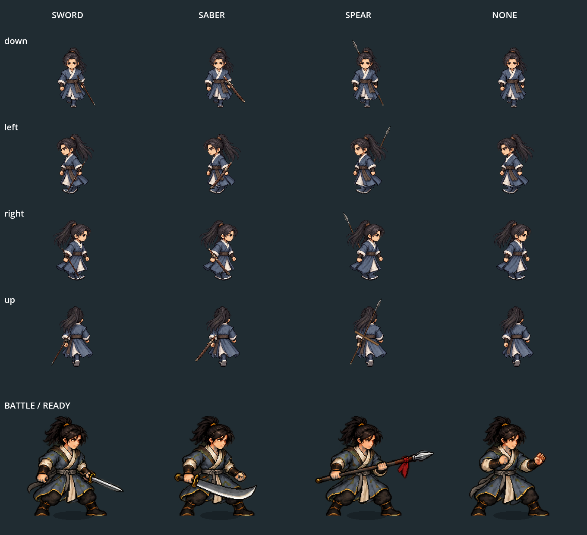

# 장착 무기와 캐릭터 외형

I 소지품에서 장착한 검·도·창·맨손을 탐험 캐릭터와 전투 캐릭터에 함께 표시한다. 같은 종류의 무기는 등급에 관계없이 같은 외형을 사용한다. 무기별 능력치·조건·가격은 변경하지 않았다.

## 표시 방식

- 검: 공통 무기 없는 몸체에 곧은 검집 `sheathed_straight_sword.png`를 별도 장비층으로 표시한다. 검의 몸체 경로는 저장/기존 코드 호환을 위해 유지하지만 실제 그림은 맨손 몸체와 같다.
- 도: 기존 후배도·단강도·중강도 아이콘을 참고한 두꺼운 칼등/넓은 몸체의 도집을 허리에 표시한다. 크게 말린 끝을 없애고 완만한 굽음/각진 끝으로 교체했다. 손잡이 포함 표시 높이는 몸체의60%에서45%로25% 줄였다. 별도 `sheathed_thickback_saber.png`를 사용한다.
- 창: 탐험에서는 등에 비스듬히 메어 어깨 위로 창날이 보인다. 앞·옆에서는 몸이 창대 가운데를 가리고, 뒤에서는 창대와 고정 끈이 보인다. 보행 중 손을 따라 흔들리지 않는다. 전투에서는 기존처럼 손에 창을 든다.
- 맨손: 검과 검집을 제거한 몸체만 표시한다.
- 몸체와 별개로 그리는 검/도/창은 발 교차 변형에 휘지 않는다. 캐릭터 전체는 기존 발밑 Y정렬/건물 가림을 따른다. 발밑 충돌, 속도, 몸체 크기는 유지한다.
- 전투는 기존 무기별 준비/공격 준비/출수/피격 그림을 장착 종류에 맞춰 선택한다. 전투 진입 때도 실제 장착 종류를 다시 적용한다.
- 대화용 도원 초상화는 특정 무기 없는 기존 그림을 유지한다.

장착 변경과 저장 불러오기는 `battle.weapon_equipped` 신호를 통해 탐험 몸체에도 반영한다. 별도의 외형 저장 필드는 추가하지 않고 기존 장착 아이템 ID에서 복원한다. 새 여정은 기본 검 외형으로 돌아간다.

## 실제 플레이 화면

도집 교체 후 실제 I 장착/WASD 이동 캡처: [앞](../../godot/screenshots/saber-refit-live-down.png) · [뒤](../../godot/screenshots/saber-refit-live-up.png) · [왼쪽](../../godot/screenshots/saber-refit-live-left.png) · [오른쪽](../../godot/screenshots/saber-refit-live-right.png). 창/전투 그림은 유지한다.

소지품에서 실제 창 장착 후 WASD 이동으로 재확인한 새 캡처: [뒤](../../godot/screenshots/spear-back-live-up.png) · [앞](../../godot/screenshots/spear-back-live-down.png) · [왼쪽](../../godot/screenshots/spear-back-live-left.png) · [오른쪽](../../godot/screenshots/spear-back-live-right.png). 기존 비교 파일과 다른 이름으로 저장해 구별한다. 뒤에서는 창대/고정 끈, 앞/옆에서는 몸 뒤 가림을 확인했다. `capture_spear_back_live.gd`로 재생성한다.

| 종류 | 탐험 | 전투 |
| --- | --- | --- |
| 검 | [화면](../../godot/screenshots/equipment-field-sword.png) | [화면](../../godot/screenshots/equipment-battle-sword.png) |
| 도 | [화면](../../godot/screenshots/equipment-field-saber.png) | [화면](../../godot/screenshots/equipment-battle-saber.png) |
| 창 | [화면](../../godot/screenshots/equipment-field-spear.png) | [화면](../../godot/screenshots/equipment-battle-spear.png) |
| 맨손 | [화면](../../godot/screenshots/equipment-field-none.png) | [화면](../../godot/screenshots/equipment-battle-none.png) |

## 미술 자료와 검증

교체 도집은 기존 `assets/icons/equipment.png`의 도3종을 참조해 생성했다. 원본: `/workspace/generated_images/exec-727c56f4-f0dc-47bc-8174-82184394a6a5.png`. 기존 합본 시트의 도집은 보존하되 런타임에서는 새 전용 PNG를 연결한다. 알파 경계/칼집 입구 위치만 메타데이터로 등록하며 픽셀은 편집하지 않았다.

`hero_walk_unarmed.png`는 기존 16개 보행 자세에서 검/검집을 제거한 생성 편집 그림이다. `carried_weapons.png`는 별도 생성한 투명 도집/창 그림이다. 생성 원본은 작업 환경의 `/workspace/generated_images/exec-7b015936-334f-4b4e-afa6-69a01ca91c24.png`, `/workspace/generated_images/exec-419595fe-c573-4246-ab9a-c84a80f6046c.png`에 보관했다. 프레임 JSON은 알파 영역을 읽어 발밑/머리 위치를 맞춘 메타데이터이며 픽셀을 다시 그리지 않았다.

- `equipment_visuals.gd`: I 실제 장착, 네 종류의 사방 보행/정지 크기, 발밑 충돌/속도, 저장/불러오기, 전투 진입과 네 자세, 새 여정 복원.
- `battle_motion.gd`: 네 무기의 실제 공격/복귀와 피격·효과음·체력 표시 회귀 검사. 렌더 캡처와 병행한 첫 실행은 0.2초 고정 시점 검사 한 곳이 실패했으며, 캡처 종료 후 단독 재검사는 통과했다.
- `road_stride.gd`, `paper_menu_live.gd`: 보행 및 실제 소지품/무공 메뉴 회귀 검사.
- `capture_equipment_visuals.gd`, `capture_equipment_overview.gd`: 실제 Godot 렌더 캡처. 사용자 저장과 분리된 XDG 폴더에서 실행한다.
