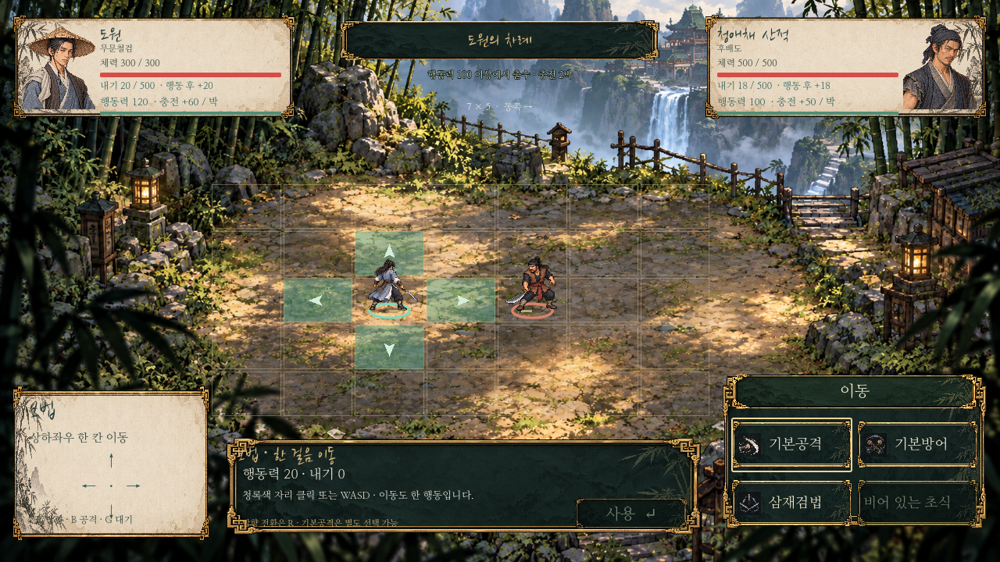

# 가변 격자 전투 — 실제 게임 적용

2026-10-28. 기본7×5 전장을 실제 전투 장면에 적용했다. 기존 HTML 실험실과 별개이며, 새 무공의 최신 위력·행동력·내기·범위는 [재편표](../martial-arts/redesign-v2.md)를 사용한다.



[1440p 화면](../../godot/screenshots/grid-battle-1440.png) · [9×6/장애물 확장 확인](../../godot/screenshots/grid-battle-variable.png)

현재 화면은 [전용 미술과 기본 동작](../ui/premium-battle.md)으로 개편했다. 선택 비용은 하단 중앙, 이동+4칸은 우하단이다.

## 화면과 조작

- 위쪽 양끝: 이름/무기/체력과 피해 잔상/내기/행동력 수치·준비 막대/다섯 능력치. 적 소속은 이름의 툴팁에서 확인한다.
- 가운데: 전장 크기·방향·충전 박자·행동 조건. 적이 다음에 쓸 기술이나 공격 의도를 미리 표시하지 않는다.
- 전장: 청록색 이동 가능 자리, 주홍색 무공 공격 위치, 시전자 전진 위치와 선택한 방향. 현재 캐릭터는 무기별 기존 전투 그림/피격/붉은 피해 숫자/효과음을 재사용한다.
- 하단 중앙: 선택한 행동의 위력·행동력·내기·범위 설명과 기존4칸 편성. 기본공격은 편성에서 빼도 B로 선택할 수 있다.
- WASD/방향키:한 칸 이동. 이동 버튼을 고른 뒤 청록색 칸을 클릭해도 된다. 이는 전투 입력이며 탐험 클릭 이동을 되살리지 않는다.
- 1~4:편성한 초식 선택. R:공격 방향 회전. Enter/Space/출수 버튼 또는 주홍색 공격 칸 클릭:실행. 범위에 상대가 없으면 실행하지 않는다.
- 숨 고르기:행동력20을 쓰고 내기를 정상 회복한다. L 기록/F2 도움말/ESC 설정과 일시정지는 유지한다. R 호의도는 탐험에서 사용하고 전투에서는 방향 전환이다.

## 행동과 자원

양쪽에 같은 규칙을 사용한다. 시작 행동력0, 내기는 내공만큼이다. 아무도 행동할 수 없으면 공통 박자를 진행해 각자의 행동력을 `기민+10`만큼 충전한다. 충전 중에는 실제 시간이 흐르며 공격하는 방식이 아니라, 다음 선택 가능한 상태까지 계산한다. 시작 박자/속도 기본값10은 조정 가능한 초기 구현값이다.

매 행동은 **행동력100 이상 및 해당 비용 충족**을 요구한다. 행동 후에도100 이상이면 같은 인물이 이어서 행동할 수 있다. 그 조건을 벗어나면 다른 준비된 인물에게 넘긴다. 새로 두 인물이 동시에 준비되면 높은 게이지가 먼저, 동률이면 직전에 행동하지 않은 쪽이 먼저다. 한 번 입장한 차례의100을 자유 예산으로 취급하지 않는다.

예:기민50/40 →2박 후120/100 →도원이 이동20으로100 →무공80으로20 →상대 행동. 복합 무공의 이동/공격은 한 행동이며 추가 이동20을 청구하지 않는다.

- 기본공격30, 기본방어20, 일반 이동20, 무공은 재편표 비용을 사용한다.
- 내기는 실제 자기 행동이 끝날 때 내공만큼 회복한다. 충전 박자만으로 회복하지 않는다. 이동/숨 고르기도 회복하고, 조식수원공은 별도200% 회복에 정상 회복을 더한다. 상한500.
- 방어는 부여한 행동 이후 **다음 자기 실제 행동 시작까지** 유지하며 그 사이 모든 공격을 줄인다. 선택/충전/상대 이동/피격만으로 만료하지 않는다. 실패한 실행도 방어를 없애지 않는다.
- 조식수원공의 대기3은 사용 후 다른 자기 행동3회를 마치면 다시 사용할 수 있다는 뜻이다. 단순 충전3박이 아니다.
- 무기 장착 조건/창 내기 절감/근골·장비 방어·기존 피해 계산을 양쪽에 동일하게 적용한다. 이번 전장 작업에서 무공 위력이나 적 스탯을 다시 바꾸지 않았다.

적 수치와 AI의 최신 기준은 [9전투 밸런스](encounter-balance.md)를 따른다.

## 범위·이동·적 판단

무공의 `attack_offsets`를 현재 방향으로 회전시켜 실제 위치로 변환한다. 전진 통로/도착지가 막히면 비용을 지불하지 않는다. 공격 후 후퇴/밀침이 막히면 공격은 유지하고 이동만 생략한다. 한 적에게 한 기술의 위력을 한 번 적용한다. 현재는 도원1명/적1명이며 다수 적 전투는 이번 범위에 포함하지 않는다.

장애물은 이동/시야를 독립적으로 막는다. 공격이 벽이나 막힌 모서리를 통과하지 않는다. 적은 현재 자원·장비·대기·실제 공격 위치로 가능한 행동을 고르고, 공격할 수 없으면 너비 우선 탐색으로 공격 위치까지 우회한다. 적 판단은 플레이어가 아직 선택하지 않은 기술을 읽지 않는다.

기존 적 기술의 위력은 유지한다. 격자 설정이 없던 적 공격에는 기본 근접 범위/쇄목의 직선 범위와 행동 비용을 연결했다. 기존 공통 `combat_actions.gd`/`inner_qi.gd` 계산과 같은 내기 상한·소비·회복 원칙을 사용하며, 실제 전투 원장과 연출 사이에서 자원을 이중 차감하지 않는다.

## 전투마다 크기/지형 지정

조우 JSON의 선택적 `field`가 전장을 지정한다. 없으면7×5다. 좌표는0부터 시작하며 현재 화면이 지원하는 범위는 가로2~32/세로2~24다. 크기가 바뀌면 격자와 캐릭터 표시 크기를 함께 맞춘다.

```json
{
  "field": {
    "width": 9,
    "height": 6,
    "player_spawn": [1, 3],
    "enemy_spawn": [7, 3],
    "blocked": [[4, 1], [4, 2]],
    "terrain": [
      {"cell": [2, 3], "name": "풀밭", "color": "557c5444"},
      {"cell": [4, 4], "name": "담장", "blocks_movement": true, "blocks_sight": true}
    ]
  }
}
```

지형은 위치·이름·표시색·통행/시야 차단을 보관하는 독립 자료다. 단위의 점유와 분리해 높이/이동 비용/지형 피해/상호작용 등의 후속 확장을 연결할 수 있다. 이번에 지형 효과나 별도 장애물 원화·실제 스토리 조우의 장애물을 임의로 추가하지 않았다.9×6 장애물 화면은 테스트 전용이다. 잘못된 시작점은 통행 가능한 서로 다른 칸으로 보정하며, 지형 제작자는 양쪽 사이 진행 경로를 확인해야 한다.

## 진행·저장과 구현 구분

실제 `battle.tscn`은 `grid_battle.gd`를 사용한다. 기존 승리/패배 신호로0장·의뢰·사망/타이틀·비살상/재도전 정책에 이어진다. 전투/대화/거래 중 수동 저장 금지는 유지한다. 이전 전투 저장은 HP/내기/학습/장비를 유지해 새 격자에서 재개한다. 이전 저장에는 위치/행동력이 없으므로 조우 시작 위치와 새 행동력 충전을 사용한다. 전투 중 저장을 새로 허용한 것이 아니다.

`battle.gd`는 이전 교환 전투의 공통 UI/호환 기반으로 남아 있다. 그 엔진의1대1 교환/예고/턴별 수치를 고정한 과거 `smoke`/`combat_updates` 등의 UI 차례 검사는 새 전투를 검증하는 기준이 아니다. 순수 무공·무기 계산은 유지하고 새 실제 전투는 아래 검사로 확인한다. 기존 HTML 시뮬레이터는 이전 엔진이다.

## 검사

- `grid_combat.gd`:120→100→80의 연속 행동과 매번100 조건, 방어의 여러 피격/자기 행동 만료, 실패 시 무소비, 지형·시야·모서리·우회, 조식 회복/대기, 네 무기 경로.
- `grid_battle_live.gd`:실제 장면의 가변 격자/상태 표시/이동/회전/선택 무소비/취소/승리 신호.
- `grid_story_integration.gd`:본게임 진입/Enter/저장 차단/설정 일시정지/기존 전투 저장 호환/주요 패배 사망 화면.
- `grid_campaign.gd`:0장 기본 캐릭터·삼재검법과 장사 산적2전의 검/도/창/맨손 총9경로를 단순 자동 선택으로 끝까지 진행. 모두 승리했다. 이는 검사한 조건의 결과이며 후속 조우 전체 난이도를 보장하지 않는다.
- `capture_grid_battle.gd`:720p/1440p/9×6 실제 렌더.

검사 저장은 별도 XDG 폴더를 사용한다. 새 엔진의 행동력/회복 시점은 후속 밸런스 조정 대상이다.
