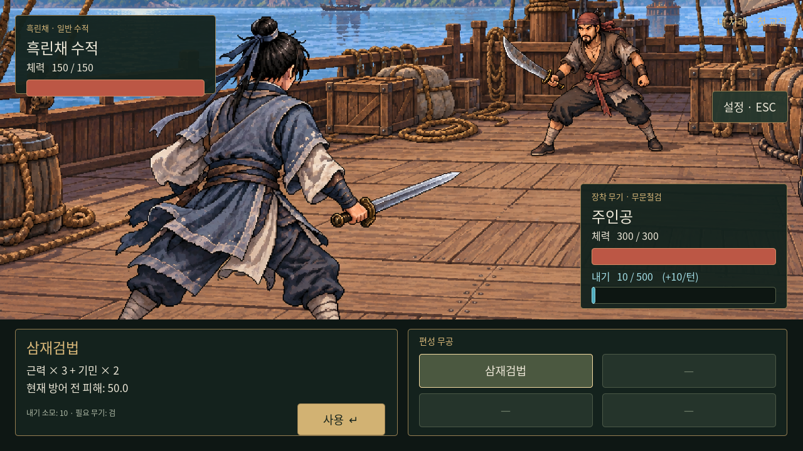

# 내기 — 내공에 영향을 받는 전투 자원

사용자 확정: 다섯 기본 스탯 중 **내공**을 기반으로 별도 전투 수치 **내기**를 둔다. 내공 스탯의 범위는 기존대로 0~100이고, 내기의 상한은 내공과 무관하게 **500**이다. 공격·방어 기술은 각각 정해진 내기를 소모하도록 추가한다. 체력·피해 공식·경지 합계에는 내기를 더하지 않는다.

| 항목 | 규칙 |
|---|---|
| 최대 내기 | 500 |
| 전투 시작 보유량 | 내공과 동일 |
| 턴 회복량 | 내공과 동일, 상한 500 |
| 기술 사용 | 비용만큼 차감, 부족하면 사용 불가 |
| 다음 전투 | 남은 내기를 이월하지 않고 다시 내공만큼 시작 |

회복 시점은 이번 구현에서 **다음 주인공 턴이 시작할 때**로 두었다. 첫 턴은 시작 지급만 적용해 두 번 지급하지 않는다. 상대 행동 때 별도로 회복하지 않는다. 기술 설명을 보거나, 실행이 막히거나, 대화를 넘기거나, 메뉴를 열고 닫거나, 저장을 불러오는 행위로는 회복하지 않는다. 승리 직후에도 추가 회복하지 않는다.

현재 주인공의 내공은 10이므로 첫 턴 내기 10, 다음 턴 20, 그다음 턴 30으로 쌓인다(소모하지 않는 경우). 예를 들어 향후 어떤 기술의 비용을 25로 정한다면 30에서 사용 시 5가 남고 다음 턴에는 15가 된다. 이는 소모 계산 예시이며 특정 무공의 비용 확정이 아니다.

## 적용 범위

전투의 체력 패널 아래에 현재 내기/500과 턴 회복량을 표시했다. 탐험 HUD에 체력이나 내기를 추가하지 않았다. `inner_qi.gd`는 시작·회복·지불·복원을 담당하며 전투 진행은 `battle.gd`에서 호출한다.

기술의 비용은 `battle.skill_qi_costs`에 정의할 수 있다. 실행할 때 한 번만 차감하고, 선택·설명 미리보기에는 차감하지 않는다. 내기 부족이나 음수 비용은 실행·턴 소모를 막는다. `try_spend_qi(cost)`는 이후 공격·방어 행동이 확정될 때 사용할 공통 지불 API다. 방어 효과·반응 행동 시점·공격 기술별 구체 위력은 이번에 새로 정하지 않았다.

**최신 사용자 확정으로 삼재검법의 내기 비용은 10**이다. 전투 실행과 설명에 적용했다. 이후 공격 무공 10종의 비용·피해·학습 조건은 [상위 초급 공격 무공](../martial-arts/basic-attacks.md)에 정리했다. 학습·편성은 교관과 K 무공 창에 연결했다. 기본공격·기본방어는 내기 소모0이며 일반 턴 회복으로 축적한다. 적도 같은 내기 시작·회복·소모 규칙을 사용한다. [최신 행동·방어 규칙](combat-actions-and-icons.md).

## 저장 호환

수동 슬롯 형식을 schema 2로 올려 전투 내공 기준값과 남은 내기를 저장한다. 불러오면 전투 시작 처리를 한 뒤 저장량을 복원하므로 회복량을 더 받지 않는다. 내기 도입 전 schema 1 슬롯도 지원한다. 과거에는 내기 소모가 없었으므로 그 전투의 주인공 턴 번호 × 당시 기본 내공 10을 최대 500으로 제한해 복원한다. 그 밖의 0장/1장 체크포인트 형식은 바꾸지 않았다.

## 검증

`godot --headless --audio-driver Dummy --path godot --script res://tests/inner_qi.gd`

시작량·회복 상한·내공 0·정확히 전량 소모·부족/음수 비용 차단·미리보기 무소모·실제 턴에서 한 번 회복·중복 실행 지불 방지·승리 후 무회복·새 전투 초기화·저장량 복원·과거 슬롯 호환을 검증한다. 테스트에서 삼재검법 비용을 일시적으로 7/11로 바꿔 경계를 확인하지만 이 값은 게임 데이터에 채택하지 않으며 실제 확정 비용은 10이다.

