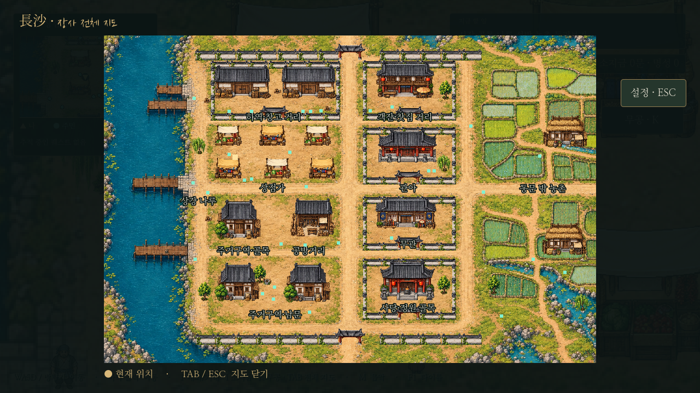
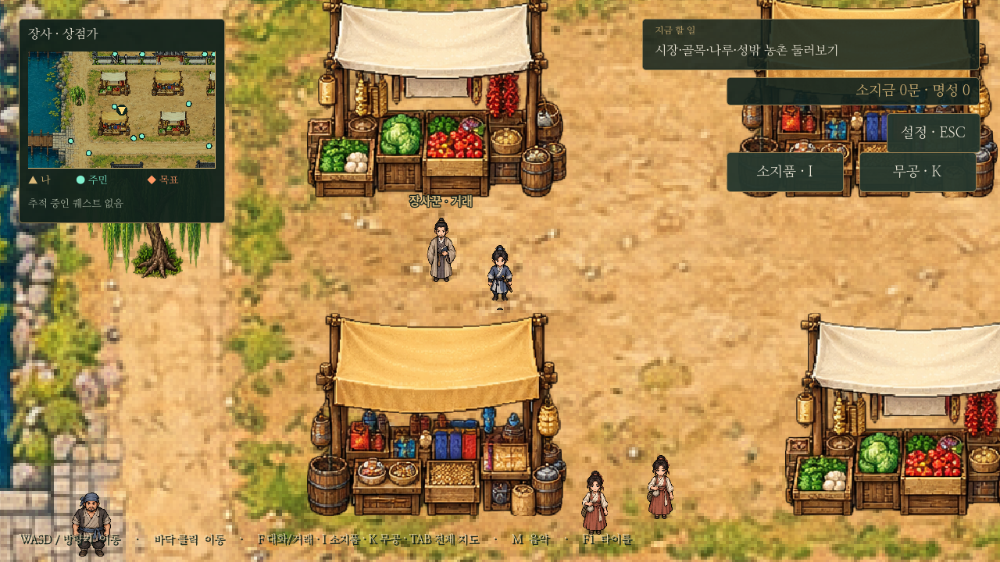
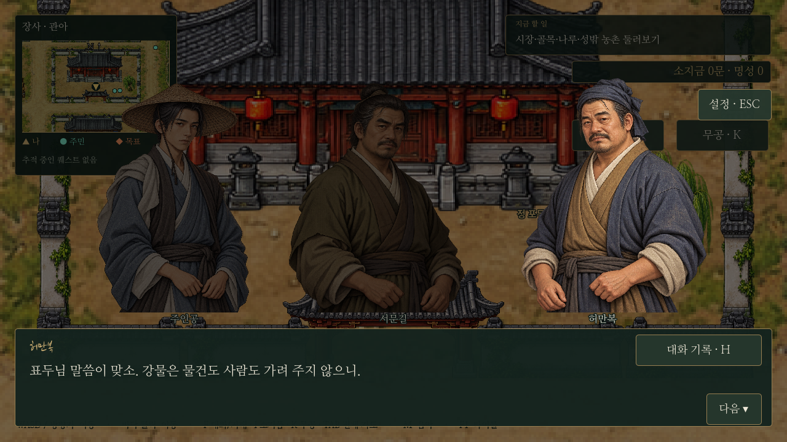
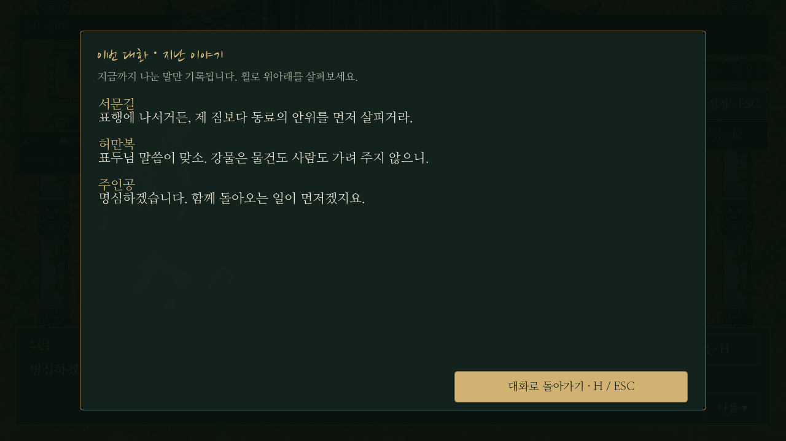

# 장사 오브젝트 분리와 대화 도구

2026-10-24 적용. 사용자에게 바닥·건물/담장·문/지붕 가림을 분리하는 방식을 제안했고 해당 방식으로 개편하도록 승인받았다.

## 바닥과 건물

- 기존 일체형 도시/상세 그림은 보관하고, 실행 시에는 건물·담장·수목을 제거한 `layered/ground.png`를 바닥으로 사용한다.
- `layout.json`의 `objects`에 건물·문·담장·노점·수목·화물·우물 **152개**를 각각 배치한다. 도시 크기는 기존 6,144×4,096을 유지한다. 구역·상점·주요 NPC와 퀘스트 ID도 유지한다.
- `layered/prefabs.json`은 원본 투명 PNG의 AtlasTexture 영역, 종류와 실제 발밑 충돌 영역을 정의한다. 하나의 PNG 아틀라스를 여러 오브젝트가 공유해 같은 그림 파일의 중복 저장을 피한다. 새 이미지 3종은 이미지 생성 도구로 제작했다. 아틀라스의 픽셀은 편집하지 않고 영역 메타데이터로 사용한다.
- `city_scenery.gd`의 각 StaticBody2D가 자기 그림과 충돌체를 가진다. 발밑의 Y 위치로 플레이어·NPC와 함께 정렬하므로 건물 뒤의 인물은 건물에 가려지고 앞의 인물은 앞에 표시된다.
- 문은 좌우 기둥에만 충돌이 있고 가운데는 통과할 수 있다. 중앙의 투명한 부분으로 바닥/인물이 보이고, 불투명한 지붕과 들보가 지나가는 인물을 자연스럽게 가린다. 문 앞과 뒤에서 다시 보이는 공간을 확보했다.
- 물·통행 경계, 오브젝트 발밑 영역은 키보드 물리 이동과 클릭 길 찾기에 같은 데이터로 반영한다. NPC 배치는 발밑뿐 아니라 전체 도트 인물과 건물의 표시 영역이 겹치지 않는지 검사하며, 거래 NPC는 자기 구역 안에 둔다.
- 미니맵과 전체 지도는 같은 바닥/오브젝트 배치를 보여 준다. 미니맵 클릭은 월드 이동으로 전달하지 않는다. 구버전 저장의 위치가 새 충돌 영역 안에 있으면 기존 안전 위치 복구를 사용한다.

문 가림 비교: [문 앞](../../godot/screenshots/layered-gate-front.png), [통과 중](../../godot/screenshots/layered-gate-under.png), [문 뒤](../../godot/screenshots/layered-gate-behind.png).

## 공용 NPC 초상화

공용 남성 2장·여성 2장을 추가해 총 10장을 준비했다. 기존 주인공과 전용 초상화는 유지한다. 모든 새 그림에 눈높이·얼굴 크기·좌우 반전용 프레이밍 값을 등록했다.

`dialogue_portraits.gd`는 한 대화의 발언자와 청자 전체를 먼저 확인한다. 기본/전용 초상화를 우선 보존하고 같은 파일이 겹치는 인물에는 같은 성별의 아직 사용하지 않은 공용 초상화를 배정한다. 발언이 바뀌어도 그 대화의 배정은 바뀌지 않는다. 허만복과 수령인에는 새 남성 공용 그림을 기본 연결했다.

새 인물을 추가해 같은 성별의 초상화 풀이 부족해지면 이미지를 먼저 보충해야 한다. 부족한 경우 오류를 기록하고 이름만 표시하며 같은 그림을 두 인물에게 재사용하지 않는다. 전용 인물의 설정·전투 수치는 추가하지 않았다.

아래 대화 캡처는 표현 점검용 대사이며 새 스토리를 추가한 것은 아니다.

## 지난 대사 보기

대화창의 **대화 기록 · H** 버튼 또는 **H키**로 연다. 현재 대화의 처음부터 현재 표시된 줄까지 화자·속말/회상 구분과 대사를 순서대로 표시한다. 미래 대사와 아직 고르지 않은 분기는 보여 주지 않는다. 휠로 스크롤하고 H/Esc 또는 돌아가기 버튼으로 닫는다.

기록을 보는 동안 진행과 입력을 멈추고, 닫으면 같은 줄로 돌아온다. 기록만 열어서는 대화가 넘어가거나 종료 보상이 발생하지 않는다. 새 대화는 새 기록으로 시작하며 전체 게임 영구 로그를 추가한 것은 아니다. 구버전 대화 저장을 불러와도 기존 대사/인덱스에서 기록을 재구성하므로 저장 형식 변경이 필요 없다.

## 검증

- `tests/layered_city.gd`: 152개 오브젝트의 개별 물리 충돌·발밑 정렬, 모든 문 중앙 통과와 기둥 충돌, NPC 전신 겹침·길 찾기, 목적지·맵 전환 정리를 확인한다.
- `tests/conversation_tools.gd`: 네 대사 자료 전체의 인물별 이미지 중복 금지, 추가 이미지 4장, H/Esc·일시 정지·스포일러 방지·콜백 보존·새 대화 초기화·구버전 기록 재구성을 확인한다.
- 기존 도시 이동/충돌·대화 프레이밍·연계 의뢰·산적 토벌·저장 제한/복원 검사도 사용한다. 테스트는 별도 XDG 사용자 폴더에서 실행한다.
- 실제 Godot 실행 화면은 `tests/capture_conversation_city.gd`로 캡처한다. 배포 EXE를 새로 만들지는 않았다.

실행 결과: `layered_city`, `city_collision`, `changsha`, `conversation_tools`, `dialogue`, `onboarding_menus`, `bandit_story`, `saves`, `save_restrictions` 통과. 새 구조에 맞춰 과거의 상세 이미지 4장/초상화 11장 개수 검사를 갱신하고, 강 경계 기준도 현재 바닥의 경계로 맞췄다. 실제 렌더링에서 문 앞→통과→문 뒤와 대화 기록을 확인했다.
