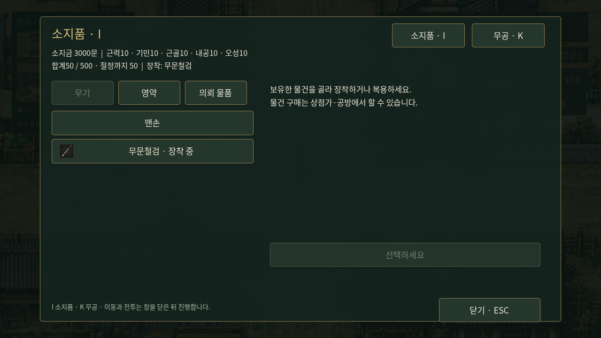
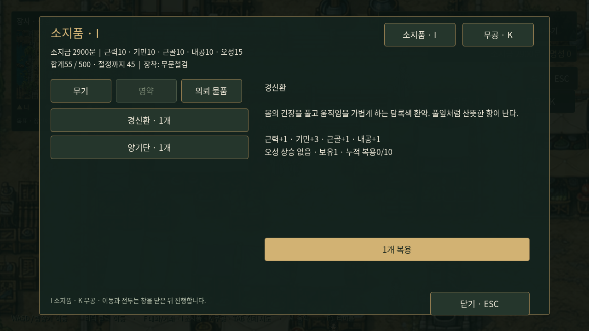
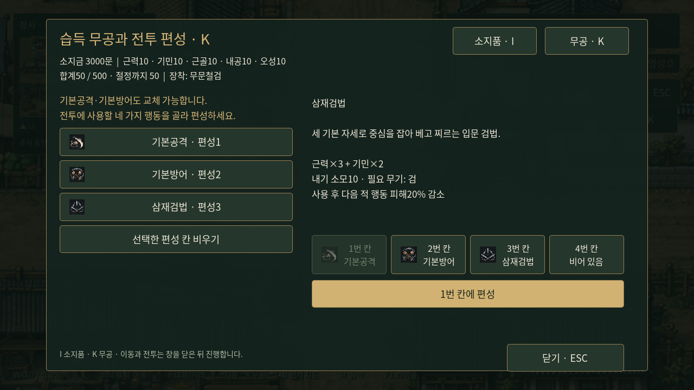

# I 소지품과 K 무공

탐험 중 **I**로 소지품, **K**로 습득 무공과 전투 편성 창을 연다. 화면 오른쪽의 버튼으로도 열 수 있다. 같은 키를 다시 누르거나 ESC로 닫고, 다른 키로 두 창 사이를 전환한다. 창이 열려 있으면 이동과 자동 스토리 진입을 멈춘다. 대화·전투·시설·전체 지도 중에는 열지 않는다. ESC는 이 창부터 닫으며 그 다음 ESC로 설정을 연다.

## 소지품

- 무기: 보유한 무기를 선택해 장착한다. 맨손으로 바꿔 권법·장법을 준비할 수도 있다.
- 영약: 실제 구매해 보유한 영약의 수량·효과·종류별 누적 복용량을 보고1개씩 복용한다. 오성은 오르지 않는다.
- 의뢰 물품: 현재 도입 연계의 전달 물품과 전달 방법을 표시한다. 판매하거나 임의 소비하지 않는다.

## 무공

이미 익힌 무공만 표시한다. 설명·공격 계수·장비를 반영한 내기 비용·필요 무기와 현재 장비의 사용 가능 여부를 확인할 수 있다. 무공과 목표 칸을 선택해 편성하고, 다른 칸에 있던 같은 무공은 이동한다. 선택한 칸을 비울 수도 있다. 네 칸 모두 편성하며 기본공격·기본방어도 바꾸거나 뺄 수 있다. 새 게임은 기본공격/기본방어/삼재검법/빈칸이다. 무공과 아이템에 아이콘을 표시한다.

두 창 상단에는 소지금·다섯 능력치·합계/500·경지·현재 장비를 표시한다. 새 무기·영약의 구매는 기존 시설, 새 무공 전수는 교관에게서 진행한다. 기존 시설의 장착·복용·편성 탭도 유지한다.

보유품·복용량·성장·무공 편성은 기존`player_progress.gd`, 장착 무기는 기존전투 장비 상태를 공유한다. 따라서 수동 저장 후 복원되며 창을 새로 열어도 값이 같다. 메뉴 자체는 일시적인 탐험 UI다. 설정을 열면 정비 창을 닫아 저장 가능한 탐험 상태로 돌아간다. 전투 도중 장비나 편성을 바꿀 수는 없다.

구현은`godot/scripts/player_menu.gd`, 키 등록과 모달 제어는`main.gd`다. `tests/onboarding_menus.gd`와 `tests/capture_onboarding_menus.gd`로 검증·화면 확인한다.

세력 호의도는 R 전용 창으로 분리했다. 호의도를 얻은 세력만 현재값/100과 막대로 표시한다. [호의도 규칙](faction-favor.md).
