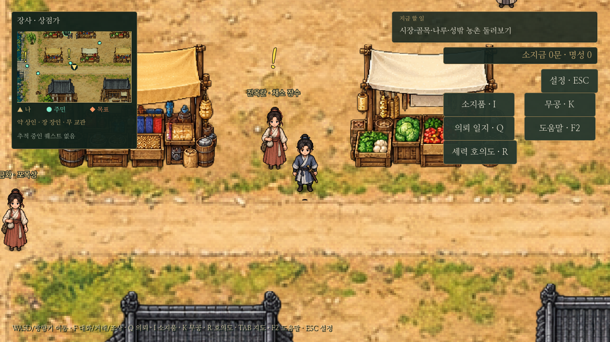
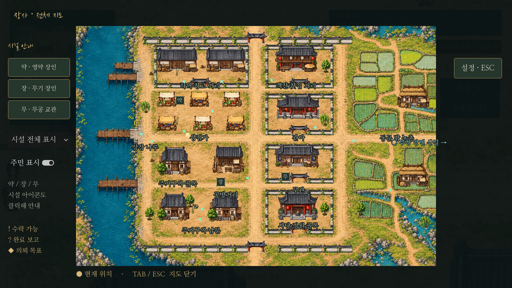
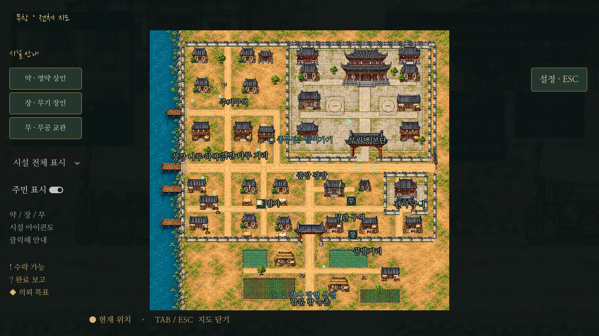
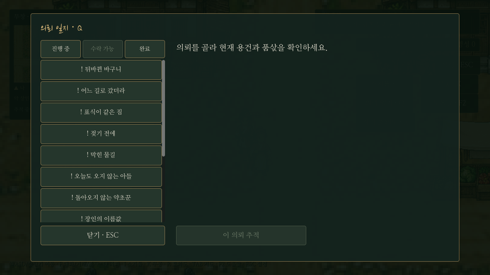
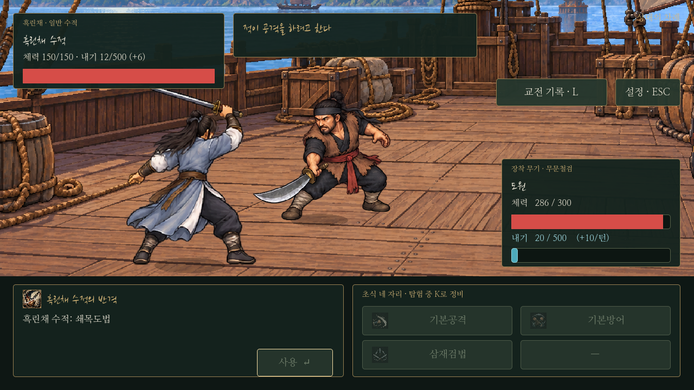

# 전역 의뢰·지도 표식·판매·보상·적 무공

2026-10-25 사용자 요청 반영. UI 전체 개편은 별도 [비교 시안](../ui/ui-concepts.md)이며 이번 게임에는 기능 변경과 표식 크기만 적용했다.

## 의뢰 일지와 추적

Q에서 현재 지역과 관계없이 장사·무창의 수락 가능/진행 중/완료 의뢰를 함께 본다. 별도로 확정한 선행 조건(무림맹 전수 후 사칭 사건 등)은 유지한다. 수락은 해당 인물과 F 대화로 진행하고, 여러 일반 의뢰의 진도는 독립적으로 유지한다.

목록에서 의뢰를 고른 뒤 ‘이 의뢰 추적’ 또는 ‘의뢰인 위치 안내’를 누른다. 선택한 의뢰 행에는◆를 표시한다. 다른 의뢰의 수락·대화·달성은 기존 추적을 교체하지 않는다. 현재 의뢰 자체의 단계가 바뀔 때만 목표를 갱신하며, 추적이 비어 있으면 진행한 의뢰를 안내한다. 저장/불러오기는 기존 추적 필드를 사용한다. 지역 밖에서는 목적지로 가는 포탈을 가리킨다. 장사 의뢰도 무창/산길/총무당에서 귀환 방향을 안내한다.

## 머리 위·전체 지도·미니맵

- 노란!는 지금 수락 가능한 의뢰인, ?는 완료 보고 가능한 의뢰인이다. 수락한 일의 의뢰인에게!를 계속 남기지 않는다.
- 진행 대화의 대상은◆, 선택한 추적의 지도 목표는 마름모이며 미니맵 밖이면 가장자리 방향 화살표다.
- 머리 위!/?는34→68폰트,40×46→80×92영역으로2배 확대했다. 이름표와 겹치지 않도록 위쪽으로 옮겼다. 조사 마름모와 기존 지도 추적 마름모/화살표도2배 확대했다.
- 두 도시 전체 지도와 미니맵에 수락 가능!·보고?·진행 대상◆를 추가했다. 잠긴 사칭 의뢰는 선행 전에는!를 표시하지 않는다. 전체 지도의 일반 주민 표시를 꺼도 의뢰 표식은 유지한다. 표시는 현재 지역의 실제 NPC 좌표와 의뢰 상태를 사용한다.

## 장사 무기 판매

`data/city_weapon_stock.json`의 장사 판매 목록은 정련검·후배도·균형창3종, 각각300문이다. 표시뿐 아니라 실제 거래에서도 목록을 검증한다. 무창은 기존9종, 영약상과 무공 전수 가격은 유지한다. 이미 소유한 상위 무기는 계속 장착할 수 있다.

## 오성 보상

기존5를 주던11종을 각각2로 수정했다. 보상 알림·수락창·일지의 표시도 함께 수정했으며 상한100과 완료 보고 마지막 지급/중복 방지는 유지한다.

| 범위 | 의뢰 수 | 오성 총합 |
| --- | ---: | ---: |
| 장사 도입 | 3 | 6 |
| 장사 일반 | 6 | 12 |
| 장사 토벌 메인 | 1 | 2 |
| 무창 품삯 | 1 | 2 |
| 합계 | 11 | 22 |

처음 오성10이면 위 보상만 모두 받을 때32다. 기존 저장에서 이미 받은 능력치·완료 이력은 소급해서 깎거나 다시 지급하지 않는다. 앞으로 보고하는 보상부터2를 적용한다. 다른 무창 의뢰에 오성을 새로 추가하지 않는다.

성장도 달라진다. 구조 경로에서 장사9종 완료 시 보수1,150문/오성28/영약 전 합68이다. 절정까지32가 부족해 하급 영약6알(합36상승,600문)이 필요하다. 예를 들어 시작 검 유지+무공350+영약600=950문이다.300문 무기까지 추가하면1,250문이므로 다른 지역 의뢰 수입을 활용할 수 있다. 가격이나 절정 조건은 변경하지 않았다.

## 적의 하급 무공

0장 수적, 토벌2명, 약초꾼 사건 구칠, 대련 유소강, 객잔 장만길, 사칭범 마응칠 모두 기존 무공에 **쇄목도법**1개를 추가했다. 기존 능력치·체력·무기는 원본과 비교해 동일함을 확인했다.

- 하급 도법, 도 필요. 위력=근력×4+기민×2. 내기12. 기존 무기의 피해 증가와 공통 근골/방어 계산을 따른다.
- 습득 조건 합40, 근력10·기민8·내공6. 현재 모든 적이 조건을 만족하며 별도의 예외나 무료 내기 충전을 넣지 않았다.
- 새 전용 그림을 생성해 `assets/icons/soemok.png`와 `icon_manifest.json`에 등록했다. 원본은 생성 이미지 폴더에 보존했다. 새 적 도법은 플레이어의 판매/학습 목록에 자동 추가하지 않는다.
- 적의 실제 출수가 시작된 뒤 설명창에 아이콘을 표시한다. 예고에는 공격/수세만 표시하며 이름·아이콘·비용을 미리 드러내지 않는다. 내기·방어·회복 규칙은 양측 공통이다.

버프 후에는 최소 신체 능력치와 높은 오성만으로 절정에 도달한 일부 빌드의 공격 일변도 승리를 보장하지 않는다. 기존 최소 조건 비교는 난이도 관측값으로 보관하고 균등20 비교의 승리, 패배 후 재도전/대안, 전투 내기/예고/저장 검사는 유지했다. 토벌의 기존110비교와 무창 약초꾼20·객잔20·사칭30비교를 실행한다. 테스트 기대값을 낮추기 위해 게임의 적 수치를 되돌리지 않았다.

## 검증

`tests/quest_update.gd`는 지역 통합 목록·동시 진행·명시 추적·다른 의뢰 진행/수락 시 선택 유지·포탈 안내·저장 복원·잠긴 의뢰 숨김·두 도시 지도 표식·주민 필터 독립·300문3종 판매와 거래 우회 차단·보상2·모든 적이 실제로 쇄목도법을 사용하는지를 검사한다. 새 도법 아이콘이 실제 출수 후에만 보이는지도 확인한다. `capture_ui_concepts.gd`로 위 실제 화면과 별도 UI 시안을 출력한다. 기존 진행·저장·F 입력 검사를 함께 실행한다.

이번 단순 전략 비교에서는 토벌110경우 중109승, 약초꾼20경우 중17승이었다. 패배는 신체 능력치를 낮게 둔 편중 성장에서 발생했다. [관측값과 패배 빌드](quest-world-balance.json)에 수치와 장비를 남겼다. 검사 통과는 모든 빌드의 승리를 뜻하지 않는다.
