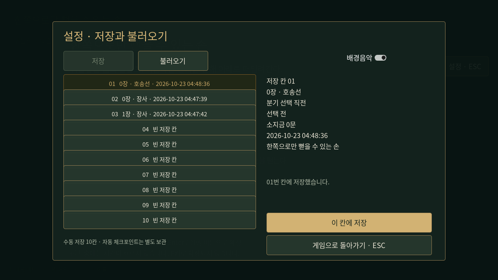
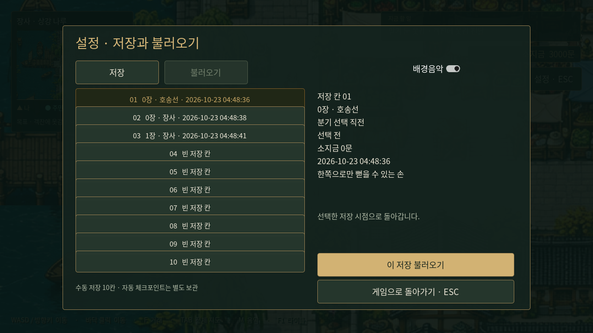

# 수동 저장 슬롯과 설정 메뉴

플레이 중 오른쪽 위 **설정 · ESC** 버튼 또는 ESC로 설정을 연다. **저장 → 슬롯 선택 → 이 칸에 저장**으로 여러 시점을 남기고, **불러오기 → 슬롯 선택 → 이 저장 불러오기 → 확인**으로 돌아간다. 수동 저장은 10칸이다. 기존 칸에 덮어쓸 때와 현재 진행을 버리고 불러올 때 확인 창을 표시한다. 빈 칸은 바로 저장한다. 취소하면 파일과 진행을 바꾸지 않는다.

타이틀의 **이어하기**는 최근 정상 저장을 불러오며, **불러오기**에서 다른 시점을 선택할 수 있다. 타이틀 자체는 저장할 수 없다. 시설 창이나 전체 지도를 열었다면 ESC는 먼저 그 창을 닫는다. 해당 화면에서 바로 설정을 열려면 항상 표시되는 설정 버튼을 누를 수 있다.

## 저장하는 내용

- 장 번호·맵·정확한 플레이어 좌표·바라보는 방향.
- 현재 대화 전체와 읽고 있던 줄, 대화 참여자와 속말/회상 표시, 대화가 끝난 뒤 이어질 진행.
- 0장 진행 장면·남은 장면 순서·귀물/구조 분기·보수 지급 여부와 소지금.
- 선택창이 열려 있는 상태와 아직 확정하지 않은 선택. 이 시점을 저장해 두면 다시 불러와 다른 경로로 진행할 수 있다.
- 1장 도입/장 표시 완료 여부, 첫 옷감 의뢰의 수락 상태, 추적 중인 목표와 달성 목표 목록. 아직 구현되지 않은 퀘스트의 완료 기능을 추가한 것은 아니다.
- 시설 이용 창과 선택한 탭, 전체 지도 표시 여부.
- 내 차례의 전투 체력·턴·무공 선택 상태. 전투 중 이전 공격의 비동기 처리는 불러올 때 취소한다.
- 장면 배경·HUD와 현재 BGM/음소거 상태. BGM 재생 위치나 걷기 애니메이션의 정확한 프레임은 이어붙이지 않는다.

타이틀과 게임 내 슬롯 목록·상세에는 **저장 날짜·시간(초까지)과 저장 장소**만 표시한다. 의뢰 목표·분기·소지금은 표시하지 않는다. 슬롯 번호와 수동/자동 구분은 저장 선택을 위한 보조 표기다.

## 일시 정지와 제한

2026-10-23 변경: **대화·거래·전투 중에는 새 수동 저장과 덮어쓰기를 모두 금지**한다. 설정의 저장 버튼은 비활성화하고 현재 상황에 맞는 이유를 표시한다. 저장 API도 같은 제한을 검사하므로 직접 호출해도 기존 파일·백업을 건드리지 않는다. 탐험과 분기 선택창에서는 저장할 수 있다. 앞서 나열한 대화·시설·전투 상태 보존 항목은 이전 저장 파일을 불러오기 위한 호환 기능이다.

설정을 열면 이동·대화·선택 확정·장 표시와 공격 타이머가 멈춘다. 닫으면 같은 상태로 돌아간다. 타이틀, 짧은 장 표시, 대화, 거래, 전투 중에는 저장 버튼을 비활성화하고 이유를 표시한다. 전투는 내 차례·공격/피격 연출·패배 대기를 포함해 전부 제한한다. 해당 진행을 마친 뒤 탐험으로 돌아오면 저장할 수 있다. 분기 선택창의 저장도 유지한다. 설정에서 불러오기는 연출 도중에도 가능하며 기존 연출/콜백을 취소하고 저장 상태로 바꾼다.

이미 보수를 받은 시점을 불러와도 3,000문을 다시 지급하지 않는다. 선택 전 저장을 불러오면 이후 분기와 보수 상태를 함께 되돌린다. 다른 슬롯은 영향을 받지 않는다. 1장 도입을 끝낸 저장은 대화나 장 표시를 다시 시작하지 않고, 도입 대화 중의 저장은 해당 대사부터 진행한다.

## 파일과 기존 저장 호환

수동 저장은 Godot 사용자 데이터 폴더 **`user://saves/slot_01.json` … `slot_10.json`**에 저장한다. Windows 기본 위치는 `%APPDATA%\Godot\app_userdata\가라앉은 약속 · Godot 0장\saves\`다. 실제 사용자 데이터 위치는 Godot 실행 환경에 따라 달라질 수 있다. Git 저장소나 GitHub에 저장하는 기능이 아니며 PC 사이에 자동 동기화되지 않는다. 다른 PC로 옮기려면 사용자 데이터의 저장 파일을 복사한다.

기존 **`user://chapter_00.json`** 자동 체크포인트는 별도로 유지한다. 타이틀 불러오기에서 ‘자동 저장’으로 구분하며 수동 슬롯과 함께 저장 시각순으로 표시한다. 이어하기는 둘 중 가장 최근의 정상 저장을 연다. 기존 자동 저장이 수동 슬롯을 덮어쓰지 않으며, 파일을 슬롯 형식으로 변환하지 않는다. 새 자동 체크포인트에는 `saved_at`을 추가하고 이전 파일은 파일 수정 시각으로 표시한다. F10 개발 도구에는 기존 0장 재개도 남겨 두었다.

저장은 임시 파일 작성·닫기 후 최종 파일로 교체한다. 덮어쓰는 파일은 같은 경로의 `.bak`으로 한 세대 보관한다. 교체에 실패하면 이전 파일로 복구한다. 손상되거나 지원하지 않는 형식은 불러오기 버튼을 막으며 현재 진행을 변경하지 않는다. `.bak`은 보조 백업으로만 보관하며 자동으로 대신 불러오지는 않는다.

## 구현과 검증

- `godot/scripts/save_system.gd`: 버전 2의 수동 저장 형식(버전 1 읽기 호환), 슬롯 읽기/쓰기/검증, 상태 캡처와 복원.
- 대화 이후 진행은 허용 목록에 등록한 메서드 이름으로만 기록한다. 객체나 실행 코드를 파일에서 역직렬화하지 않는다. 새로운 대화 연결을 추가할 때 해당 진행 메서드를 명시적으로 등록한다. 등록되지 않은 콜백은 저장을 막는다.
- `godot/scripts/settings_menu.gd`: 설정·일시 정지·10칸 목록·확인 창.
- `tests/saves.gd`: 같은 분기점에서 두 결말 진행, 정확한 대사와 콜백/위치/장/의뢰/소지금 복원, 지급 중복 방지, 재생성한 게임 인스턴스의 복원, 슬롯 독립성, 덮어쓰기 확인/백업, 손상 파일, 시설 및 전투 복원, 설정 중 공격 타이머 정지를 검사한다.

```sh
godot --headless --audio-driver Dummy --path godot --script res://tests/saves.gd
# 그래픽 디스플레이가 있는 환경
godot --audio-driver Dummy --path godot --script res://tests/capture_saves.gd
```

테스트와 캡처에서는 별도 Godot 사용자 데이터 환경을 사용해 실제 플레이 저장을 덮어쓰지 않는다. 새 EXE/데모 배포본을 만들지 않고 기존 Godot 프로젝트에 추가한 기능이다.




내기 전투 자원 도입 후 schema 2는 내공 기준값과 남은 내기도 보존한다. 이전 schema 1의 전투 저장은 당시 무소모 규칙에 맞춰 주인공 턴 번호×기본 내공을 최대 500으로 제한해 복원한다. [내기 규칙](inner-qi.md)을 참고한다.

무기 장착 조건 도입 후 전투 정보의 `weapon_type`에 현재 장착 분류(맨손/검/도/창)를 함께 보존한다. 기존 슬롯에 필드가 없으면 튜토리얼의 검 장착 상태로 복원한다. 이는 아이템 인벤토리나 무기 능력치 저장을 새로 구현한 것은 아니다.

구체 무기 데이터 도입 후 `weapon_id`도 보존해 같은 종류의 다른 등급을 구분한다. ID가 없는 과거 파일은 기존 분류에 맞게 복원하고, 시작 검은 무보정 무문철검이다. 소유 목록/인벤토리 UI를 추가한 것은 아니다.

## 거래·성장 저장 — schema3

장사 거래 구현으로 기본 스탯·보유 무기·습득 무공·편성3칸·영약별 재고와 평생 복용 횟수를 추가했다. 금전과 함께 수동 저장하며 새 무공을 선택한 전투 상태도 복원한다. schema1/2는 이전 진행을 유지하고 신규 성장/소유 항목만 초기값으로 보충한다. 거래 후에는 수동 저장을 사용한다. 자동0장 체크포인트는 장사 도입 재개용 기존 기능을 유지한다.

## 1장 토벌 저장

선택 필드bandit_story에 모집·지원·집결·두 전투·철수·보고·완료 상태와 지급 여부·이전 의뢰 목표를 보관한다. progress.fame는 명성, battle.encounter_id는 적ID다. 적 최대 체력과 산길 전투/대화 배경도 복원한다. 이전schema3에 신규필드가 없으면 토벌 미시작·명성0으로 읽는다. 보고 대화를 끝낸 탐험 상태에서 저장할 수 있다. 과거 버전의 보고 대화 저장도 불러올 수 있으며 지급 후 저장을 불러와도 중복 보상을 주지 않는다. 이전 체크포인트로 되돌아가 다시 완료하는 것은 해당 시점의 정상 진행이다.

## 저장 제한 검증

`tests/save_restrictions.gd`는 실제 대화·거래·전투의 내 차례 및 공격 중에 저장 버튼/덮어쓰기 확인을 막고, 직접 저장 호출도 거절하며 기존 슬롯·백업과 빈 슬롯이 바뀌지 않는지 확인한다. 진행 종료 후 저장 재활성화, 탐험·분기 저장, 제한 상황에서 불러오기와 공격 취소도 검사한다.

`tests/legacy_save_fixture.gd`는 테스트 전용으로 과거 대화·거래·전투 저장 파일을 구성한다. 새 게임 API가 쓰기를 거절하는 것을 확인한 뒤에만 파일을 만들며, 기존 회귀 검사의 구버전 불러오기 범위를 유지한다. 런타임에 제한을 우회하는 기능은 추가하지 않았다.

실행 결과: `save_restrictions`, `saves`, `onboarding_menus`, `bandit_story`, `combat_updates`(110개 사례) 통과. Godot 편집기의 가져오기와 스크립트 검사도 완료했다. 테스트는 격리된 XDG 사용자 폴더에서 실행했다.

## 2026-10-24 일반 의뢰·시설 안내

선택 필드 `ordinary_quests`에 일반6종의 수락/달성/완료·완료 목표·안부 전달 선택을, `navigation.facility`에 시설 안내를 저장한다. 구버전 파일에 필드가 없으면 미수락/안내 없음으로 읽는다. 보상 중복 지급과 의뢰 선택창에서의 쓰기를 차단한다. [공통 편의 기능](adventure-usability.md). 음량·화면·대화 글자 크기와 최초 안내 확인은 이야기 진도와 별도의 `user://preferences.cfg`다.
