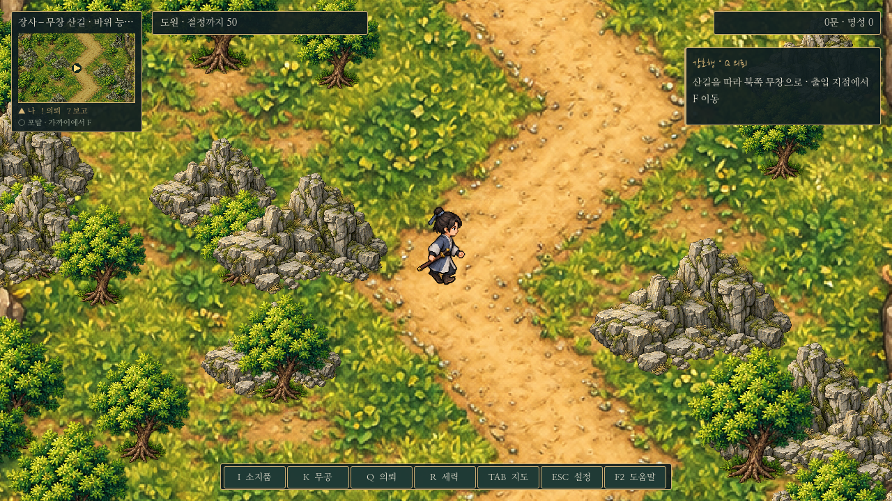
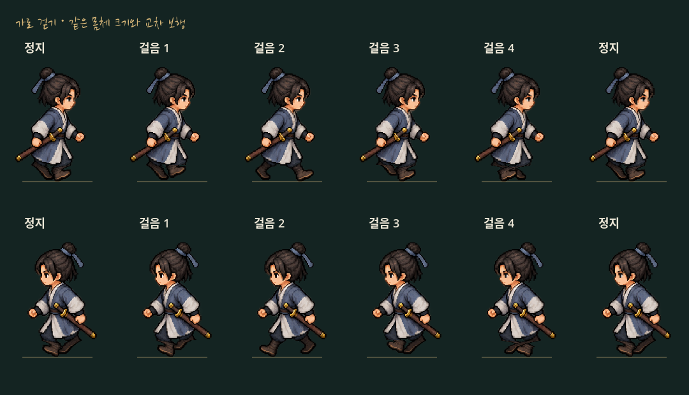
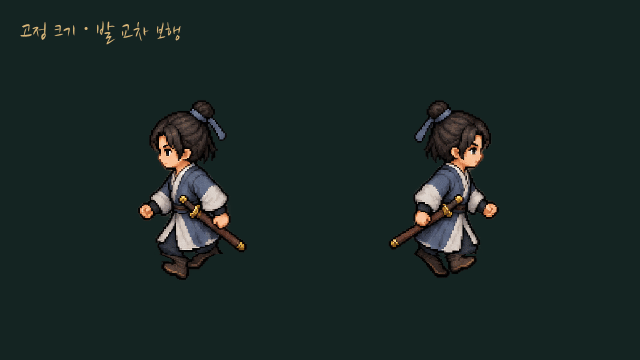

# 산길 이동 단축과 캐릭터 보행

2026-10-25 요청 두 가지를 함께 적용했다. 장사–무창 산길을 줄이고, 이어 요청한 가로 발 교차와 정지/걷기 크기 고정을 수정했다.

## 산길

월드4096×5120을2560×3200으로 줄였다. 원본 도안1024×1280과 바닥·나무·바위·동진 후 북상하는 동선은 그대로 사용하고, 도안1당 월드4였던 배율을2.5로 줄였다. 바닥과 독립 오브젝트/충돌/길 경계는 같은 배율을 사용한다. 주인공 표시 높이140·이동 속도360·카메라 배율은 유지했다. 지도 안의 길과 주변 구조물이 가까워지므로 실제 이동 거리가 줄어든다.

| 같은 도안 경로 비교 | 이전 | 변경 |
| --- | ---: | ---: |
| 내비게이션 보행 거리 | 7,152 | 약4,504 |
| 속도360 기준 편도 예상 | 약19.9초 | 약12.5초 |

약37% 단축이다. 실제 수동 조작의 회전·정지·F 입력 시간은 별도다. 좁아진 길의 내비게이션 격자는16으로 세분화했으며 무창 등의 기존32 격자는 유지한다. 도안 좌표를 보존하므로 포탈 목적지와 약초 꾸러미/사건 인물 위치·목표 안내도 같은 축소 지형에 맞는다. 약초 꾸러미 조사 전에는 사건 인물이 계속 숨겨져 있다. 상시 NPC/새 전투는 추가하지 않았다.

[전체 산길 이미지](../../godot/screenshots/short-road-map.png)

## 기존 저장

산길 저장은 `world.layout_version:3`을 기록한다. 이전2(4096×5120)는 X/Y 모두0.625배, 최초1/필드 없음(4096×10240)은 먼저 Y를0.5배로 호환 변환한 뒤 X/Y를0.625배 한다. 변환 뒤 현재 발밑 충돌을 확인하여 안전 위치로 복원한다. 새3 저장은 다시 축소하지 않는다. 다른 도시 저장 좌표·진도·보수는 바꾸지 않는다.

## 발 교차와 크기

이전에는 정지와 걷기의 서로 다른 원본 그림 비율을 높이만 맞춰 사용해, 전환할 때 머리/몸통 굵기가 달라 보였다. 정지도 걷기 시트의 같은 방향 기준 몸체로 통일했다. 가로 이동에서는 몸체 기준 프레임과 배율을 유지하며 하체만 번갈아 앞뒤로 내딛고 발을 들도록 렌더링한다. 신발 모양을 유지하도록 두 다리의 경계를 분리했다. 앞뒤 방향의 기존 걷기 프레임 전환은 유지한다.

위상은 실제 이동 거리에 따라 변한다. 입력만 하고 벽에 막혀 이동하지 않으면 정지 자세이며, 대화·멈춤에서는 중립으로 돌아간다. 발밑 충돌과 맵별 기존 표시 높이104/140는 유지한다. 원본 PNG를 덧칠하거나 교체하지 않았다.

## 확인

- `road_stride.gd`: 실제 이전/현재 지형에서 경로 길이를 비교하고, 저장1/2→3과3 재로드, 실제 좌우 키 입력/배율 고정/발밑 충돌을 확인한다.
- `side_stride_render.gd`: 실제 렌더러 픽셀을 비교해 좌우 발 부분은 달라지고 머리·몸통은 정지/걷기 모두 같으며, 멈춘 뒤 같은 중립 이미지로 돌아오는지 검사한다. headless가 아닌 그래픽 환경에서 실행한다.
- 기존 `overland_travel`, `herbalist_quest`, `alliance_story`, `saves`, `map_art`, `quest_update`, `smoke`, `prologue_f_input`, `movement_scale`, `camera`, `keyboard_exploration` 검사를 실행했다.
- `capture_short_road.gd`와 `capture_walk_cycle.gd`로 실제 그림·렌더 프레임을 만들었다. GIF는 캡처 프레임24장을 인코딩한 동작 미리보기이며 게임 자체의 이동 속도 설정을 바꾸지 않는다.

기존 플레이 저장과 분리한 XDG 사용자 폴더에서 검사했으며 데모/EXE는 새로 내보내지 않았다.
