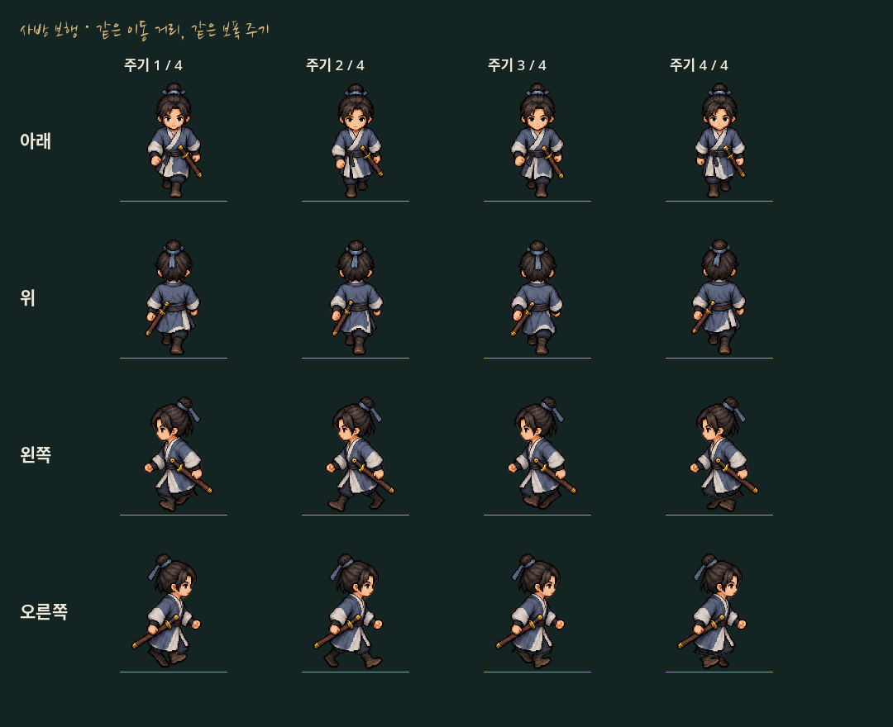

# 사방 보행 통일·좁은 통로 점검

사방 보행의 재생 기준을 실제 이동 거리로 통일했다. 이동 속도360, 도시 캐릭터 높이140/0장104, 발 충돌 반경16, 카메라 설정은 그대로다.

## 확인한 차이와 수정

가로 보행은 기존 `gait_phase`로 발을 교차했지만 세로 보행은 AnimatedSprite2D의 시간 기반10fps로 진행했다. 평지의 속도 차이는 작아도 벽을 비스듬히 스치며 실제 이동량이 줄면 세로 보행만 같은 속도로 재생될 수 있었다.

`player.gd:_play`에서 네 방향의 보행 타이머를 멈추고 실제 이동 거리로 누적한 공통 위상에 맞춰 프레임을 선택한다. 가로의 기존 발 셰이더와 같은 한 주기를 쓴다. 움직임이 없으면 기존처럼 정지 자세로 돌아간다. 원본 그림·프레임 순서·발 기준점·크기 보정은 유지한다.

## 문·모서리 점검

장사·무창·남경·총무당·삼거리 산촌·청애채의 문 구조를 조사했다. 두 기둥으로 된 문13곳 중 통행용12곳의 중앙과 실제 통행 폭 안쪽을 원래 플레이어의 원형 발 충돌로 연속 검사한다. 지역별 대표 문은 실제 키 입력으로 통과하고, 무창 동문은 기존 `wuchang.gd`에서 왕복 입력을 확인한다.

- 인접 담장이 문 지붕 아래 가장자리를 차지하는 곳은 담장까지 포함한 실제 통행 폭을 측정한다. 기둥 사이 폭 전체를 무조건 빈 통로로 가정하지 않는다.
- 무창 동문은 맵 바깥 제한까지 포함해, 제작된 통행 지점과 실제 도달 가능한 구간으로 검사한다.
- 무림맹 정문은 방문 허가 상태로 열린 문을 검사한다. 기존 입장 제한을 없애지 않는다.
- 청애채 정문은 `sealed_front_gate` 때문에 막히는 것이 의도된 구조다. 서쪽 잠입 경로를 사용하는 설정을 유지한다.
- 제어된 벽 모서리에서는 실제 대각 입력으로 벽을 따라 움직이는지, 발이 벽을 뚫지 않는지, 느려진 보행도 같은 위상을 쓰는지 확인한다.

이번 점검에서 통행 가능한 문 중앙을 막는 오류는 확인되지 않았다. 문·담장·NPC의 충돌이나 맵의 배치는 변경하지 않았다.

## 검사

- `tests/walk_passages.gd`: 문 충돌/실제 입력·기둥 주변·발 지름32 유지·사방/대각 속도·벽 스치기·거리 기반 프레임·정지. 시험용 무림맹 허가와 벽은 검사 인스턴스에만 적용하며 저장하지 않는다.
- `road_stride.gd`, `movement_scale.gd`: 기존 이동 속도·키 해제·발 크기·정지/보행 크기 유지·산길 저장 호환.
- `wuchang.gd`, `layered_city.gd`: 문 왕복·도시 장애물/열린 기둥 통로·NPC 접근.
- `side_stride_render.gd`: 실제 렌더링으로 발 교차와 머리·상체 크기 불변 확인.
- `capture_unified_walk.gd`: 동일 위상의 네 방향 실제 렌더링. 새로운 인물 그림이나 데모 실행 파일을 만든 것은 아니다.

검사는 분리한 XDG 사용자 데이터에서 진행한다. 카메라 완충·지도 크기·충돌 크기를 바꾸지 않는다.
