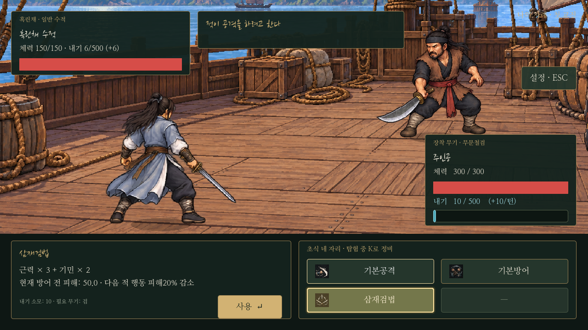
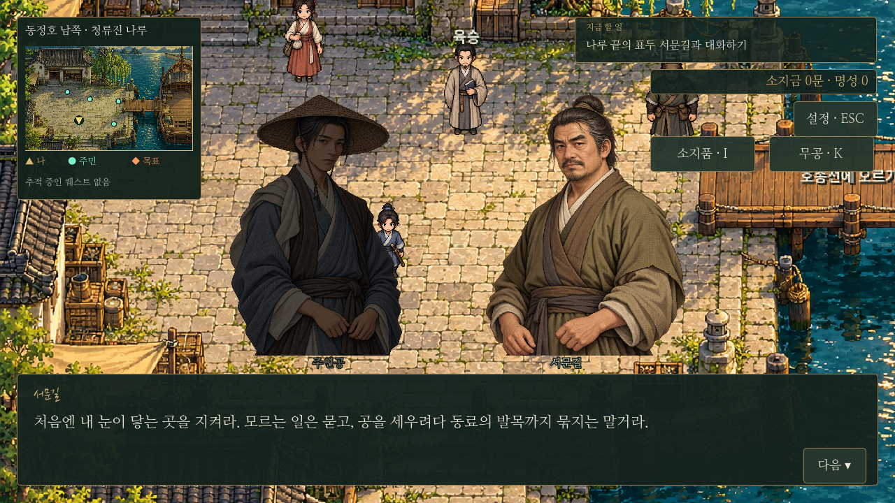
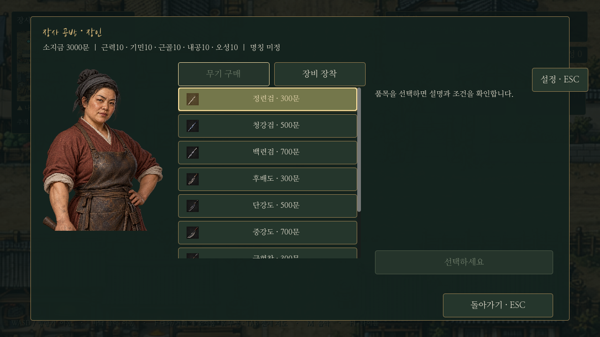

# 무협 문체·서체·마우스 강조

2026-10-23 Godot 적용. 앞으로의 작업 기준은 `godot/AGENTS.md`에도 기록했다.

## 적의 기세

공격을 준비한 적은 무공 종류와 관계없이 **“적이 공격을 하려고 한다”**만 보여 준다. 무공명·내기 비용·위력·개별 아이콘·툴팁은 노출하지 않는다. 수비는 “상대가 수세를 취하고 있다”로 표시한다. 행동을 실제로 실행한 뒤의 기술명과 결과 기록은 유지한다.

예고의 공개 범위만 바꿨다. 적의 행동 확정 시점, 내기·피해 계산, 저장 시 행동 보존은 유지한다.

## 문체와 서체

0장, 장사 도입, 거래 안내, 산적 토벌의 대사를 인물의 역할에 맞춰 다듬었다. 표두·무림인은 표행·사문·신의·출수 등의 표현을 쓰되 상인과 농부는 생활감 있는 말투를 유지한다. 귀물과 인명 사이의 갈등, 양쪽 선택의 후회, 보수와 퀘스트 구조는 유지한다. 조작법과 조건은 분명하게 설명한다.

제목·인물 이름·큰 소제목에는 **나눔손글씨 붓**, 긴 대사·설명·수치에는 **나눔명조**를 적용했다. 서체를 번들해 PC의 설치 서체와 무관하게 같은 모습으로 표시한다. 라이선스와 한자 보조 글꼴은 [서체 안내](../../godot/assets/fonts/README.md)를 참고한다.

## 커서 강조

전투 무공, I 소지품, K 무공, 상점의 아이콘 항목에 커서를 올리면 금색 테두리와 밝은 배경이 표시된다. 공통 `CatalogIcons.apply()` → `UI.item_highlight()` 경로로 연결하므로 새 콘텐츠에도 적용된다. 빈 칸은 강조하지 않는다. 사용할 수 없는 항목은 강조되어도 실행할 수 없다.

강조는 미리보기용 시각 효과다. 커서를 올리는 것만으로 선택·구매·무공 편성·턴 진행이 일어나지 않는다. 기존 클릭 선택 상태와 키보드 포커스를 유지하며 창을 닫으면 강조를 해제한다.

## 실제 실행 화면

추가 캡처: [소지품](../../godot/screenshots/ink-inventory-hover.png), [무공창](../../godot/screenshots/ink-martial-hover.png), [첫 화면](../../godot/screenshots/ink-title.png).

## 검증

`tests/ink_ui.gd`: 공격 예고의 단일 문구·숨긴 아이콘/툴팁, 실제 GUI 마우스 진입·이탈, 커서 강조 시 선택/금전 보존, 번들 서체와 글리프, 네 대사 자료 전체의 실제 대화창 줄바꿈·높이를 검사한다.

기존 도입 의뢰·0장 양쪽 분기·산적 토벌·전투 계산·모션·저장 검사도 함께 실행한다. 테스트는 별도 XDG 사용자 폴더를 사용한다. 캡처 재현은 `tests/capture_ink_ui.gd`로 가능하다.

실행 결과: `ink_ui`, `onboarding_menus`, `prologue`, `bandit_story`, `combat_updates`(110개 비교), `saves` 통과. `battle_motion`은 첫 실행의 중간 자세 시점 검사에서 한 번 실패했고 단독 재실행에서 전체 통과했다. 실제 렌더링 캡처에서도 예고·서체·강조를 확인했다.
