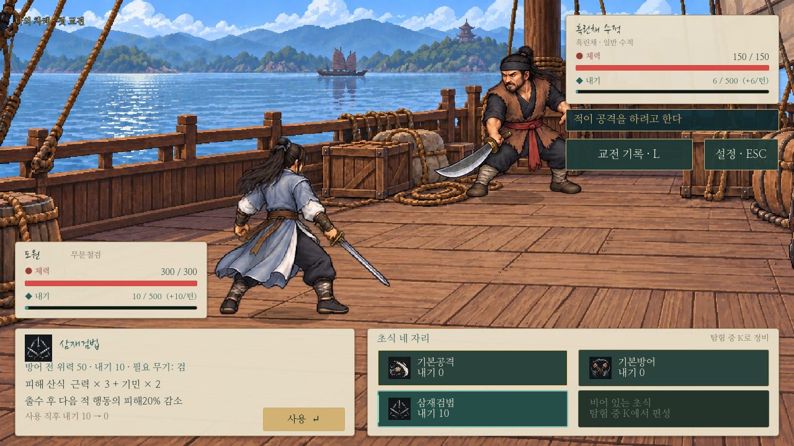

# 전투 화면 정보 정리

> 현재 본게임의 전투 화면은 [가변 격자 전투](../systems/grid-combat.md)로 교체했다. 아래는 이전 교환식 화면 기록이며 새 전투도 같은 한지/기존 아이콘과 상태·피해 표시를 이어받는다.

사용자가 채택한 1·2·3번을 적용했다. 체력·내기 표시, 적 기세 예고, 무공 선택/설명을 정리하며 새 차례 전환 연출은 추가하지 않는다. 기존 차례 문구·공격/피격·피해 숫자·체력 잔상은 유지한다.

[1440p 실제 캡처](../../godot/screenshots/battle-hud-refined-1440.png)

## 상태와 기세

- 적: 오른쪽 위 한지 카드. 이름/소속, 붉은 원의 체력/붉은 막대, 청록 마름모의 내기/청록 막대와 보조 수치를 나눈다.
- 도원: 왼쪽 아래 카드. 이름/장착 무기, 체력/내기를 같은 규칙으로 표시한다. 내기는 현재/500과 턴 회복량을 함께 보여 준다.
- 막대는 무거운 기본 최소 높이를 제거해 체력9px/내기6px로 그린다. 기존 체력 감소 잔상은 그대로 동작한다.
- 중앙의 큰 공격 예고판은 제거했다. 적 카드 바로 아래의 작은 먹빛 안내에 공격/수세만 표시한다. 무공명·비용·위력·전용 아이콘·툴팁은 예고에 넣지 않는다.
- 실제 출수가 끝난 뒤의 기술명/피해/기록은 기존대로 표시한다. 적 행동 선정·내기 소비·예고 고정 시점은 바꾸지 않았다.
- 상태 카드와 인물이 겹치지 않도록 전투 준비 위치를 조정했다. 공격/피격 애니메이션 종류·시간·전투 수치는 유지한다. 교전 기록/설정 버튼은 예고 아래로 옮긴다.

## 무공 선택

하단 왼쪽 한지 카드에는 아이콘/이름 → 방어 전 위력·실제 내기 소모·장비 조건 → 피해 산식·부가 효과 → 사용 직후 내기 변화(운기 회복/500 상한 반영) 또는 사용 불가 사유 → 사용 버튼 순으로 표시한다. 예상 피해를 적 방어 적용 후 확정 피해처럼 표시하지 않는다. 방어/운기 무공은 위력 대신 기능에 맞는 요약을 사용한다.

하단 오른쪽의2×2 편성 칸에는 기존 아이콘·무공명·실제 장비 보정을 반영한 내기 소모를 표시한다. 장비/내기 부족·재사용 대기는 둘째 줄과 설명에 표시한다. 사용 불가 무공도 선택해 설명을 읽을 수 있고 실행 버튼만 잠긴다. 빈칸은 K 편성을 안내한다.

청록 선택 배경/테두리/세로 표식과 금색 키보드 포커스·마우스 하이라이트는 공통 처리를 유지한다. 선택만으로 내기나 턴을 소비하지 않는다. 모든 초식이 막혔을 때의 임시 기본공격도 유지한다.

| 상황 | 실제 화면 |
| --- | --- |
| 내기 부족 | [확인](../../godot/screenshots/battle-hud-refined-unavailable.png) |
| 기본방어 | [확인](../../godot/screenshots/battle-hud-refined-defense.png) |
| 조식수원공 | [확인](../../godot/screenshots/battle-hud-refined-support.png) |

## 코드와 점검

배치는 `scripts/battle_hud.gd`, 상태/설명 갱신은 `scripts/battle.gd`가 맡는다. 기존 아이콘/서체/공통 선택 스타일을 재사용하며 새 아이템·무공·공격 예고 정보는 추가하지 않았다.

- `ui_states.gd`: 내기 부족·장비 불일치·재사용 대기의 사유, 실행만 금지, 선택 시 턴/피해 불변.
- `combat_updates.gd`: 기존 카탈로그 이미지·공통 계산·적 예고·임시 기본공격·110개 균형 경우.
- `battle_motion.gd`: 무기별 공격/피격·효과음·체력 감소 잔상·저장 복원. 첫 실행은 기존0.2초 고정 시점 검사 한 곳이 실패했으며 단독 재검사는 통과했다.
- `capture_battle_hud.gd`:720/1440p, 기본방어/내기 부족/운기 화면을 실제 렌더로 확인. 운기 캡처의 능력치/편성은 캡처 전용 설정이다.

검사는 사용자 저장과 분리한 XDG 경로에서 실행한다.
