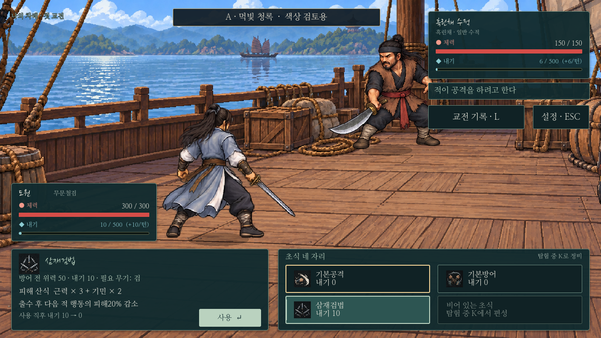
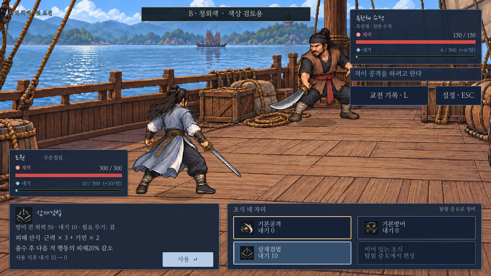
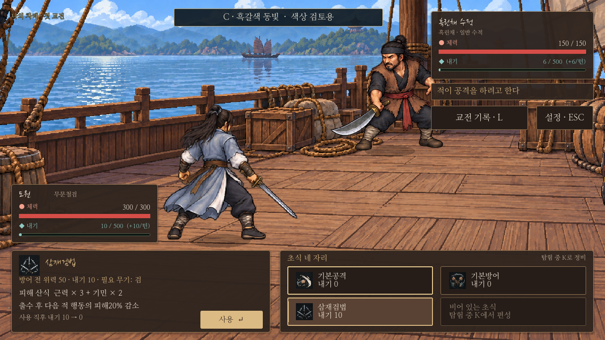

# 전투 UI 색상 후보 — 선택 대기

현재 한지 베이지가 전투 배경과 떨어져 보인다는 의견에 대한3가지 후보다. 같은 실제 전투 장면·삼재검법 선택·서체·크기·배치를 유지하고 UI 바탕/글자/테두리/선택 강조/사용 버튼의 색만 비교한다. 체력의 붉은색과 내기의 푸른 계열 구분은 유지한다.

게임의 기본 색상은 아직 기존 베이지다. 이 문서의 후보는 검토용 렌더이며 사용자 채택 후 적용한다. 상단의 ‘색상 검토용’ 표시는 비교를 위한 것으로 본게임 UI가 아니다.

| A · 먹빛 청록 | B · 청회색 | C · 흑갈색·동빛 |
| --- | --- | --- |
|  |  |  |
| 어두운 청록 바탕과 옅은 옥색 강조. 차분하고 무협풍을 유지하기 좋은 방향. **추천.** | 어두운 남색/청회색 바탕과 은청색 강조. 또렷하고 차가운 분위기. | 짙은 갈색 바탕과 동빛 강조. 목재·흙·가죽과 어울리는 따뜻한 분위기. |
| [원본 크기](../../godot/screenshots/battle-palette-a.png) | [원본 크기](../../godot/screenshots/battle-palette-b.png) | [원본 크기](../../godot/screenshots/battle-palette-c.png) |

바탕의 불투명도는 세 후보 모두 약95%로 맞춰 글자를 읽기 쉽게 하고, 창 뒤의 장면이 아주 약하게 비치도록 했다. 무공 효과·위력·내기 비용·적 예고·체력/내기 값에는 차이가 없다.

## 재현

`godot/tests/capture_battle_palette_candidates.gd`만 각 후보를 실제 Control 노드에 적용한다. `scripts/battle_hud.gd` 등의 런타임 기본 배색은 수정하지 않는다. 색상 변경은 저장하지 않고 사용자 저장과 분리한 XDG 경로에서 실행한다. 이미지를 픽셀 편집하거나 게임 화면과 다른 시안을 합성하지 않았다.

```sh
DISPLAY=:98 XDG_DATA_HOME=/tmp/battle-palette-data XDG_CONFIG_HOME=/tmp/battle-palette-cfg XDG_CACHE_HOME=/tmp/battle-palette-cache godot --path godot --audio-driver Dummy --rendering-method gl_compatibility --script res://tests/capture_battle_palette_candidates.gd
```
