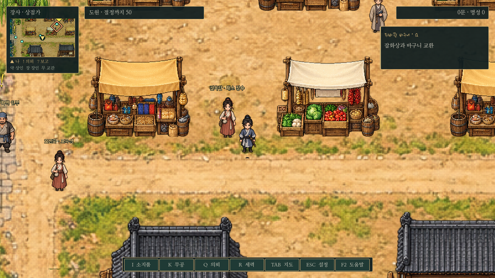
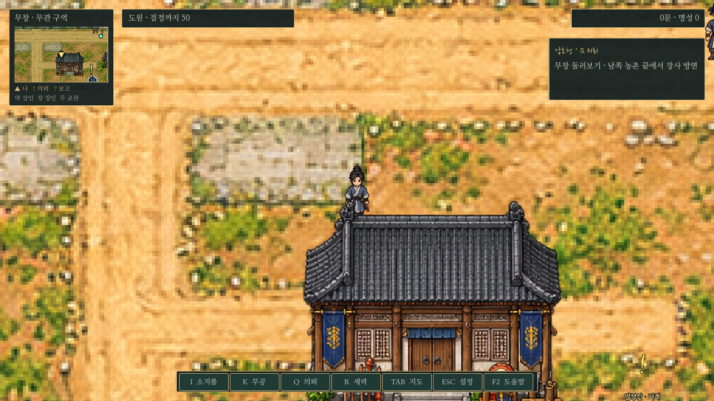
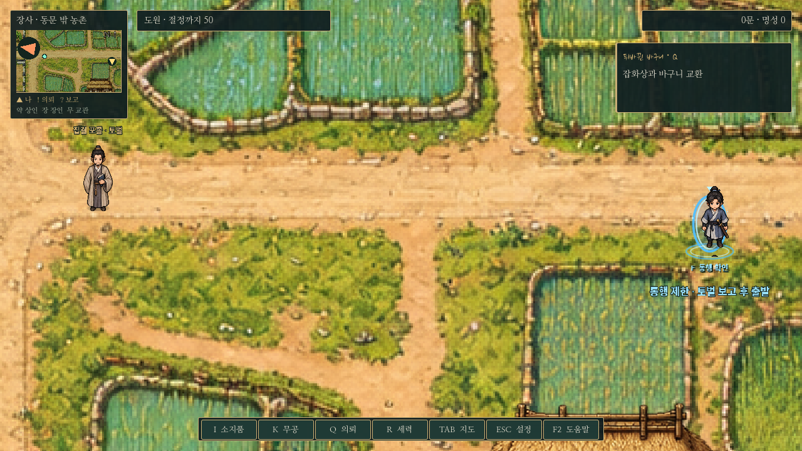

# 이후 적용

목표 위계·이름표·하단 안내의 최신 표시 규칙은 [탐험 HUD 정리](exploration-hud.md)를 따른다. 아래는 작은 A안 도입 당시 기록이다.

# 작은 A안 HUD와 장사 출발 조건

사용자가 먹빛/금선 A안을 선택하고 화면을 덜 가리도록 축소·시야 확대·장사 통행 제한을 요청하여 적용했다. UI 색과 테두리는 공통 창에도 연결하며 대화/전투의 고정 배치와 조작은 유지한다.

## 실제 플레이 화면

- 미니맵188×174, 지형 부분168×100. 위치 이름·자기 위치·의뢰!/?·추적 목표/방향 화살표와 시설을 유지했다. 기존264×290보다 작고, A안 시안218×202보다도 줄였다.
- 오른쪽에는 현재 추적1개만282×112로 표시한다. 의뢰명/목표가 길면 툴팁으로 전체 문구를 확인한다. 다른 의뢰는Q 일지에서 선택한다.
- 상단에 이름/경지와 소지금/명성을 짧게 배치했다. 아래에는648×38바에 I/K/Q/R/TAB/ESC/F2 버튼을 모았고 실제 마우스 동작·키보드 단축키를 유지한다. 작은 버튼은 내부 여백도 줄여 서로 겹치지 않는다.
- 0장의 좁은 공간에서는 기존 다음 대사/조작 안내와 별도 설정 버튼을 유지한다. 메뉴를 열면 이동이 멈추고, 대화창·전투창은 화면 좌표에 고정된다.

## 1장 장사 탐사 목표

1장 장사에서 토벌 모집 전에는 우측 목표 창 상단에 **주요 목표 · 장사를 탐사하세요**를 표시한다. 추적 중인 의뢰명/진행 안내는 아래에 함께 유지하고 긴 내용은 툴팁으로 확인한다. 창 크기는 유지하며 토벌 모집이 시작되거나 다른 지역으로 이동하면 탐사 문구를 숨기고 기존 배치로 돌아간다. 저장 필드나 의뢰 수락 조건은 추가하지 않는다.

## 더 넓은 시야

장사·무창·산길·총무당은 줌1.0→0.8로 변경했다.1280×720기준으로1280×720→1600×900의 월드 범위가 보여 가로/세로25%, 면적56.25%가 늘어난다. 0장 기본 줌도1.5→1.2로 넓혔다. 주인공/주민/건물의 월드 크기, 발밑 충돌, 이동 속도는 유지한다. 카메라는 몸을 따라가며 맵 가장자리에서는 고정되고 작은 지도는 빈 가장자리가 보이지 않도록 최소 줌을 자동 적용한다.

## 장사 통행 제한

사용자 확정은 **토벌을 끝내고 정 포두에게 보고하여 보수까지 받은 뒤**다. 출발 공통 경로에서 `bandit_story.stage == completed`와 `reward_granted == true`를 함께 확인한다. 지원 수락·전투 승리만으로 열지 않는다.

그전에는 동쪽 농촌 포탈의 이름을 ‘통행 제한 · 토벌 보고 후 출발’, 가까운 F 안내를 ‘통행 확인’으로 표시한다. F를 누르면 이유를 독백으로 알리고 장사에 머문다. 대화를 마치면 즉시 다시 이동할 수 있다. 보고가 끝나면 같은 지도에서 표식과 실제 이동이 열린다. 저장/불러오기도 같은 진행 상태를 사용한다. 출발 제한은 장사에서 외부로 나가는 이동에 적용하고, 기존 외부 지역 저장의 읽기나 장사로 돌아오는 길은 유지한다. 타이틀의 ‘무창 자유 탐방’은 이야기와 분리된 기존 답사 모드다.

## 성장 비용과 저장 호환

통행 제한으로 초기 성장 자금이 부족해지지 않도록 사용자에게 선택을 받아, 장사 의뢰 합계를100문 늘렸다.

| 의뢰 | 이전 | 변경 |
| --- | ---: | ---: |
| 젖기 전에 | 100문 | 150문 |
| 막힌 물길 | 150문 | 200문 |
| 도입3종+일반6종 합계 | 1,150문 | 1,250문 |

오성 보상은 각각2로 유지한다. 구조 경로에서 장사 의뢰9종을 끝내면 오성28/영약 전 합68이다.300문 무기1개+350문 무공1개+100문 영약6알=1,250문으로 절정까지 준비할 수 있다. 검사에서는 검/도/창 각각 실제 구매·복용·학습을 실행해 합104 도달을 확인했다. 무공마다 조건이 다르므로 영약은 원하는 무공의 조건을 보고 고른다.

기존 저장에서 위 두 일반 의뢰를 이미 완료했다면 각각50문씩 차액을 보정한다. 새 저장에 `changsha_reward_revision:1`을 기록하여 보정한 상태를 다시 불러와도 중복 지급하지 않는다. 원래의 옛 저장을 다시 불러오면 원래 시점의 돈+차액으로 돌아가며 누적되지 않는다. 아직 완료하지 않은 의뢰는 앞으로 새 보수로 보고한다. 이미 얻은 오성·다른 보상·진행 상태는 유지한다.

## 검증과 캡처

`tests/compact_hud_gate.gd`는 실제F 통행 차단(모집 전/지원/전투 후/보고 대기), 보고 전후 저장, 해제 후 실제 포탈 이동·귀환, 지도 배율, 버튼 겹침/클릭, 검·도·창 준비 비용, 옛 저장 차액의 한 번 보정/재저장/원본 재로드를 검사한다. 기존 `camera`, `overland_travel`, `f_interaction`, `quest_update`, `adventure_features`, `saves`, `bandit_story`, `alliance_story`, `alliance_office`, `wuchang_residents`, `prologue_f_input`을 회귀 검사에 사용한다. 실제 플레이 저장과 분리한 XDG 폴더에서 실행한다.

`capture_compact_hud.gd`는 위 그림을 실제 런타임에서 캡처한다. 배포용 데모/EXE는 새로 생성하지 않았다.
