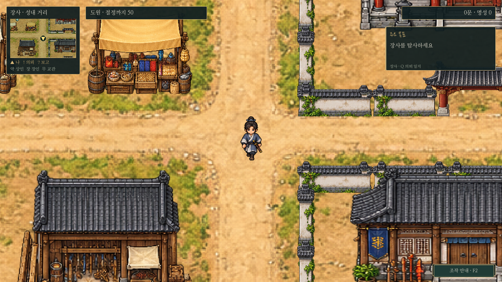
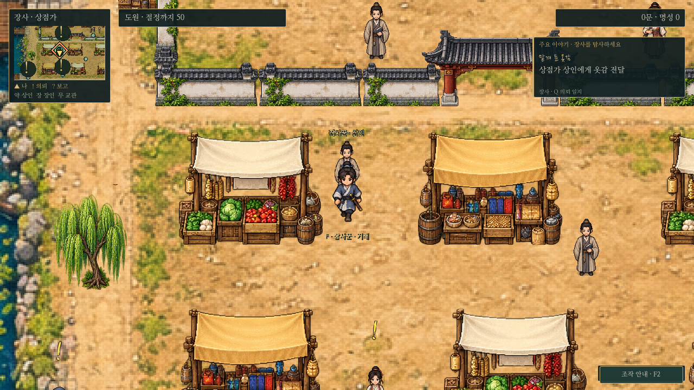
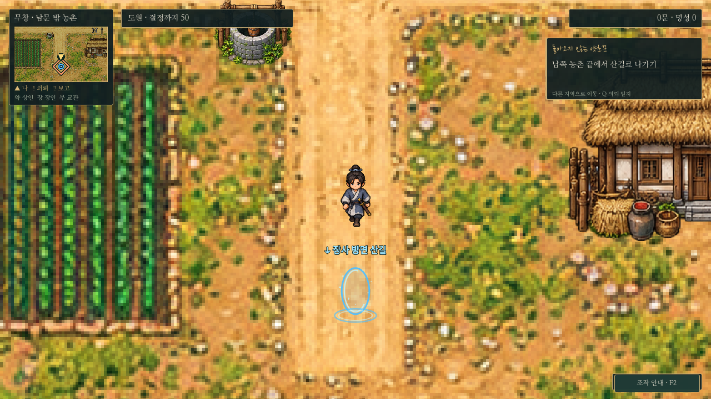
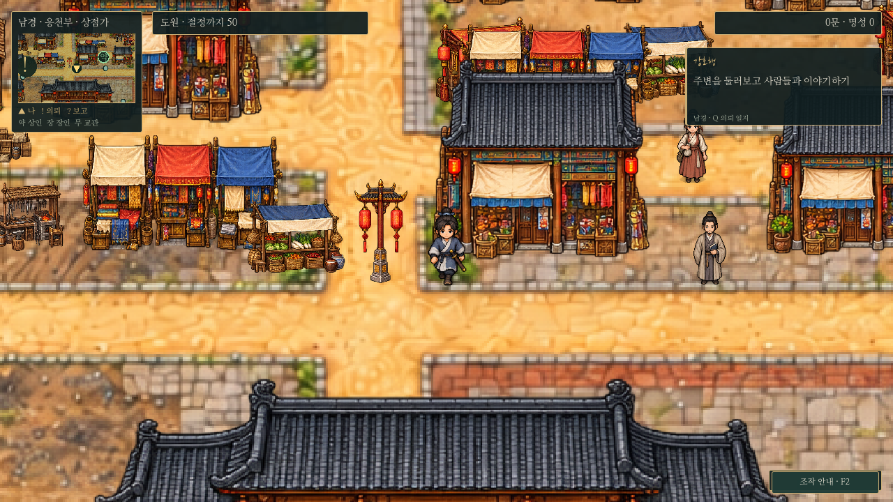

# 탐험 HUD — 목표·이름표·표식의 위계

작은 A안 HUD의 크기와 0.8 도시 카메라 배율을 유지하며 정보만 정리했다. 지도 그림·이동 속도·F 대상 선정·의뢰 상태·보상은 변경하지 않았다.

## 화면

## 표시 규칙

- **목표창:** 추적 의뢰 하나의 제목과 다음 행동을 우선한다. ` · `로 붙은 부가 설명은 HUD에서 줄이고 Q의 기존 설명은 유지한다. 주요 이야기가 따로 있으면 작은 한 줄로 표시하며, 추적 의뢰가 없으면 주요 목표를 본문에 표시한다. 장소 또는 다른 지역으로의 이동과 Q 안내를 작은 줄로 덧붙인다.
- **장사 1장 안내:** 토벌 모집 전 `장사를 탐사하세요`를 유지한다. 다른 의뢰를 추적하면 주요 이야기 줄로 축소한다. 이후 토벌·무림맹 진행에 맞는 안내로 바뀐다.
- **주민 이름:** 240 월드 단위 안의 인물만 이름·겉직업을 표시한다. F 대상과 매우 가까운 다른 주민의 이름은 숨기고, 나머지도 겹치는 이름표를 생략한다. 숨겨진 조직 소속을 덧붙이지 않는다.
- **의뢰 표식:** 수락 가능한 `!`와 보고할 `?`는 멀리서도 유지한다. 기존 68px 크기를 보존하고 이름표 위에 별도 자리를 배정한다. 가까운 표식이 겹치면 가로로 벌린다. 대화·메뉴 중에는 숨겼다가 탐험에서 복원한다.
- **조사 표식:** 현재 추적 목표 위치의 `◆`만 강조한다. 다른 의뢰의 조사 오브젝트·F 상호작용·진행 상태는 유지한다. 아직 등장하지 않은 단서를 새로 만들거나 공개하지 않는다.
- **F 안내:** 발밑 선택 표시를 유지하고 `F · 대상 이름 · 대화/거래/조사/이동`을 보여 준다. 대상과 플레이어의 발 아래로 내려 표시하며 화면 가장자리에 잘리지 않도록 제한한다. 머리 위의 작은 선택 화살표는 이름표와 경쟁하지 않게 생략한다.
- **미니맵:** 위치·시설·수락/보고 표식을 유지한다. 주민 점과 일반 표식은 차분하게, 추적 목표의 주황색 마름모/화살표는 선명하게 그린다. 겹치는 같은 종류의 의뢰 표식은 `!2`처럼 묶어 표시한다. 표식 데이터 자체는 유지한다.
- **하단:** 일곱 단축키 버튼/긴 키 목록 대신 오른쪽 아래 작은 `조작 안내 · F2` 버튼을 둔다. WASD·F·I/K/Q/R/TAB/ESC/F2 기능은 그대로다.
- **알림:** 왼쪽 아래의 정해진 위치에 짧게 표시한다. 대화·전투·메뉴 중이거나 F 안내와 겹칠 때는 큐에 보관하고 탐험이 가능해지면 이어서 보여 준다. 메뉴 내부의 구매/장착 결과 문구는 그대로다.

## 구현·검증

`exploration_hud.gd`가 퀘스트 갱신 뒤 화면 표시만 정돈한다. 월드 Label 목록은 지역이 바뀌거나 새 Label이 추가될 때만 다시 수집한다. `exploration.gd`의 이름표 참조, `ui.gd`의 표식 메타데이터와 함께 쓰며 의뢰 상태나 F 대상 선정 알고리즘은 바꾸지 않는다. 카메라·저장 형식도 유지한다.

- `tests/exploration_hud.gd`: 목표 위계·접근/원거리 이름·F 대상 이름·표식 분리·비추적 조사 숨김/상호작용 보존·미니맵 묶음·다른 지역 안내·대화 알림 대기/복원.
- `quest_update.gd`: 지역 무관 동시 진행·추적·!/?·두 도시 의뢰/거래·저장 복원.
- `compact_hud_gate.gd`: 새 목표/도움말 표시와 기존 장사 토벌 출입 제한·보수·저장·배율.
- `adventure_features.gd`, `prologue_f_input.gd`: 기존 일반 의뢰 완료·환경 설정·실제 0장 F 입력.
- `capture_exploration_hud.gd`: 실제 Godot 화면. 분리된 XDG 사용자 데이터로 실행하며 EXE/데모를 추가 생성하지 않는다.
