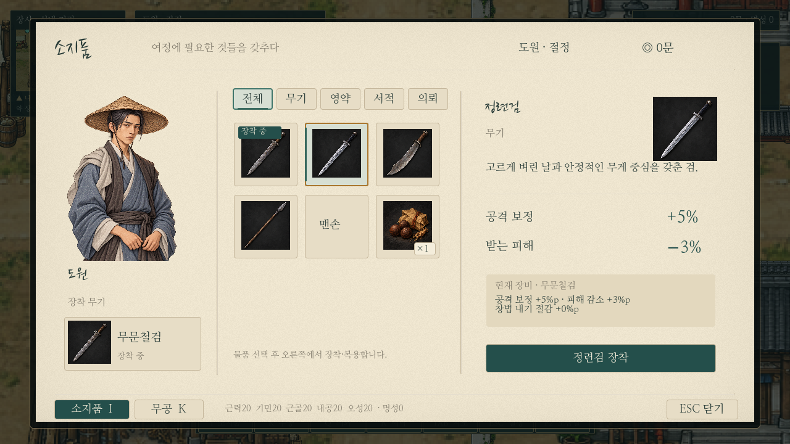
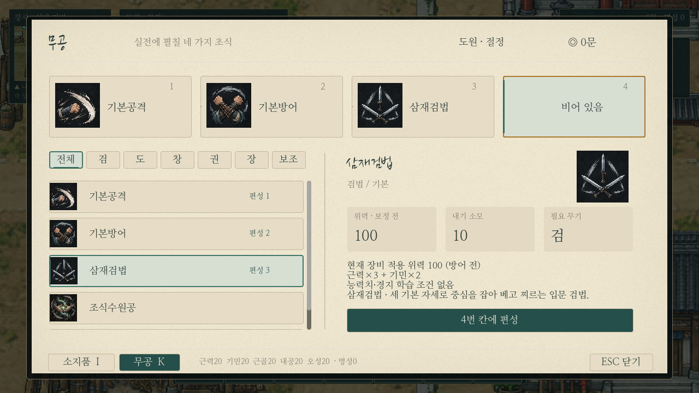
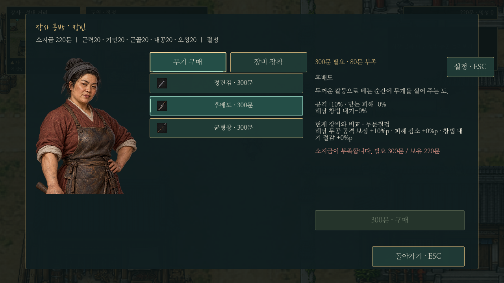
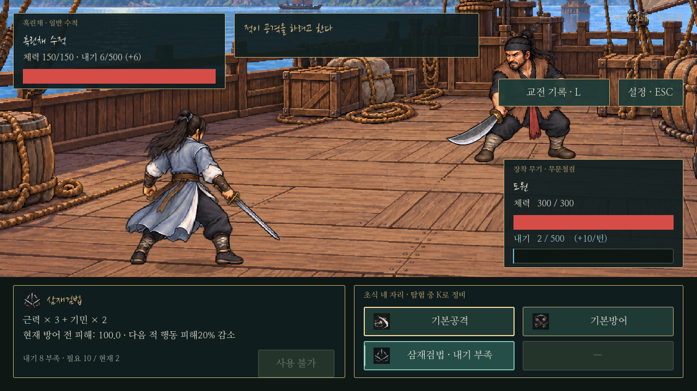
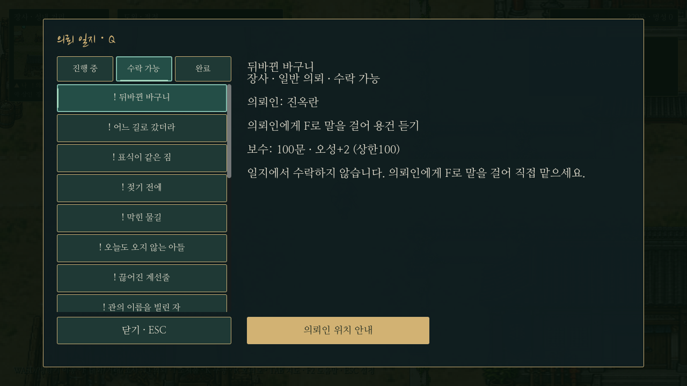

# 선택·포커스·사용 불가의 구분

기존 한지/먹빛 디자인에 공통 상태 표시를 적용했다. 화면 구성·아이콘·가격·학습 조건·전투 수치는 유지한다.

| 상태 | 표시 | 조작 |
| --- | --- | --- |
| 기본 | 기존 종이색 또는 먹빛 바탕 | 설명할 항목을 선택 가능 |
| 마우스 올림 | 배경을 조금 밝게, 아이콘 테두리를 옅은 청록으로 강조 | 소리·선택·실행을 발생시키지 않음 |
| 키보드 포커스 | 배경을 덮지 않는 금색 외곽선 | 선택된 다른 항목과 동시에 존재 가능 |
| 선택 | 청록 테두리·옅은 청록/먹빛 청록 바탕·왼쪽 세로 표식 | 항목 자체를 비활성화하지 않음 |
| 현재 탭 | 청록 강조와 하단 밑줄 | 현재 탭도 키보드 탐색 가능 |
| 장착/편성 | `장착 중`, `편성 1` 등의 별도 표기 | 설명 선택 여부와 구분 |
| 실행 불가 | 실행 버튼만 흐림, 근처에 구체적인 사유 | 설명 행은 계속 선택 가능 |
| 실행 완료 | 기존 알림/효과음·구체적인 결과 문구와 짧은 결과 강조 | 커서 올림으로 실행되지 않음 |

## 실제 화면

## 적용 범위

- **I:** 선택 물품·장착 무기 구분. 영약 보유/복용 한도/올릴 능력치 없음, 서책 보유/기습득/학습 조건을 실행 전에 안내한다. 사용 불가여도 물품 설명은 읽는다.
- **K:** 살펴보는 무공과 교체할 편성 칸을 각각 강조한다. 편성 번호를 따로 표시하며 무기 불일치도 설명에 남긴다. 무기 불일치는 편성 자체를 금지하지 않는다.
- **거래:** 현재 탭과 선택 품목·편성 칸에 공통 표시. 소지금 부족은 필요 금액/부족액으로 표시하고, 이미 소유·학습 조건·복용 한도 등은 설명에 표시한다. 선택만으로 돈/아이템을 소비하지 않는다.
- **전투:** 내기 부족·무기 불일치·대기 중인 무공도 선택해 읽는다. 사용 버튼은 실제 실행 조건을 따라 비활성화하며 `내기 8 부족`, `2턴 뒤 사용 가능`, `현재 맨손`처럼 이유를 보여 준다. 내기 변화 후 표시를 갱신한다. 적 예고는 기존 공격/수세만 유지한다.
- **Q:** 현재 필터를 비활성화하지 않는다. 살펴보는 의뢰의 청록 강조와 실제 `추적 중` 문구를 구분한다. 선택만으로 추적이 바뀌지 않는다.
- **기타:** 저장 탭·저장 칸·0장 분기 선택·무림맹 전수 목록에도 같은 표시를 쓴다. 타이틀의 기존 별도 디자인은 유지한다.

## 구현과 확인

`ui.gd`의 `selection`은 선택 스타일·표식, `unavailable`은 실행 불가·사유, `applied`는 짧은 결과 강조를 맡는다. `paper_menu_base.gd`에서도 이 규칙을 호출한다. 선택 상태를 버튼의 `disabled`나 전체 `modulate`로 표현하지 않는다. 마커는 입력을 가로채지 않는다.

`tests/ui_states.gd`는 선택/포커스의 동시 표시, 장착/복용 한도/무기 불일치/소지금 부족/내기 부족/대기, 미리보기의 비소비, 의뢰·저장 탭을 확인한다. 한도 초과 보유의 방어 검사는 시험용 비정상 데이터이며 실제 저장에 기록하지 않는다. `capture_ui_states.gd`는 분리된 사용자 데이터로 실제 UI를 렌더링한다.

기존 `paper_menu_live`, `trading`, `combat_updates`(110사례), `adventure_features`, `ink_ui`, `onboarding_menus`를 관련 회귀 검사로 사용한다. 별도 데모/EXE는 생성하지 않는다.
