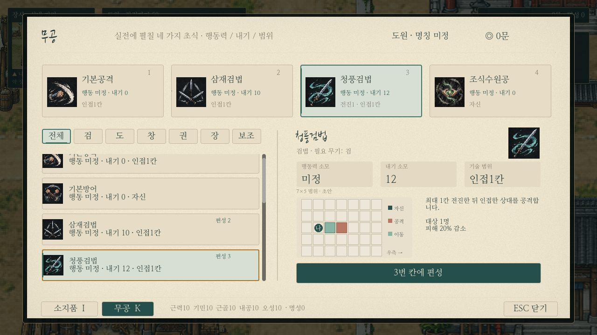

# K 무공창: 행동력·내기·범위와4칸 편성

기존 한지/먹빛 글자/청록 선택·기존 무공 아이콘을 유지하며 실제 게임의 K 창을 개편했다. 선택한 무공과4칸 편성은 기존 진행/저장과 연결된다. **새 행동 게이지 전투 엔진을 적용한 변경은 아니다.**

[1440p 실제 화면](../../godot/screenshots/k-tactics-charge-1440.png)

## 구성

- 상단:4개 실제 편성 슬롯. 아이콘/무공명/행동력·내기 소모/공격 범위와 전진·후퇴·추격·밀침 요약. 선택한 교체 대상 칸은 기존 청록 표식으로 강조한다.
- 왼쪽: 익힌 무공 목록과 전체/검/도/창/권/장/보조 필터. 각 행에 비용/범위, 이미 편성한 칸 번호를 표시한다. 선택 행을 레이아웃 완료 후 스크롤 안에 온전히 드러낸다.
- 오른쪽: 선택한 무공의 이름/필요 무기/행동력 소모/내기 소모/범위.7×5 격자로 자신·공격 가능한 칸·이동/변위 칸을 구분하고 오른쪽 방향 기준으로 보여 준다.
- 범위 옆: 전진/후퇴/관통/밀치기/추격 등 무공 특징과 대상 수, 지원 무공의 회복/방어/재사용, 장비 불일치/학습 조건 안내. 상세 글은 스크롤로 읽는다.
- 하단 버튼: 고른 무공을 선택한1~4번 칸에 편성. 기본공격/기본방어도 교체·비우기 가능하다.

## 아직 확정하지 않은 값

무공별 **소모 행동력은 아직 정하지 않았으므로 모두 ‘미정’**이다.100이라는 행동 시작 조건을 무공의 소비량으로 표시하지 않는다. 미래에 `martial_tactics.json`의 `action_cost`를 확정하면 비용 칸에 숫자를 표시할 수 있다.

내기는 현재 무공 카탈로그 값을 사용하고, 해당 무공에 적용 가능한 현재 장착 무기의 내기 절감 보정을 반영한다. 행동력과 내기를 별도 필드로 표시하며 이번 작업에서 기술 비용을 차감하지 않는다.

범위는 기존7×5 재설계안/분석 실험에 따른 **초안**이며 격자 위에 이를 명시한다. 공격칸 표시는 기술에 따라 단일 대상의 선택 가능 위치 또는 여러 적에게 닿는 범위다. 옆의 대상1명/범위전체/관통 설명으로 구분한다. 실제 장애물/점유 판정이나 새 전투 동작을 실행하는 창은 아니다.

## 범위 예시

| 기술 | 실제 화면 |
| --- | --- |
| 청풍검법:전진1칸+인접 검격 | [확인](../../godot/screenshots/k-tactics-charge-720.png) |
| 회풍도법:주변8칸 | [확인](../../godot/screenshots/k-tactics-area.png) |
| 연환창법:전진 뒤 직선2칸 | [확인](../../godot/screenshots/k-tactics-spear.png) |
| 조식수원공:자신 | [확인](../../godot/screenshots/k-tactics-support.png) |

캡처는 테스트 전용 진행에 무공을 채운 예시다. 일반 플레이의 무공을 자동 습득시키지 않는다.

## 소스와 유지한 기능

- `data/martial_tactics.json`:20개 기존 플레이어 기술의 표시용 행동력/범위/이동 초안. 기존 피해 계수/무공 내기 비용과 분리했다.
- `scripts/martial_tactics.gd`, `martial_range_preview.gd`:초안 조회/요약/7×5 도식.
- `scripts/martial_menu_panel.gd`:K 레이아웃. `player_menu.gd`는 I/K 열기·닫기/선택/장착·편성/상태 기억을 계속 담당한다.

기존 이미지/아이콘을 재사용하며 새 아이템이나 무공을 추가하지 않았다. 실제 배운 목록/필터·4칸 편성/기본 행동 교체·비우기/장비 안내/키보드·마우스 선택/저장을 유지한다. I 소지품과 전투의 피해·내기·행동 규칙, 가격·보상·학습 조건은 바꾸지 않았다. 새 저장 스키마는 만들지 않았다.

## 점검

- `k_tactics.gd`:기존 기술 전체 표시·미정 비용/현재 내기 분리·7×5 안의 도식·전진/주변/자기 대상·선택 행 표시·표시 메타데이터가 전투 수치/자원을 바꾸지 않음·4칸 편성/비우기/저장 복원. 숫자60은 비용 표시 경로 검사용 임시 값이며 배포 데이터에는 저장하지 않는다.
- `paper_menu_live.gd`:실제 I/K 마우스·키보드·장착·복용·편성·필터·빈칸·저장 회귀.
- `ui_states.gd`:선택/포커스와 실행 불가 구분 회귀.
- `capture_k_tactics.gd`:720/1440p와 전진/주변/직선/자기 대상 실제 렌더.

모든 Godot 검사는 사용자 저장과 다른 XDG 폴더에서 실행한다.
