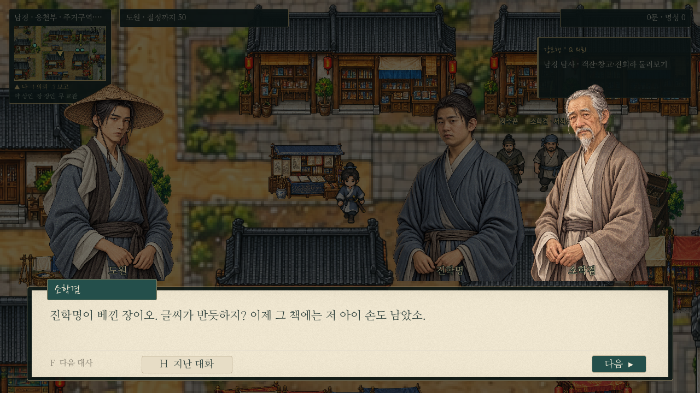
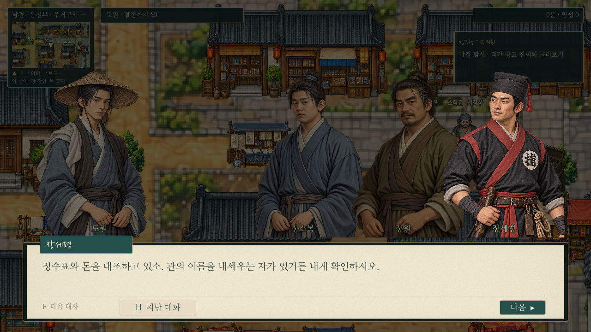
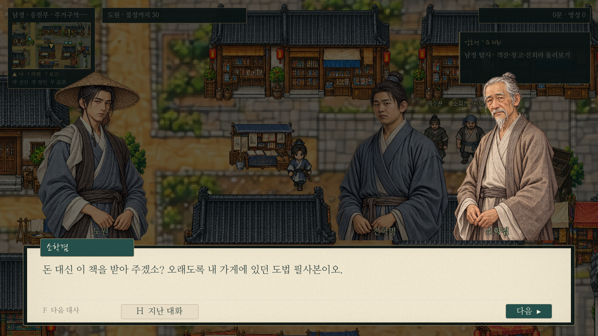
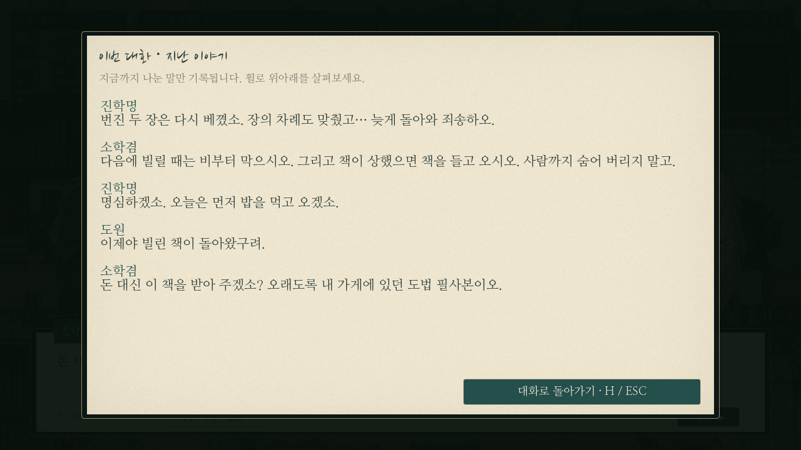
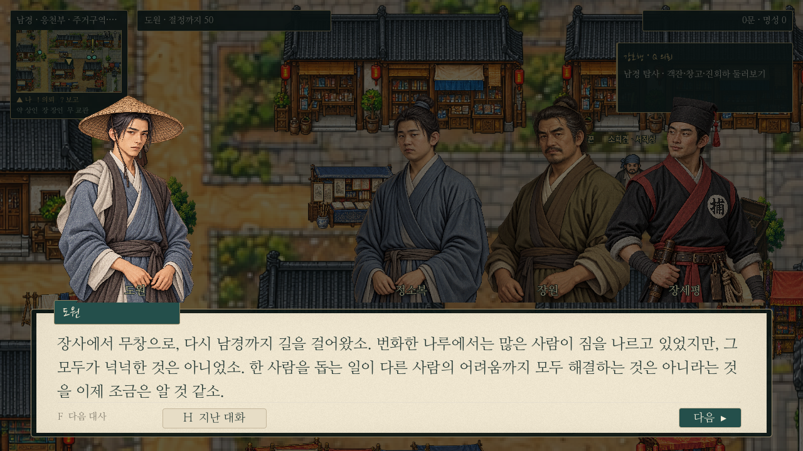

# 한지 대화창 — 기존 대화 일괄 적용

채택한 [대화창 시안](paper-dialogue-proposal.md)을 공통 대화 처리에 적용했다. 0장·장사·무창·남경·산촌·청애채·무림맹의 기존 대사/선택지/콜백/보상은 수정하지 않았다. 기존 저장을 읽어도 새 공통 UI로 표시한다.

## 화면과 인물

- 기존 I/K와 같은 한지 바탕·먹빛 본문·청록 이름표·얇은 구분선. F 다음, H 지난 대화, 다음 버튼을 유지한다.
- 도원은 왼쪽 고정. 나머지 인물은 오른쪽에 묶어 배치한다. 상대1/2/3명은 시안의 간격과 겹침을 사용하며 더 큰 대화도 전원을 유지하는 압축 배치/행 분할을 사용한다.
- 화자는 밝게/겹침 앞쪽, 비화자는 어둡게 표시한다. 발화자 변경으로 좌우 순서/위치를 바꾸지 않는다.
- 기본적으로 도원과 상대가 마주보게 하며 대본의 `to`와 `facing` 연출, 상대끼리 말하기, 도원이 앞선 화자에게 답하는 추론을 유지한다.
- 기존 일러스트만 사용하고 대화당 같은 그림의 중복 배정을 막는다. 빠져 있던 남궁연서의 얼굴 중심/눈높이/눈-턱 길이 프로필을 등록했으며 그림 파일은 바꾸지 않았다.
- 대화 시작 시 전체 대본의 최대 줄 수와 실제 Label 행 높이로 본문 공간을 미리 확보한다. 긴 대사/짧은 대사·화자가 번갈아도 같은 대화 안에서 초상화 크기·위치를 유지한다. 글씨 설정 변경 시에는 다시 측정한다.
- 상단 그림 장면은 자체 연출을 유지하며 일반 배경은 어둡게 처리한다. 대사/자막 이름이 길면 이름표 폭을 조절한다.

## 대화 기록·호환

H 기록도 같은 한지/먹빛/청록으로 맞췄다. 지금까지 읽은 줄만 표시하고 열려 있는 동안 정지하며, F/콜백/보상이 발생하지 않는다. 닫으면 같은 대사로 돌아간다. 대화 중 수동 저장 금지와 과거의 대화 중 저장 불러오기를 유지하며 새 저장 스키마를 만들지 않는다.

## 실제 게임 캡처

별도 사용자 데이터 폴더에서 기존 의뢰 대본과 실제 공통 대화창으로 캡처했다. 큰 글씨 검토용 문장은 테스트에서만 사용한다.

## 검사

- `paper_dialogue_live.gd`:기존 메인/의뢰 대본291장면의 좌우 배치·전원 표시·중복 그림·발화자 변경 안정성. 실제 긴/짧은 대사 전환의 전역 사각형 비교, 큰 글씨 본문/화면 경계, 기록 정지/읽은 경계, 기존 대화 저장 복원.
- `dialogue.gd`:모든 초상화 프레이밍·시선·명시 연출·6명 표시·초기화·과거 저장.
- `conversation_tools.gd`:기록의 미래 대사 차단·진행/보상 방지·초상화 분리.
- `adventure_features.gd`:환경 설정/큰 글씨 및 기존 대본 줄바꿈.
- `prologue_f_input.gd`:실제0장 이동·F 대화·승선·첫 전투 연결.
- `saves.gd`:기존 저장 회귀. 저장 검사는 모두 별도 XDG 사용자 폴더를 사용한다.

주요 파일은 `main.gd`, `dialogue_portraits.gd`, `paper_dialogue_panel.gd`, `dialogue_history.gd`, `game_options.gd`, `portrait_framing.json`이다. 세계 미술/전투 수치/I/K 기능은 유지한다.
