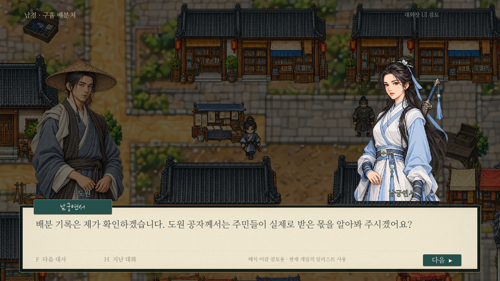
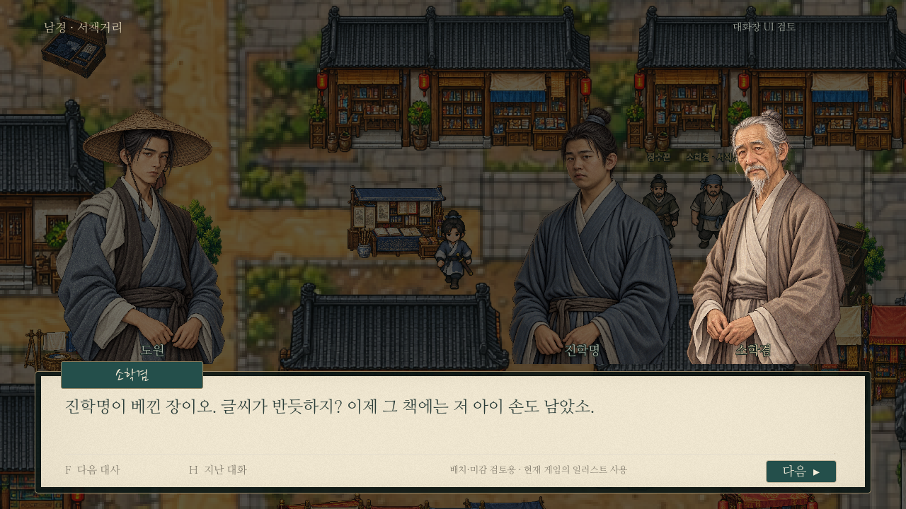
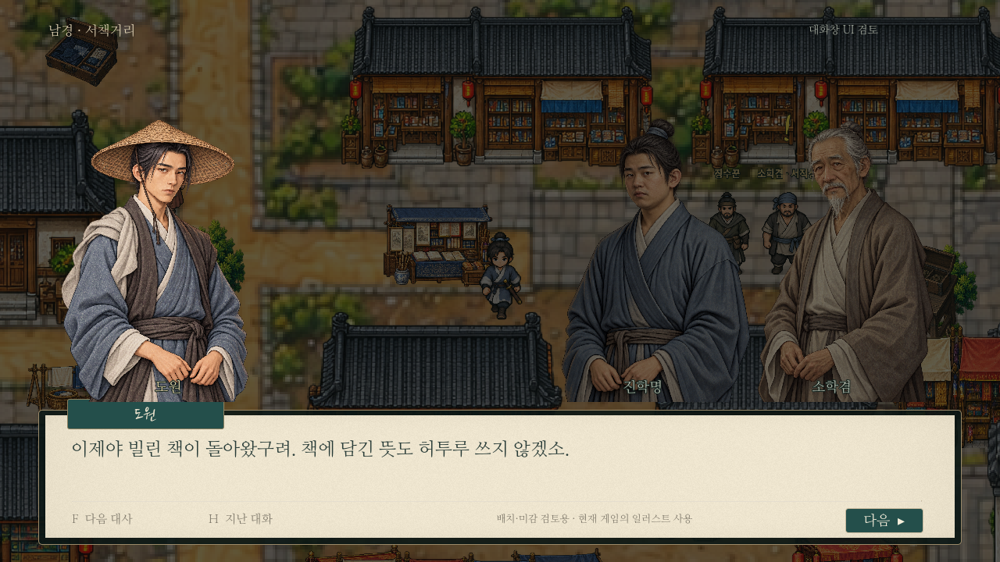
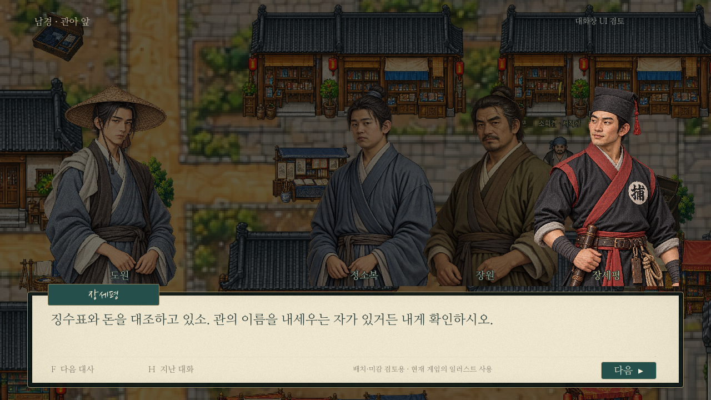

# 한지 대화창과 좌우 무리 배치 — 검토용

현재 I/K 한지 UI와 같은 재료/서체/색으로 만든 실제 Godot 렌더링 시안이다. **일반 게임의 대화창/인물 배치는 아직 변경하지 않았다.** 사용자 검토 후 적용할 자료이며, 예시 대사는 배치 설명용으로 스토리에 새로 등록하지 않는다.

## 구성

- 플레이어 도원은 왼쪽에 고정한다.
- 상대 인물은 오른쪽에 묶고 어깨 부분을 조금 겹쳐 배치한다. 상대2명은 오른쪽 구역에,3명은 중앙 오른쪽부터 배치하며 왼쪽 도원과는 간격을 둔다.
- 같은 대화에서 말하는 사람이 바뀌어도 좌우/순서를 유지한다. 말하는 인물만 밝게, 듣는 인물은 어둡게 처리한다. 발화자 그림은 겹침의 앞에 두되 위치는 움직이지 않는다.
- 양측 인물은 서로를 바라보게 좌우 반전하며 기존 얼굴 크기/눈높이 프레이밍을 재사용한다. 한 대화에서 다른 인물에게 같은 초상화를 중복 사용하지 않는지 캡처에서 확인한다.
- 한지 대화 바탕, 청록 발화자 이름표, 먹빛 본문, 얇은 구분선, F 다음/H 기록/다음 버튼을 사용한다.
- 기존 초상화만 사용했다. 사진/인물/배경을 이미지 생성으로 다시 그리거나 원본 이미지를 편집하지 않았다.
- 화면의 오른쪽 묶음은 대화 상대 구성이다. 실제 세력 소속이나 충성 관계를 새로 확정하는 표식은 붙이지 않는다.

## 1:1

## 도원 대 상대2명

## 같은 구도에서 도원 발화

## 도원 대 상대3명

`previews/paper_dialogue.gd`와 `tests/capture_paper_dialogue.gd`에서 프리뷰를 구성한다. 캡처는 별도 XDG 사용자 폴더에서1280×720으로 수행했다. 라이브 `main.gd`의 대화창과 `dialogue_portraits.gd`의 배치 로직은 수정하지 않았다. 현재 예시는 상대3명까지이며 더 많은 인물/최대 글자 크기/긴 문장·선택지는 실제 적용 단계에서 추가 검증한다.
