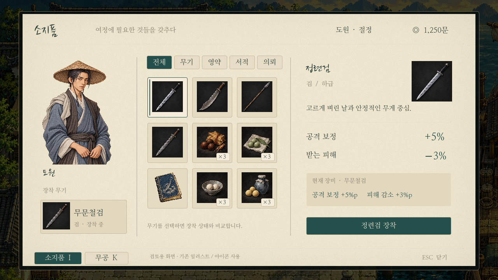
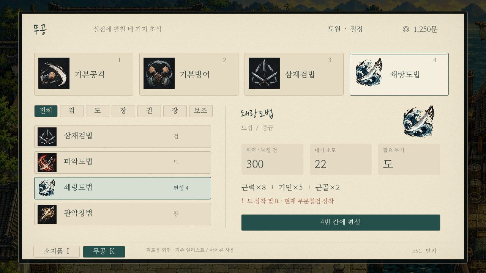

# 한지 UI — 기존 자산을 사용한 실제 엔진 프리뷰

0장 나루 미술 변경(07ff37c)은 af62eca에서 되돌렸다. GitHub 최신 파일에서 새 나루 맵/미술/스크립트/캡처를 제거하고 원래 탐험 코드·저장 처리를 복원했다. 일반적인 되돌리기 커밋이므로 과거 커밋 기록은 남아 있다.

이번 화면은 이미지 생성으로 게임 모습을 다시 그리지 않고, 실제 Godot Control/Label/TextureRect/버튼으로 구성하여1280×720에서 캡처했다.

- 도원: 기존 `assets/portraits/player/hero.png`와 기존 얼굴 프레이밍 사용.
- 무기·영약·서적·무공: 기존 `catalog_icons.gd`와 `icon_manifest.json`의 이미지를 그대로 사용한다. 기존 아이콘의 어두운 바탕도 유지한다.
- 글꼴: 현재 번들된 붓글씨/명조체. 한지 바탕만 셰이더의 미세한 노이즈로 표현한다.
- 미술 원본 파일을 편집하거나 새 캐릭터/무공 그림을 생성하지 않았다.
- 검토용 소지품/금전/능력치/편성 예시이며 플레이 저장이나 보유품을 변경하지 않는다. 쇄랑도법 위력300은 모든 능력치20에서 기존 공식으로 계산되는 방어/장비 보정 전 값이다.

**실제 I/K 메뉴는 아직 교체하지 않았다.** 별도 `previews/paper_menu.tscn`의 레이아웃 검토 화면이다. I/K와 하단 소지품·무공 버튼으로 화면을 전환할 수 있으며, 분류·물품 선택·장착·편성 등 나머지 버튼은 시각 배치 예시다. 사용자 채택 후 실제 보유품/선택/장착/편성 로직과 연결한다.

## 소지품

기존 주인공 일러스트와 장착 무기, 전체 물품 아이콘 격자, 선택한 무기의 상세/비교를 세 영역으로 나눈다. 선택색은 청록, 본문은 짙은 먹빛, 비교는 현재 수치의 의미가 드러나는 문구로 표시한다.

## 무공

상단 네 편성 슬롯, 아래 전체/종류 분류와 목록, 선택 상세의 위력/내기/무기 조건을 나눈다. 무공명을 생성 이미지의 글자로 대체하지 않고 기존 카탈로그에서 읽어 표시한다.

## 확인 방법

Godot에서 `previews/paper_menu.tscn`을 열고 F6로 실행하면 같은 화면을 볼 수 있다. 일반 게임의 메인 씬은 그대로다. `tests/capture_paper_preview.gd`는 두 화면을 실제 렌더링해 저장한다. 모델 상향 없이 우선 기존 자산으로 구현 가능한 레이아웃을 확인한 것이며, 최종 미감·정보량은 사용자 검토 후 결정한다.
