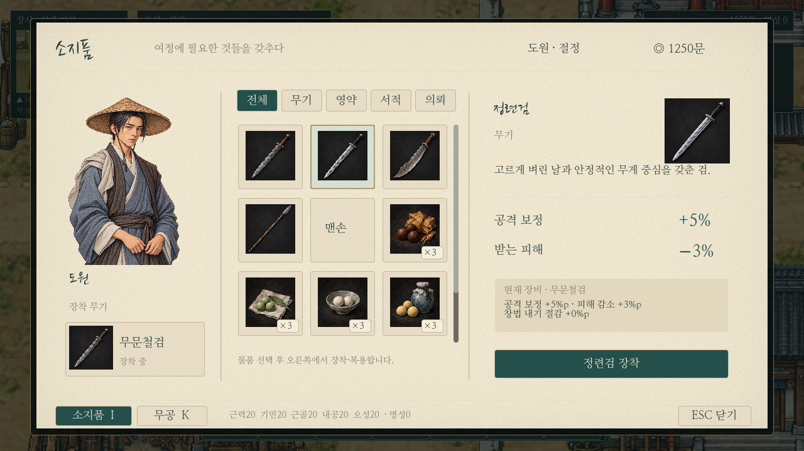
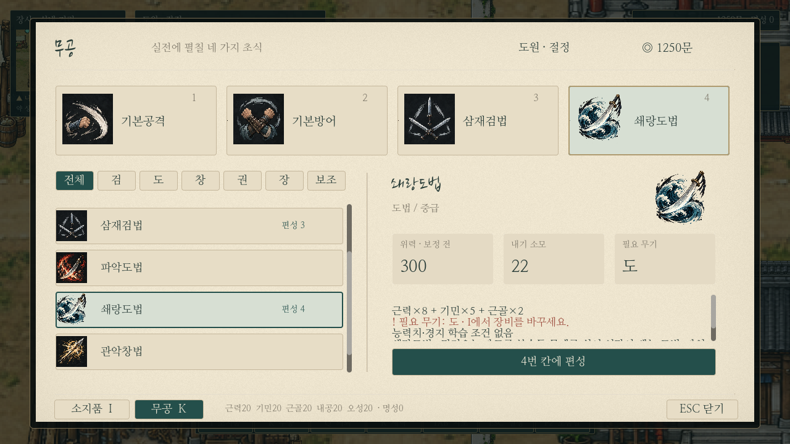

# 한지 소지품·무공 메뉴

사용자가 채택한 [기존 자산 프리뷰](paper-menu-existing-assets.md)를 실제 게임의 I/K 메뉴에 반영했다. 한지 바탕·먹빛 글자·청록 선택색·구역/버튼 배치·기존 도원 일러스트와 아이콘을 유지하고, 모든 값은 현재 플레이 데이터에서 읽는다. 나루 맵 롤백 상태는 유지한다.

## I 소지품

- 왼쪽: 기존 도원 일러스트와 현재 장착 무기. 장착 영역을 누르면 해당 무기를 선택한다.
- 가운데: 전체/무기/영약/서적/의뢰 분류와 실제 소지품3열 격자. 수량·선택 테두리·마우스 강조와 스크롤을 제공한다. 없는 물품을 시안처럼 임의 지급하지 않는다.
- 오른쪽: 선택 물품의 설명·효과·현재 장비 대비 차이와 실행. 무기 장착/맨손 전환, 영약1개 복용, 서책1권 사용, 의뢰 물품의 대화 전달 안내가 기존 로직과 연결된다.
- 이미 장착한 무기, 이미 익힌 서책과 빈 목록은 해당 이유에 따라 실행을 막는다. 영약 복용 한도와 능력치 상한, 무공 습득 중복 방지를 유지한다.

## K 무공

- 상단4개 실제 편성 슬롯을 누르면 교체할 칸을 선택한다. 기본공격/기본방어도 교체할 수 있다.
- 전체/검/도/창/권/장/보조 필터와 익힌 무공 목록, 현재 편성 번호를 표시한다. 목록/슬롯에는 기존 아이콘과 마우스 강조를 사용한다.
- 오른쪽 위력(장비/방어 보정 전)·현재 장비 적용 내기·필요 무기를 카드로 표시한다. 무공 설명/계수/현재 장비 적용 위력/무기 조건은 아래 스크롤 상세에서 확인한다.
- 기본방어는 피해 감소20%, 조식수원공은 내공200% 회복·피해20% 감소·재사용 제한으로 표시한다. 실제 계산/학습 조건/가격/효과 수치는 변경하지 않았다.
- 무공과 칸을 고른 뒤 편성 버튼으로 적용하며, 칸 비우기도 제공한다. 맞는 무기를 안 들고 있어도 편성은 가능하되 장비 조건을 안내한다. 실제 전투의 장비 제한은 유지한다.

## 조작·저장

I/K로 열기·화면 전환·같은 키로 닫기, ESC로 닫기. 방향키/Tab으로 포커스 이동, Enter/Space로 선택/적용한다. 아이콘·글자 영역이 클릭을 가로막지 않으며, 입력이 필드 F 대화로 새어 나가지 않도록 기존 메뉴 차단을 유지한다. 열려 있는 동안 이동과 새 수동 저장은 차단한다. 마지막 분류·선택·스크롤은 세션 안에서 기억하며 새 보유품 상태를 검증해 없는 선택을 정리한다.

프리뷰용 가짜 수치 대신 현재 능력치/경지/소지금/명성·무기·수량·복용 기록·무공·편성 정보를 표시한다. 장착/복용/습득/편성은 기존 progress 신호와 저장 자료를 사용하고 새 저장 스키마를 만들지 않았다. 알림이 메뉴 본문을 가리지 않으며 적용 결과는 하단에 표시한다.

`paper_menu_base.gd`는 공통 한지/서체/스타일을, `player_menu.gd`는 실제 보유품·조작을 담당한다. 기존 `previews/paper_menu.tscn`은 시안 비교용으로 남아 있으나 일반 플레이의 I/K는 실장 메뉴를 연다. 한지 셰이더는 재사용한다.

## 실제 게임 캡처

아래는 분리된 테스트 환경에서 소지품/무공을 채워 실제 메뉴로 캡처한 화면이다. 일반 플레이에는 예시 재화나 아이템을 지급하지 않는다.

## 확인

- `paper_menu_live.gd`:실제 마우스 클릭(아이콘/실행), 장착·복용·편성, 종류 필터, Enter/Tab/ESC, 재개 상태 기억, 빈 목록·중복 서책, 저장 복원.
- `onboarding_menus.gd`:도입 의뢰/거래→I/K 장착·편성·복용·전투 반영 및 모달 차단.
- `book_quest.gd`:소모 서책 보상→I 사용→K 편성·저장.
- `alliance_arts.gd`:중급5종 아이콘/학습 조건/장비·저장.
- `duel_quest.gd`:조식수원공의 회복/방어 설명과 보상 무공 표시.
- `saves.gd`:기존 저장 회귀. 검사는 각각 별도 XDG 폴더에서 실행한다.
