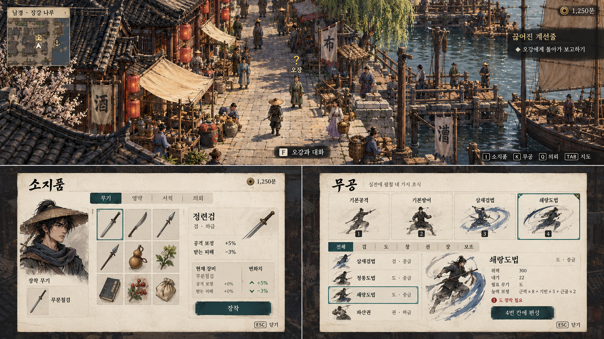
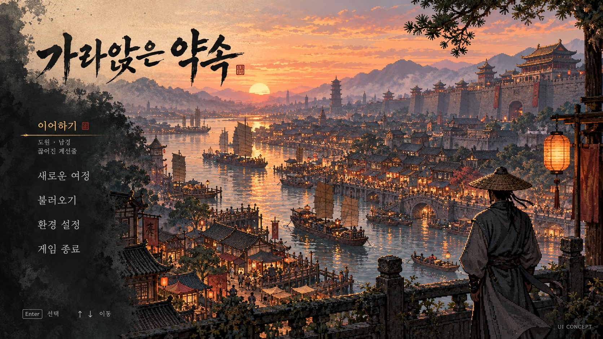

# 출시 UI 시안 — 한지와 먹빛

채택 후 실제 적용: [I/K 메뉴](paper-menu-live.md), [대화창](paper-dialogue-live.md), [타이틀](title-live.md). 아래는 최초 제안 당시 기록이다.

사용자 검토를 위한 생성 이미지이며 게임에 적용하지 않았다. 기존 먹빛·금색에 따뜻한 종이 표면과 청록색 선택 강조를 조합한다. 게임 코드·세계 지도·인물·무공·수치·제목은 이 시안으로 변경하거나 확정하지 않는다. 배경/인물은 분위기 예시이며 생성 이미지의 문구 오기·미등록 무공·예시 수치는 구현 자료로 사용하지 않는다.

## 탐험 · 소지품 · 무공

위쪽은 탐험 HUD, 아래 왼쪽은 소지품, 아래 오른쪽은 무공 편성이다.

- 탐험: 구석에 미니맵/소지금/목표를 작게 배치하고 가까운 대상에만 F 안내. 필드 체력바는 표시하지 않는다.
- 소지품: 장착 무기 요약, 물품 아이콘 목록, 선택 상세와 비교, 짧고 명확한 장착 버튼.
- 무공: 상단 고정4칸과 종류별 목록, 위력·내기·무기 조건을 분리한 상세. 조건 부족은 작은 표식과 사유로 표시.
- 한지 밝은 면과 먹빛 HUD의 역할을 구분하며 금색 사각 버튼을 반복하지 않는다. 실제 구현 시 작은 글씨의 크기/대비와 선택/사용 불가 상태는 별도 점검한다.

## 타이틀

최근 진행 이어하기를 우선하고 메뉴에 여백을 준다. 그림과 메뉴의 시각적 영역을 먹 번짐으로 자연스럽게 연결한다. 작품 제목 표기는 기존 임시 명칭을 사용한 시안이다.

생성 원본: `exec-7adc18a7-a233-4626-b7b2-364e353bf130.png`, `exec-0b936bfd-b1bc-4f89-a300-9bbc8f5e368d.png`. 이미지 편집 없이 원본을 복사했다. 사용자가 채택/수정 방향을 정한 뒤 실제 UI 작업을 진행한다.
