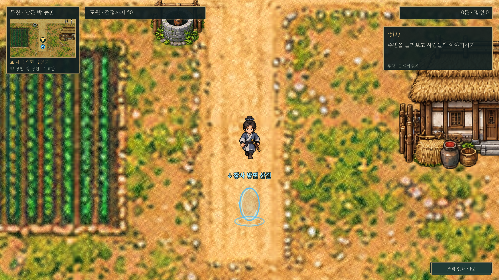
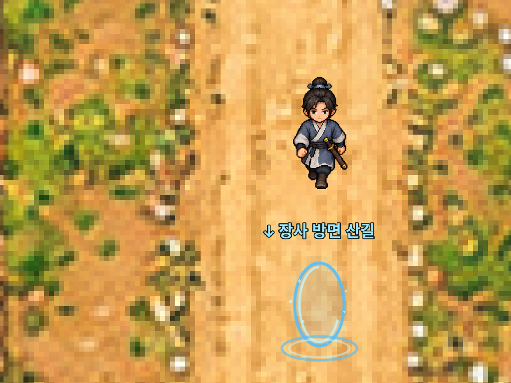
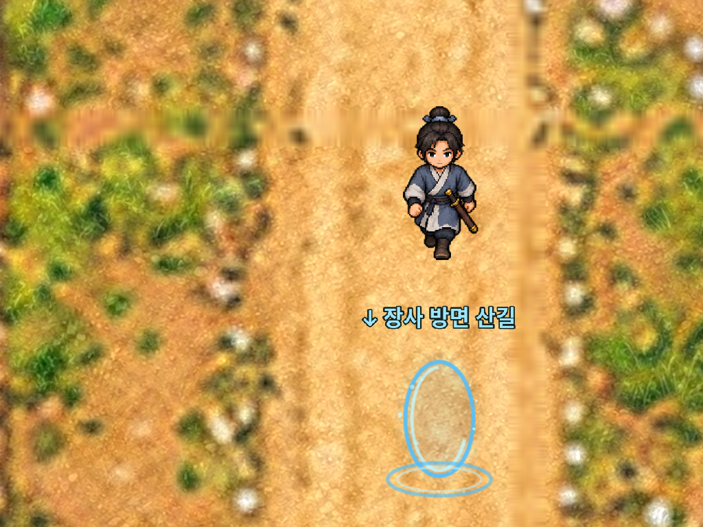
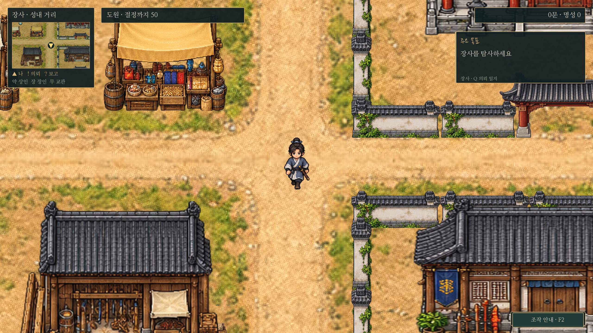
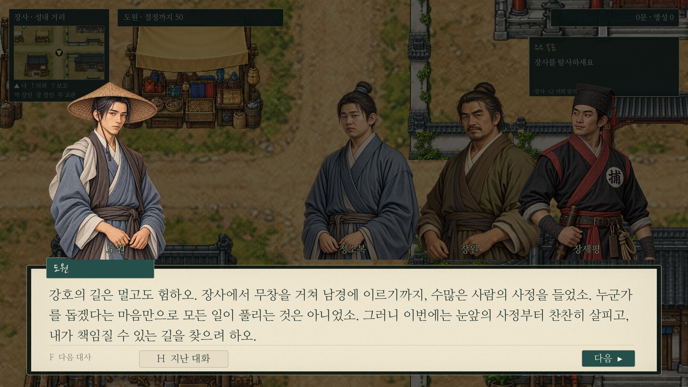

# 720p·1080p·1440p 점검과 바닥 확대 보정

실제 Godot4.6.3 GL Compatibility 렌더러에서 확인했다. **UI 잘림 검사는 통과했지만 1440p의 바닥에 과도하게 큰 픽셀 격자가 확인되어, 바닥에만 확대 보정과 세부 재질을 적용했다.** 건물·캐릭터·초상화·아이콘·글자, 카메라0.8, 맵 크기와 충돌은 그대로다.

모든1440p 파일은 **2560×1440으로 직접 렌더링한 PNG**다.720p 그림을 크게 늘려 저장하지 않았다. 아래 이미지를 열어 원본 크기로 보면 실제 픽셀을 확인할 수 있다.

## 1440p 전체 화면

[무창2560×1440 원본](../../godot/screenshots/resolution-audit/final-wuchang-1440.png) · [남경2560×1440 원본](../../godot/screenshots/resolution-audit/final-nanjing-1440.png) · [1440p 전체 화면 모드](../../godot/screenshots/resolution-audit/final-fullscreen-1440.png)

## 같은 장면의 수정 전후 — 1:1 픽셀

두 그림은 같은2560×1440 렌더링의 동일한 위치에서1024×768을 잘라낸 것이다. 확대·축소·리터칭하지 않았다.

| 수정 전 | 수정 후 |
| --- | --- |
|  |  |

[수정 전 전체 원본](../../godot/screenshots/resolution-audit/baseline-wuchang-1440.png)도 보관한다.

## 발견 원인과 적용 범위

무창 바닥 원본은1295×1215인데 월드는8192×7680이다.1440p에서 원본의 한 픽셀이 약10.1 화면 픽셀로 커졌다. 장사·남경은 같은 조건에서 약6.4픽셀이다. 따라서 글자와 건물은 선명해져도 바닥의 큰 사각형은 더 잘 보였다.

`terrain_detail.gdshader`는 실제 화면상의 확대 비율을 계산한다. 크게 확대된 바닥에만 보간을 점진적으로 적용하고, 별도로 생성한 흙·풀·석재의 미세 질감을 월드 좌표에 합성한다. 색·길·해안·밭의 큰 형태는 원본에서 유지한다. 질감은 화면이 움직여도 같은 월드 위치에 고정되며 반복 경계는 희미하게 처리한다. 작은 화면에서는 보정량이 줄어든다. 초상화·건물·캐릭터·무공 아이콘에 전역 흐림을 적용하지 않는다.0장 나루/갑판과 전투 배경도 기존 표시를 유지한다.

**한계:** 바닥 원본 자체의 해상도와 큰 지형·돌의 세부 형태는 그대로다. 이번 개선은 확대 표시와 세부 재질의 보완이다. 완전히 새로운 고해상도 지형 원화를 복원한 결과로 해석하면 안 된다. 특히 무창의 큰 돌·풀 덩어리에는 원본의 정보량 한계가 남아 있다.

## 해상도와 UI 결과

| 확인 항목 | 결과 |
| --- | --- |
| 1280×720 /1920×1080 /2560×1440 | 논리 화면1280×720·같은 카메라 시야 유지, 실제 출력 크기 일치 |
| 1600×900 | 1.25배 출력에서 UI 경계 확인 |
| 1280×800 /2560×1080 | 기존16:9 유지 설정으로 화면비 왜곡 방지, 메뉴 잘림 없음 |
| 1440p 창/전체 화면 |2560×1440 출력 및 전체 화면 모드3 확인 |
| I/K·Q·저장·전투4칸·타이틀 | 화면 밖 버튼/패널 없음 |
| 대화18/21/24·긴 한국어·다인 초상화 | 줄과 진행 버튼 잘림 없음 |
| 검사 합계 |150개 통과 |
| 바닥 이동 안정성 |720/1080/1440p에서 카메라 이동 전후 같은 월드 지점의64×64 픽셀 비교: 모두 차이0 |

검사 환경은 Linux X11 가상 디스플레이다. Windows의 실제125%/150% OS 배율이나 특정 모니터의 색감·성능을 실측한 결과는 아니다.1600×900의1.25배 출력은 게임 렌더링 배율 검사다.

## 해상도별 실제 캡처

[수정 전1440p 장사](../../godot/screenshots/resolution-audit/baseline-changsha-1440.png)

[720p 장사](../../godot/screenshots/resolution-audit/final-changsha-720.png) · [1080p 장사](../../godot/screenshots/resolution-audit/final-changsha-1080.png) · [1440p 장사](../../godot/screenshots/resolution-audit/final-changsha-1440.png)

[소지품1440p](../../godot/screenshots/resolution-audit/final-inventory-1440.png) · [무공1440p](../../godot/screenshots/resolution-audit/final-martial-1440.png) · [큰 글씨 대화1440p](../../godot/screenshots/resolution-audit/final-dialogue-large-1440.png)

## 코드·재현

- `terrain_rendering.gd`, `shaders/terrain_detail.gdshader`: 바닥 전용 표시. 원본 바닥PNG는 덮어쓰지 않는다.
- [세부 재질 원본·제작 안내](../../godot/assets/maps/materials/README.md).
- `tests/resolution_layout.gd`: 실제 창 크기6종·목록 확장·대화 크기3종·150개 검사. 게임 진행/저장 데이터 변경 없음.
- `tests/capture_resolution_audit.gd`: 해상도별 실제 캡처/전체 화면. `-- --baseline`으로 바닥 원본 표시를 비교할 수 있다. 캡처용 대사는 글자 잘림 검사 문구이며 새 이야기로 등록하지 않는다.
- [실측 출력/배율/카메라 기록](resolution-audit.json).
- `terrain_stability.gd`: 카메라를5 월드 단위 이동한 뒤 같은 지점의4096픽셀 비교. 화면 좌표에 붙어 움직이는 질감이 없는지 확인한다. 모든 미세 이동·OS 환경에 대한 보장은 아니다.
- `map_art.gd`, `prologue_f_input.gd`: 기존 원화 경로·지도 대응·포탈·0장 실제F 입력 회귀 확인.

검사와 캡처는 분리한 XDG 사용자 폴더에서 실행했다. 새 EXE/데모 배포본은 만들지 않았다.
