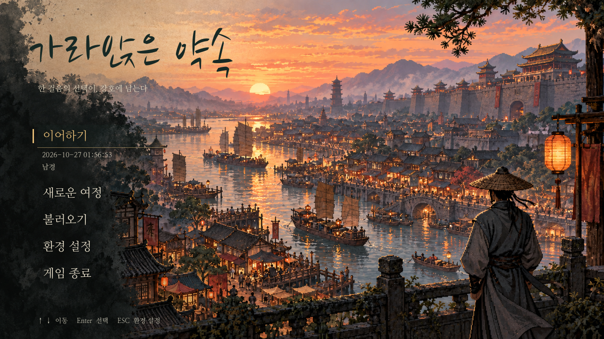
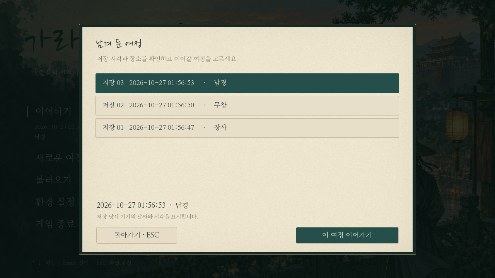

# 실제 타이틀 — 석양의 도성

최초 [타이틀 시안](release-ui-proposal.md)을 바탕으로 게임 시작 화면을 교체했다. 석양·강변 도성·등롱·삿갓 쓴 낭인은 전용 배경 그림이며, 제목과 모든 메뉴·저장 정보는 Godot의 실제 글자와 버튼이다. 기존 탐험 맵의 미술이나 이야기 제목을 새로 바꾼 작업은 아니다.

## 메뉴와 저장

- **이어하기:** 가장 최근의 정상 수동 저장 또는 0장 자동 체크포인트. 날짜·시간(초 단위)과 장소만 표시한다.
- **새로운 여정:** 기존 0장을 시작한다. 기존 저장 파일은 유지한다. 저장이 없다면 첫 선택이다.
- **불러오기:** 시각순 목록에서 다른 시점을 고른다. 저장 칸 번호/수동·자동 구분을 덧붙이며, 의뢰·분기·돈은 노출하지 않는다. 손상된 파일은 이어하기 후보에서 제외한다.
- **환경 설정:** 기존 음량·화면·대화 글자 설정을 연다. 닫으면 타이틀로 돌아온다.
- **게임 종료:** 확인 후 종료한다.
- **F10 개발 도구:** 전투 체험·장사/무창 탐방·0장 체크포인트 재개. 일반 메뉴에서는 분리했다.

마우스와 위/아래·Tab·Enter/Space를 지원한다. 불러오기에서는 방향키로 저장을 고르고 Enter로 바로 이어간다. 마우스로는 저장 선택 후 하단 버튼을 누른다. ESC는 열린 목록을 먼저 닫으며, 기본 타이틀에서는 환경 설정을 연다. 게임 내 저장 목록·상세 역시 날짜/시간·장소만 보여 준다.

## 호환과 그림

저장 형식과 불러온 뒤의 이야기·보상은 유지한다. 자동 체크포인트에 표시용 `saved_at`만 추가하며 과거 파일은 수정 시각을 현지 시각으로 변환한다. 수동 파일의 기존 `saved_at`은 그대로 사용한다. PC 간 동기화 기능을 추가한 것은 아니다. 동초 저장은 슬롯 번호로 안정적으로 정렬한다.

배경은 시안 `docs/ui/designs/release-ui-title.png`에서 글자·메뉴·워터마크·무기를 제거하도록 이미지 생성 편집을 거친 원본이다. 원본은 `/workspace/generated_images/exec-381b097d-169d-423c-966f-d7b14e50981b.png`에 보존하고 `godot/assets/ui/title-river-sunset.png`에 복사했다. 실제 UI 텍스트를 배경에 굽지 않는다. 부제는 화면용 문구이며 이야기 결말·의뢰 설정은 확정하지 않는다.

## 확인

- `tests/title_screen.gd`: 저장 없음/유효·손상 저장 혼재/날짜·장소만 노출/최근·이전 수동 저장/이전 자동 체크포인트/마우스·키보드/환경 설정 왕복/개발 메뉴/새 여정.
- `tests/capture_title.gd`: 실제 타이틀·저장 없음·불러오기 화면을 렌더링한다. 캡처의 저장은 검사용이며 배포 시 플레이어에게 생성하지 않는다.
- `tests/saves.gd`, `save_restrictions.gd`, `death_flow.gd`, `prologue_f_input.gd`: 기존 저장 복원·저장 제한·사망 후 타이틀·0장 F 조작 회귀 검사.

검사·캡처는 분리된 XDG 사용자 데이터에서 실행한다. 별도 EXE나 데모는 생성하지 않는다.
