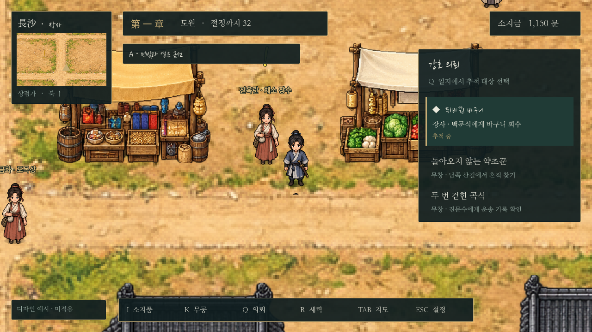
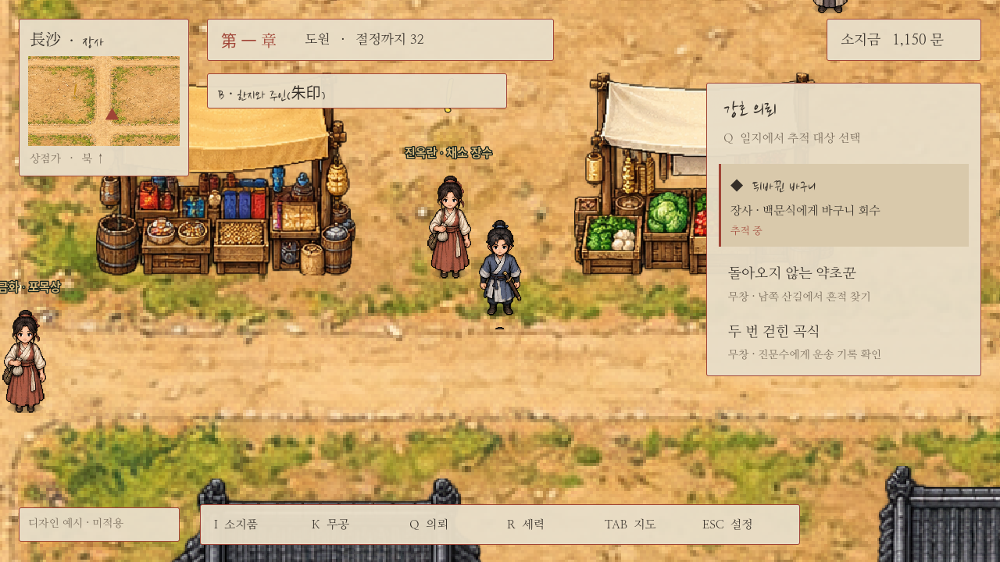

# UI 개선 비교 시안

현재 장사 탐험 장면 위에 구성한 **미적용 시안**이다. 화면의 의뢰/잔액/성장 수치는 배치 예시다. 주인공·지도·도트 미술과 무협 서체를 유지하면서 정보의 크기·여백·정렬·색 대비를 정리했다. 실제 게임의 UI 전체 교체는 사용자가 방향을 고른 뒤 진행한다.

## A · 먹빛과 옅은 금선

먹빛 바탕, 옅은 금색 경계, 짧은 정보 묶음. 배경과 글자의 대비가 좋아 가독성을 우선하는 방향이다. 현재 추적만 강조하고 다른 지역의 의뢰는 보조 정보로 낮춘다. 아래에는 단축키를 정렬한다.

[이미지 파일](https://github.com/UTopia0525/-/blob/main/godot/screenshots/ui-concept-ink-gold.png)

## B · 한지와 붉은 인장

한지색 바탕, 짙은 먹색 본문, 주홍색 강조. 의뢰를 적어 둔 강호행록 같은 방향이다. A와 같은 배치를 사용하므로 색채/명암 차이를 비교할 수 있다. 최종 적용 시 밝은 배경에서의 대비와 인벤토리·대화·전투 화면까지 함께 검토해야 한다.

[이미지 파일](https://github.com/UTopia0525/-/blob/main/godot/screenshots/ui-concept-paper-seal.png)

두 안 모두 이름·짧은 제목만 붓글씨, 긴 목표/숫자/조작은 명조체다. 실제 구현 단계에서는 긴 의뢰명과 큰 글자 설정, 해상도별 안전 영역, 마우스 하이라이트/키보드 포커스, 지도와 대화의 겹침을 다시 확인한다.
