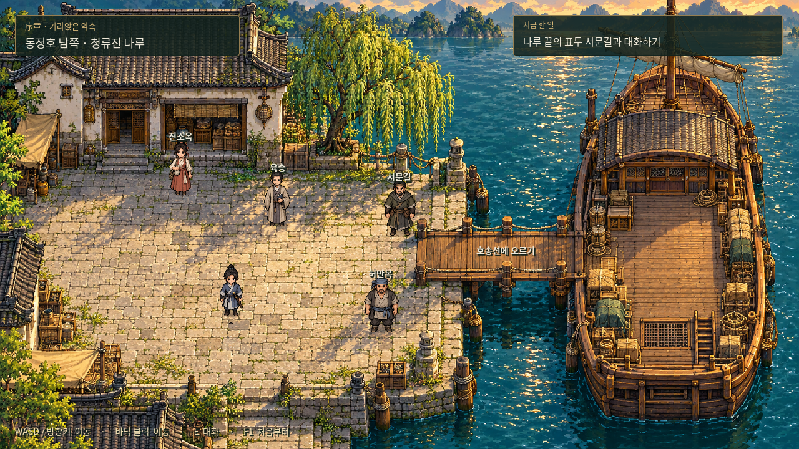
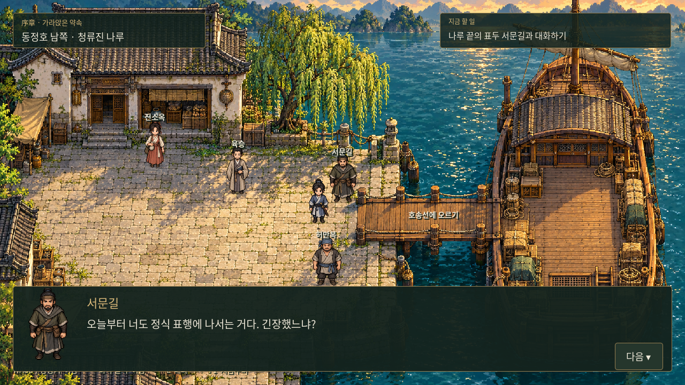
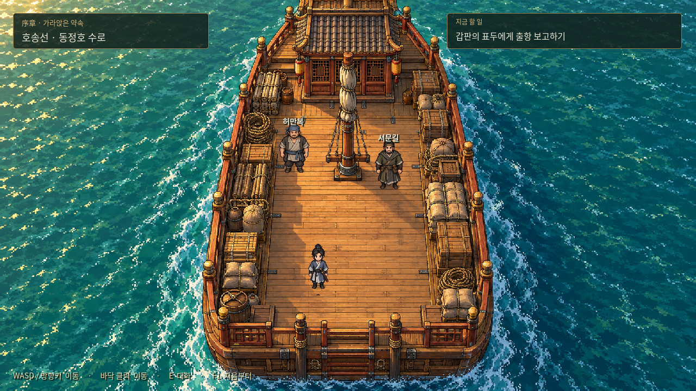
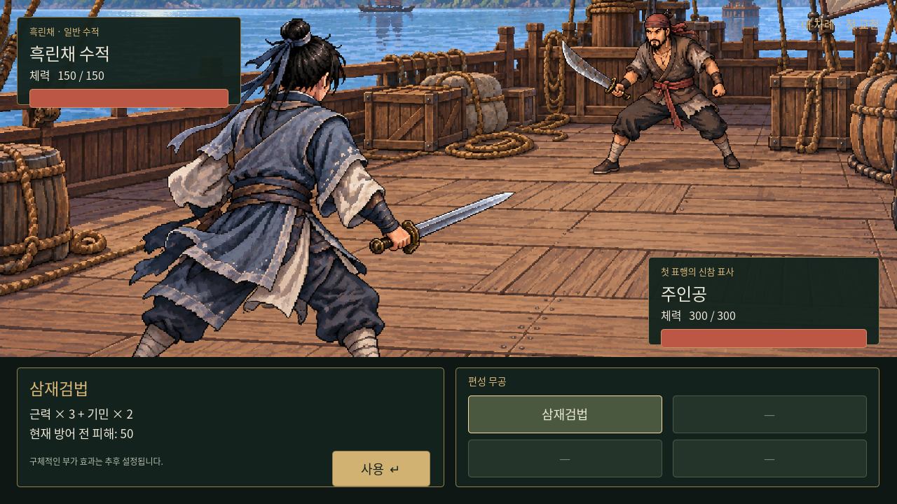

# Godot 4 · 0장 「가라앉은 약속」

기존 브라우저 데모와 별개로 만든 **Godot 네이티브 프로젝트**입니다. 사용자가 가장 아쉬워한 탐험 미술을 우선 개선했습니다. 단순 도형 맵을 새 나루터·갑판 배경과 방향별 캐릭터 스프라이트로 교체했고, Godot의 물리 이동·충돌·길 찾기·대화 UI·턴제 전투를 연결했습니다.

현재 범위는 **출항 전 인사 → 승선 → 갑판 보고 → 흑린채 첫 전투 → 침몰 → 귀물/구조 선택 → 표국 해체 → 장사 항구 인도/실패 보고 → 자유 탐험**입니다. 귀물 인도 보수는 3,000문이며 구조 경로는 해당 보수가 없습니다. [0장 전체 진행·저장 안내](../docs/story/chapter-00-implementation.md).

## 프로젝트 업데이트 — 2026-10-23

- 주인공을 **4방향×4프레임 걷기 애니메이션**으로 변경했습니다. 정지·대화·벽 충돌 때에는 방향별 정지 자세로 돌아갑니다. [애니메이션 자산 안내](assets/animation/README.md).
- **상황별 60초 반복 BGM 5곡**을 별도 파일로 저장하고 자동 전환·교차 페이드·M키 음소거를 연결했습니다. [곡 목록과 음악 파일](assets/music/README.md).
- 이번 변경은 기존 프로젝트의 소스·자산 업데이트입니다. 새 데모 배포본·EXE·화면 캡처를 만들지 않았습니다.

## 카메라 이동 방식

- **맵 안쪽:** 캐릭터의 몸 중심을 화면 중앙에서 추적하며 배경이 이동합니다.
- **맵 가장자리:** 해당 방향의 카메라 이동이 멈추고 캐릭터가 화면 안에서 움직입니다. 왼쪽 끝에서는 가로 이동만 멈추고, 세로 방향에 여유가 있으면 세로 추적은 계속합니다.
- **UI:** 목표·대화창·전투 화면은 별도 `CanvasLayer`에 고정되어 카메라와 함께 움직이거나 확대되지 않습니다. NPC 이름과 대화 가능 표시는 월드에 남겨 인물과 함께 이동합니다.
- **맵 전환:** 새 위치로 즉시 카메라를 맞추며, 이전 맵에서 새 맵으로 길게 화면이 흘러가지 않습니다.
- **조작:** WASD/방향키 이동을 유지하며, 클릭 이동도 화면 좌표를 월드 좌표로 변환합니다.

현재 맵은 1280×720으로 창과 같은 크기이므로, 기존 맵에서도 추적이 보이도록 탐험 배율을 **1.5배**로 설정했습니다. `scripts/exploration.gd`의 `camera_zoom`에서 바꿀 수 있습니다. 배율을 1로 하면 현재처럼 한 화면에 들어가는 작은 맵에서는 카메라가 고정되는 것이 정상입니다.

`map_bounds`는 맵의 실제 월드 크기이며 카메라 제한과 길 찾기 격자의 범위를 정합니다. 앞으로 넓은 맵을 추가할 때 배경·통행 영역·NPC 배치와 함께 이 값을 설정하면 같은 추적 방식을 사용할 수 있습니다. 이번 작업에서 기존 맵의 면적을 늘리거나 새 데모 배포본을 만들지는 않았습니다.

## 실제 Godot 실행 화면

아래 화면은 첫 Godot 버전의 기존 캡처입니다. 이번 애니메이션·음악 업데이트 후 새로 캡처한 화면은 아닙니다.

아래는 배경 원본만 보여 주는 이미지가 아니라 Godot에서 프로젝트를 실행해 캡처한 화면입니다.









## Windows에서 실행

1. [Godot 공식 Windows 다운로드](https://godotengine.org/download/windows/)에서 **Godot 4.6 이상 Standard 버전**을 받습니다. 이 프로젝트는 GDScript를 사용하므로 .NET 버전이나 C# 설치는 필요하지 않습니다.
2. 받은 ZIP을 원하는 폴더에 풀고 Godot 실행 파일을 실행합니다.
3. 프로젝트 저장소를 업데이트합니다. PowerShell에서:

   ```powershell
   cd C:\Users\PC\murim-rpg
   git pull
   ```

4. Godot 프로젝트 관리자에서 **가져오기 / Import**를 누릅니다.
5. **`C:\Users\PC\murim-rpg\godot\project.godot`**을 선택하고 열기 / 편집을 누릅니다.
6. 처음에는 이미지 가져오기가 끝날 때까지 기다립니다. 그다음 **F5** 또는 우측 상단의 실행 ▶ 버튼을 누릅니다.
7. **표행 시작**으로 전체 도입을 플레이하거나 **전투만 체험**을 선택합니다. 실행 종료는 **F8**입니다.

Godot 4.6.3 Standard / Compatibility 렌더러에서 확인했습니다. 현재는 **편집기에서 실행하는 프로젝트**이고 Windows 독립 실행 EXE를 배포한 것은 아닙니다. GitHub 파일 미리보기에서는 실행되지 않습니다.

## 조작과 진행

| 조작 | 기능 |
| --- | --- |
| WASD / 방향키 | 이동 |
| 이동 가능한 바닥 클릭 | 길을 찾아 이동 |
| F | 가까운 인물과 대화·다음 대사·승선 |
| 무공 버튼 클릭 | 설명 미리보기 |
| 사용 버튼 / 선택 후 Enter | 무공 실행 |
| M | 배경음악 끄기/켜기 |
| F1 | 타이틀부터 다시 시작 |

나루터 오른쪽의 **서문길**과 대화한 뒤 오른쪽 널빤지의 **호송선에 오르기** 지점으로 이동합니다. 갑판에서 다시 서문길에게 보고하면 습격과 첫 전투가 이어집니다. 진소옥·허만복·육승과의 대화는 선택 사항이며 보상이나 피해 분기가 없습니다.

## 변경하지 않은 전투 설정

- 주인공 스탯 각10, 체력300. 삼재검법의 방어 전 피해50.
- 초기 적 기준안은 근골5·체력150.
- 피해 공식은 `max(0, 전체 피해 - 근골) × 100 / (100 + 근골)`.
- 전투마다 최상의 컨디션으로 시작. 탐험 화면에는 체력 표시 없음.
- 우측 하단의 사전 편성4칸 중 삼재검법1칸, 나머지3칸은 비활성.
- 클릭으로 설명을 보고 실행을 확정. 미정인 무공 부가 효과는 추가하지 않음.

브라우저 데모와 마찬가지로 **적 공격40·소수점 버림·주인공 선공·번갈아 행동·명중 확정·별도 사용 버튼**은 임시 구현입니다. 네 번의 공격과 세 번의 반격 후 주인공 체력219로 승리합니다. 전체 게임 규칙으로 자동 확정하지 않습니다.

## 미술과 구현의 현재 한계

- 나루터·갑판·캐릭터는 새로 생성한 시안 자산입니다. 최종 인물 디자인이나 미술 스타일의 채택을 뜻하지 않습니다.
- 탐험 맵은 현재 **통짜 배경 그림 + 이동/충돌 영역**입니다. 재사용 가능한 TileMapLayer 타일셋을 완성한 것은 아닙니다.
- 주인공은 네 방향 걷기 프레임과 정지 자세를 지원합니다. 검격·피격 애니메이션·효과음·파티클·물결 애니메이션은 후속 작업입니다. BGM은 합성 악기로 제작한 5곡을 사용합니다.
- NPC와 주인공은 발 위치 기준으로 정렬하지만, 건물·버드나무는 배경에 합쳐져 있어 뒤로 가려지는 전경 레이어는 아직 없습니다. 임시 충돌로 이동 범위를 제한했습니다.
- 현재 PC 키보드·마우스용입니다. 모바일 UI, 저장·불러오기, 성장, 무공 편성 편집, 아이템, 패배 연출은 이번 범위에 없습니다.
- 나루 이름·인물 이름·대사는 이전 데모의 임시 연출이며 확정 인물 설정에 전투 수치를 부여하지 않았습니다.
- 한글은 Windows의 맑은 고딕 / macOS 및 Linux의 대응 시스템 글꼴을 사용합니다. Linux에서는 Noto CJK 계열 설치가 필요할 수 있습니다.

## 구조

```text
project.godot              프로젝트 시작 파일
scenes/main.tscn           도입·대화·전투 전환
scenes/exploration.tscn    나루터·갑판 탐험
scenes/player.tscn         CharacterBody2D 플레이어
scenes/battle.tscn         별도 턴제 전투
scripts/main.gd            진행·대화·화면 연결
scripts/exploration.gd     Area2D 상호작용·충돌·AStarGrid2D 길 찾기
scripts/player.gd          네 방향 이동·걷기 프레임·정지 자세
scripts/follow_camera.gd   중앙 추적·맵 경계 제한·배율
scripts/music.gd           5곡 반복 재생·상황 전환·교차 페이드
scripts/battle.gd          무공 설명·실행·피해·턴 처리
scripts/rules.gd           전투 계산과 데모 임시값
scripts/ui.gd              공통 UI 구성
assets/                   탐험 배경·캐릭터·전투 배경
tests/                    진행 및 전투 검사·캡처 도구
```

기존 브라우저 데모는 `../demo/`에 남겨 두었습니다. 새 작업은 이 Godot 프로젝트를 기준으로 이어갈 수 있습니다.

## 개발용 검증

Godot 실행 파일을 명령줄에서 사용할 수 있다면 저장소 루트에서:

```sh
godot --headless --path godot --editor --import --quit
godot --headless --path godot --script res://tests/smoke.gd
godot --headless --path godot --script res://tests/camera.gd
```

진행 검사에서는 경지 경계값·클릭 이동·물리 충돌·승선·습격 전환·무공 미리보기·연속 입력 방지·4회 공격 승리·재전투 체력 회복·처리 중 재시작·걷기 프레임 전환·음악 상황 전환과 반복·음소거를 확인합니다. 별도 카메라 검사에서는 중앙 추적·네 모서리 제한·고정 UI·큰/작은 맵 크기·맵 전환·전투 화면 분리를 확인합니다.

실제 렌더링 화면을 갱신하려면 그래픽 디스플레이가 있는 환경에서:

```sh
godot --path godot --script res://tests/capture.gd
```

`.godot/`는 로컬 생성 캐시이므로 Git에 포함하지 않습니다. 공개되지 않은 제작자 메모도 포함하지 않습니다.

## 공용 대화 일러스트와 발언자 표시

[엑스트라 일러스트 6종](assets/portraits/extras/README.md)은 성별·연령별 투명 배경 반신 초상화이다. 대화 참여자를 모두 화면에 남기고 발언자만 원래 밝기, 청자는 어둡게 표시한다. 전용 초상화가 있으면 우선 사용하며, 주인공은 [전용 초상화](assets/portraits/player/README.md), 나머지 0장 인물들은 공용 초상화를 임시 사용한다. 인물 등록·교체는 `scripts/dialogue_portraits.gd`를 따른다.

검증: `godot --headless --path godot --script res://tests/dialogue.gd`

## 장사 자유 탐방

타이틀에서 **장사 자유 탐방**을 선택하면 6144×4096 크기의 도시와 성밖 농촌을 걸어볼 수 있다. WASD/방향키·클릭 이동을 사용하고 TAB으로 전체 지도와 현재 위치를 확인한다. 나루·시장·객잔·공방·주거지·관아 앞·농촌을 연결했으며, 상점 메뉴·퀘스트·실내는 아직 추가하지 않았다. [전체 맵과 이용 안내](assets/maps/changsha/README.md).

검증: `godot --headless --path godot --script res://tests/changsha.gd`

장사 탐험 HUD는 주변 지형·플레이어 방향·NPC 위치·구역명을 담은 미니맵으로 갱신했다. 4개 세부 구역 배경과 NPC 발끝 정렬·지붕 가림을 적용한 [최신 시장 화면](screenshots/changsha-market-ui-revised.png)을 참고한다.

## 0장 후반부 대화 원고

[0장 전체 대화 원고](../docs/story/chapter-00-dialogues.md)에 침몰·귀물/구조 선택·양쪽의 후회·표국 해체·인도/실패 보고·장사 입성까지 작성했다. 귀물 인도 보수는 3,000문이며 구조 경로는 해당 보수를 받지 않는다. 이 원고의 대사·분기·소지금·항구 도착을 실제 게임에 연결했다. 마지막 대화는 장사 항구에서 진행하고 이후 조작을 재개한다. 0장 완료 체크포인트는 타이틀의 ‘0장 이후 이어하기’로 복원한다. 상세 범위는 [구현 안내](../docs/story/chapter-00-implementation.md)를 따른다.

분기 검증: `godot --headless --audio-driver Dummy --path godot --script res://tests/prologue.gd`. 실제 양쪽 경로 캡처: `godot --audio-driver Dummy --path godot --script res://tests/capture_prologue.gd`.

## 1장 시작 연결

0장 끝 항구 독백 뒤 포목상이 바로 말을 건다. 옷감 전달 의뢰를 자동 수락한 후 화면 중앙에 제목 없이 **1장**을 한 번 표시하고 이동을 넘긴다. 첫 의뢰 목표는 미니맵으로 안내한다. 저장을 불러와도 대화와 장 표시를 반복하지 않으며 이전 0장 완료 저장도 새 도입으로 이어진다. 상세 범위는 [1장 도입 안내](../docs/story/chapter-01-intro.md)를 따른다.

## 설정에서 여러 시점 저장

오른쪽 위 **설정 · ESC**에서 저장/불러오기를 선택해 수동 슬롯 10개를 사용할 수 있다. 대화 도중과 분기 선택 직전도 저장하며, 다른 슬롯에 선택 이후의 진행을 남길 수 있다. 설정 중 게임은 멈추고, 덮어쓰기·불러오기에 확인 창을 표시한다. 공격 연출/장 표시 중에는 메뉴를 닫아 연출을 마친 뒤 저장한다. 기존 자동 체크포인트는 별도로 유지한다. [저장 항목·사용 방법·PC 로컬 파일 경로](../docs/systems/save-slots.md)를 참고한다.

## 내기 전투 자원

내기 상한은 500, 전투 시작 보유량과 턴 회복량은 내공과 같다. 첫 턴에는 시작량만 지급하고 다음 주인공 턴부터 회복한다. 체력 아래 내기와 회복량을 표시하고 저장/불러오기에 잔량을 보존한다. 삼재검법의 비용은 아직 미정이며 새로운 공격/방어 기술의 구체 비용은 추후 정한다. [상세 규칙과 검증](../docs/systems/inner-qi.md).

## 삼재검법과 상위 초급 무공 데이터

삼재검법은 근력×3+기민×2, 내기10으로 확정해 실행에 적용했다. [공격 무공10종](../docs/martial-arts/basic-attacks.md)을 추가 데이터로 작성했으며 개별 스탯/총합 학습 조건과 비용을 갖춘다. 획득 방법은 미정이고 주인공에게 자동 지급하거나 신규 무공 버튼을 장착하지 않는다.

무기 사용 조건: 삼재검법을 포함한 검법은 검, 도법은 도, 창법은 창 장착이 필요하다. 불일치하면 미리보기만 가능하고 실행·내기·턴 소모를 막는다. 권법·장법은 현재 특정 무기를 요구하지 않는다. 튜토리얼은 검 장착으로 시작하며 구체 무기 아이템·장비 화면은 추후 추가한다.

## 무기 이름과 등급 보정

새 플레이는 부가 효과 없는 무문철검을 장착한다. 성장용 검/도/창을 각3등급씩 데이터로 추가했고, 검은 공격+피해 감소, 도는 공격, 창은 창법 내기 절감으로 구분했다. 기존 전투에 보정 계산과 무기 ID 저장을 연결했으며 신규9종은 자동 지급하지 않는다. 획득/교체 UI와 가격은 미정이다. [무기 체계와 수치표](../docs/systems/weapons.md).
