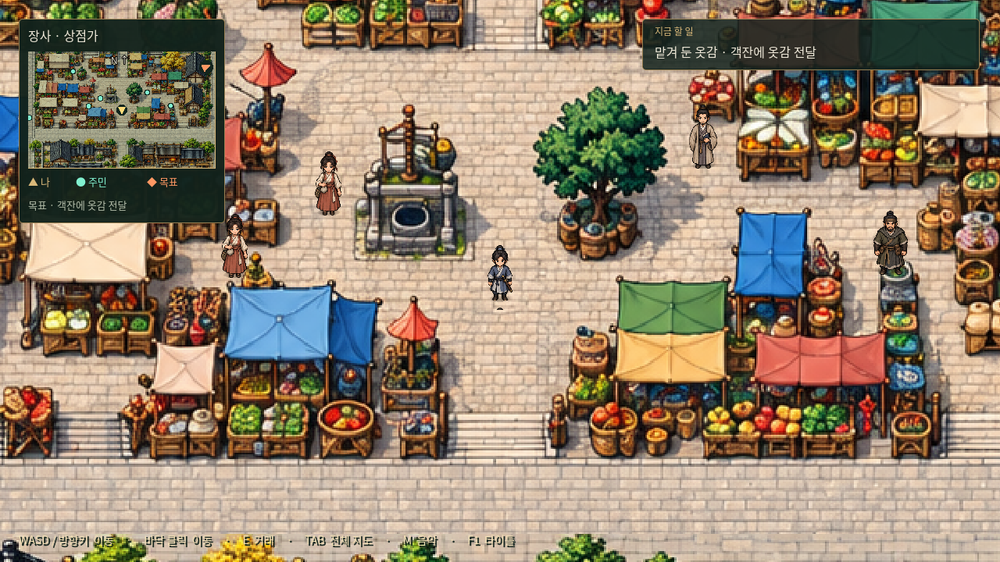
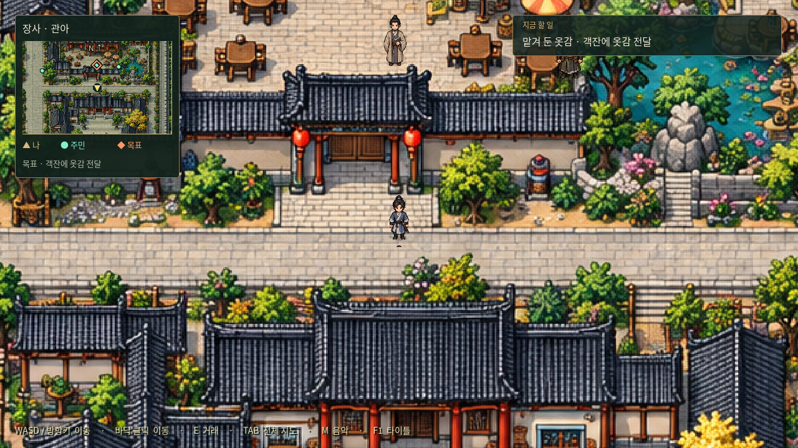

# 장사 — 자유 탐험 도시 맵


명 초기 호광의 장사와 상강 수운을 모티프로 만든 게임용 가상 배치다. 실제 1390년 장사의 성곽·건물 위치를 복원한 지도는 아니다. 서쪽은 상강 나루, 동쪽은 성문 밖 논밭과 농가로 구성했다.

## 규모와 구성

- 게임 내 크기: **6,144 × 4,096**. 1,536 × 1,024는 배치 기준 좌표이며, 실제 배경은 `detail/`의 1,536 × 1,024 이미지 4개를 구역별로 연결해 표시한다. 기존 도트 탐험 미술과 어울리도록 AI 이미지 생성 도구로 제작했다.
- 나루터·하역장, 장시·상점가, 객잔·찻집 거리, 관아 앞, 공방 거리, 주거 골목, 우물·사당 정원, 동문 밖 농촌을 한 장으로 연결한다.
- 동서 대로·남북 대로와 여러 골목을 통해 돌아다니며, 성문을 통해 농촌까지 걸어서 이동한다. 이동 속도 180 기준 긴 대로를 가로지르는 데 약 30초, 골목과 마당을 탐방하면 수 분 규모다.
- 생활 풍경용 주민·상인·농민 30명을 길과 마당에 배치했다. 의뢰 9종의 기획은 후속 채택했으며, 아직 주민에게 수락·진행 기능을 연결하지 않았다.
- 지붕·노점·논·강물의 통행을 제한한다. 넓은 길과 마당 위주로 걸을 수 있으며 모든 주요 지점이 연결되어 있다.

## 실행과 확인

기존 Godot 프로젝트를 열어 F5 → 타이틀의 **장사 자유 탐방**을 누른다.

- WASD / 방향키: 이동. 바닥 클릭: 경로 이동.
- TAB: 전체 지도와 현재 위치, 구역명 표시. TAB / ESC: 지도 닫기. 지도 중에는 이동을 멈춘다.
- 카메라는 주인공을 따라가며 가장자리에서 고정된다. 화면 왼쪽 위에 현재 구역을 표시한다.
- M: 기존 일반 맵 BGM 끄기/켜기. F1: 타이틀로 돌아가기.


0장의 침몰 이후 진행은 아직 구현하지 않았으므로, 도시 탐방 진입점을 따로 제공한다. 0장 전투 뒤에 도시로 자동 이동하는 스토리 연결을 추가하지 않았다. 이번 작업은 기존 프로젝트 업데이트이며 별도 새 데모/EXE 배포본은 만들지 않는다.

## 다음 작업을 위한 자료

`layout.json`은 배경 원본 좌표로 작성한 시작점·통행 영역·장애물·구역·주민·주요 지점을 담는다. `world_size / art_size` 비율로 게임 좌표로 변환한다. 건물 내부·상점 거래·퀘스트·NPC 대사·보상·1장 진입 조건은 추후 추가한다. 현재는 외관과 외부 탐험만 가능하다.

도시 탐험 로딩: `scripts/exploration.gd`, 전체 지도: `scripts/city_overview.gd`, 진입 버튼: `scripts/main.gd`.

검증 명령:

```sh
godot --headless --path godot --editor --import --quit
godot --headless --path godot --script res://tests/changsha.gd
```

그래픽 화면을 사용할 수 있는 환경에서는 `godot --path godot --script res://tests/capture_city.gd`로 이 도시의 플레이·시장·안내 예시·전체 지도 캡처를 갱신한다.

## 채택한 초기 의뢰

[장사 초기 의뢰 9종](../../../../docs/quests/changsha.md)을 기획으로 채택했다. 「울타리 밖의 닭」은 제외한다. 의뢰인·관련 인물 14명의 배치는 완료했다. 실제 퀘스트 수락·대화·보상 기능은 추후 구현한다.

[9개 의뢰의 전체 대화 원고](../../../../docs/quests/changsha-dialogues.md)를 작성했다. 수락·보류·진행 중·완료·재방문 대사를 포함하며, 옷감 배달 → 식기 회수 → 농기구 전달만 연계한다. 나머지 여섯 의뢰는 독립이다. 아직 Godot 퀘스트 기능에 연결하지 않은 원고 단계다.

[최신 퀘스트 진행 규칙](../../../../docs/quests/quest-flow.md): 0장 이후 도시 입구의 혼잣말과 성안 진입으로 첫 세 개 도입 연계를 순서대로 자동 수락한다. 여섯 일반 퀘스트는 노란 느낌표 NPC와 대화해 받고, 조건 충족 후 노란 물음표 NPC에게 보고해 완료한다. 입성 이벤트·표식·수락 기능과 도입에 맞춘 실제 시작점 조정은 아직 구현하지 않은 기획이다.

[시장 안 플레이 화면 — 현재 UI 검토용](../../../screenshots/changsha-market-ui.png): 실제 Godot에서 시장에 주인공을 배치해 캡처했다. 현재 위치·탐방 안내·하단 조작법을 표시하며, 기획으로 정한 퀘스트 느낌표·물음표와 퀘스트 진행 기능은 아직 연결하지 않은 상태다.

## 선명도·NPC 배치·미니맵 수정

작은 배경 한 장을 확대하던 렌더링에서 4개 세부 구역을 표시하는 방식으로 변경했다. `layout.json`의 `detail_tiles`에 구역별 아틀라스 범위를 저장하며, 탐험 배율은 1.25에서 1.0으로 낮췄다. 배경 흐릿함은 캡처 압축 문제가 아니었다. 원본 `city.png`는 초기 배치 참고 자료로 유지한다. 화면·전체 지도·미니맵은 같은 세부 구역을 표시한다.

NPC 30명의 실제 발끝과 캐릭터 영역을 기준으로 재배치했다. 몸 전체가 지붕·노점과 겹치지 않도록 여유를 두고, 건물·나무·노점 그림을 발밑 깊이에 따라 다시 그려 캐릭터가 뒤에 있을 때 자연스럽게 가려지게 했다. 세부 배경에 맞춰 장애물·지점·주민 좌표도 보정했다.

왼쪽 위 위치 패널은 주변 지형·현재 구역명·금색 플레이어 방향 화살표·청록색 NPC 점을 담은 미니맵으로 교체했다. 미니맵은 이동에 따라 갱신되고 지도 가장자리에서는 범위를 제한한다. 클릭해도 캐릭터가 움직이지 않는다. 전투 화면에서는 탐험 HUD와 함께 숨긴다.


기존 `changsha-market-ui.png`는 변경 전 비교용 캡처다. 이번 수정 화면은 `changsha-market-ui-revised.png`를 기준으로 본다. `tests/capture_city.gd`는 나루 0장 캡처를 건드리지 않고 장사 기본 화면·시장 수정 화면·전체 지도만 갱신한다.

## NPC 길 중앙 회피·퀘스트 방향 안내

주민 30명을 가게·마당·골목 가장자리로 옮기고, 의뢰 원고의 14명을 식별 가능한 NPC ID로 등록했다. 미니맵에 추적 목적지의 주황색 마름모를 표시하며 범위 밖이면 가장자리 방향 화살표를 표시한다. TAB 지도에도 주민과 목표를 표시한다. [배치·안내 규칙과 구현 범위](../../../../docs/quests/quest-navigation.md)를 참고한다.

9개 의뢰의 목적지 데이터와 안내 API를 구현했으며, 수락·대화·보상 기능은 아직 연결하지 않았다. 아래 캡처는 옷감 전달 단계를 명시적으로 추적한 안내 예시다.




## 도시 공통 구역과 시설 NPC

모든 도시의 공통 6구역은 상점가·관아·무관·공방거리·객잔·주거구역이다. 장사는 하역·창고거리와 나루·성밖 농촌을 추가 구역으로 유지하고, 기존 남동쪽 건물과 마당을 무관으로 지정했다. 사당·정원은 무관 남쪽에 남긴다. 전체 지도와 구역 HUD에 무관을 표시한다.

상점가 장사꾼, 공방거리 장인, 무관 앞 교관에게 F키로 말을 걸면 인사 대화 후 시설 창을 연다. ESC 또는 돌아가기로 닫는다. 구체 거래 품목·가격·효과는 추후 결정하므로 비어 있고 실제 거래는 발생하지 않는다. [도시 공통 기준과 시설 연결](../../../../docs/cities/city-standards.md)을 참고한다. 검증은 `tests/city_services.gd`다.
