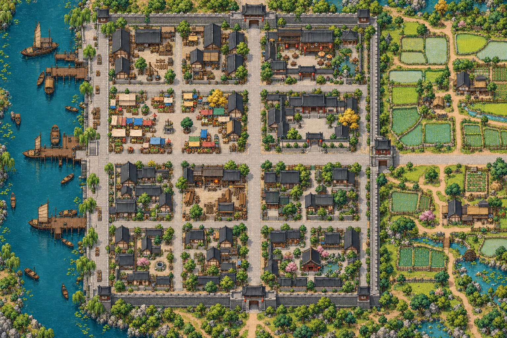
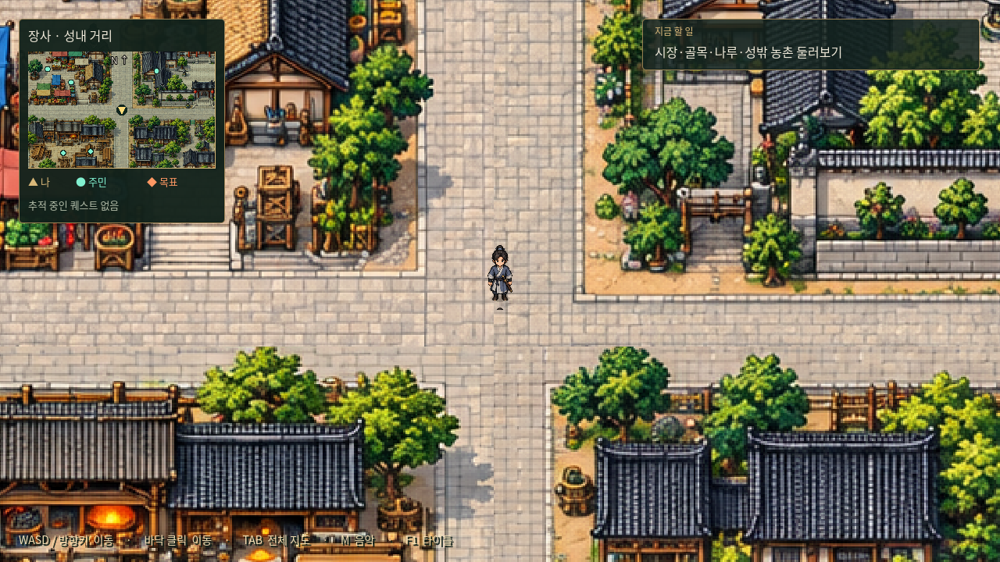
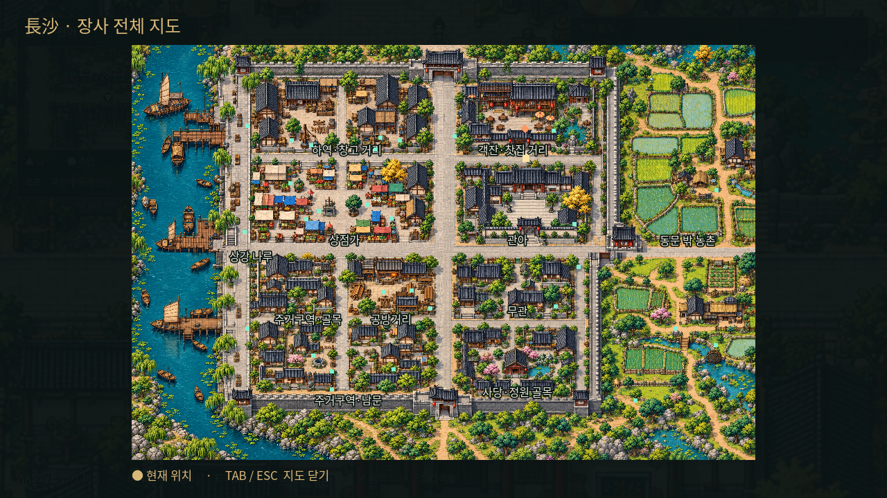

# 장사 — 자유 탐험 도시 맵



명 초기 호광의 장사와 상강 수운을 모티프로 만든 게임용 가상 배치다. 실제 1390년 장사의 성곽·건물 위치를 복원한 지도는 아니다. 서쪽은 상강 나루, 동쪽은 성문 밖 논밭과 농가로 구성했다.

## 규모와 구성

- 게임 내 크기: **6,144 × 4,096**, 배경 원본: 1,536 × 1,024 PNG. 기존 도트 탐험 미술과 어울리도록 AI 이미지 생성 도구로 제작했다.
- 나루터·하역장, 장시·상점가, 객잔·찻집 거리, 관아 앞, 공방 거리, 주거 골목, 우물·사당 정원, 동문 밖 농촌을 한 장으로 연결한다.
- 동서 대로·남북 대로와 여러 골목을 통해 돌아다니며, 성문을 통해 농촌까지 걸어서 이동한다. 이동 속도 180 기준 긴 대로를 가로지르는 데 약 30초, 골목과 마당을 탐방하면 수 분 규모다.
- 생활 풍경용 주민·상인·농민 30명을 길과 마당에 배치했다. 의뢰 9종의 기획은 후속 채택했으며, 아직 주민에게 수락·진행 기능을 연결하지 않았다.
- 지붕·노점·논·강물의 통행을 제한한다. 넓은 길과 마당 위주로 걸을 수 있으며 모든 주요 지점이 연결되어 있다.

## 실행과 확인

기존 Godot 프로젝트를 열어 F5 → 타이틀의 **장사 자유 탐방**을 누른다.

- WASD / 방향키: 이동. 바닥 클릭: 경로 이동.
- TAB: 전체 지도와 현재 위치, 구역명 표시. TAB / ESC: 지도 닫기. 지도 중에는 이동을 멈춘다.
- 카메라는 주인공을 따라가며 가장자리에서 고정된다. 화면 왼쪽 위에 현재 구역을 표시한다.
- M: 기존 일반 맵 BGM 끄기/켜기. F1: 타이틀로 돌아가기.





0장의 침몰 이후 진행은 아직 구현하지 않았으므로, 도시 탐방 진입점을 따로 제공한다. 0장 전투 뒤에 도시로 자동 이동하는 스토리 연결을 추가하지 않았다. 이번 작업은 기존 프로젝트 업데이트이며 별도 새 데모/EXE 배포본은 만들지 않는다.

## 다음 작업을 위한 자료

`layout.json`은 배경 원본 좌표로 작성한 시작점·통행 영역·장애물·구역·주민·주요 지점을 담는다. `world_size / art_size` 비율로 게임 좌표로 변환한다. 건물 내부·상점 거래·퀘스트·NPC 대사·보상·1장 진입 조건은 추후 추가한다. 현재는 외관과 외부 탐험만 가능하다.

도시 탐험 로딩: `scripts/exploration.gd`, 전체 지도: `scripts/city_overview.gd`, 진입 버튼: `scripts/main.gd`.

검증 명령:

```sh
godot --headless --path godot --editor --import --quit
godot --headless --path godot --script res://tests/changsha.gd
```

그래픽 화면을 사용할 수 있는 환경에서는 `godot --path godot --script res://tests/capture_city.gd`로 이 도시의 화면 두 장만 갱신한다.

## 채택한 초기 의뢰

[장사 초기 의뢰 9종](../../../../docs/quests/changsha.md)을 기획으로 채택했다. 「울타리 밖의 닭」은 제외한다. 의뢰인 배치의 세부 조정과 실제 퀘스트 기능 구현은 추후 진행한다.

[9개 의뢰의 전체 대화 원고](../../../../docs/quests/changsha-dialogues.md)를 작성했다. 수락·보류·진행 중·완료·재방문 대사를 포함하며, 옷감 배달 → 식기 회수 → 농기구 전달만 연계한다. 나머지 여섯 의뢰는 독립이다. 아직 Godot 퀘스트 기능에 연결하지 않은 원고 단계다.
