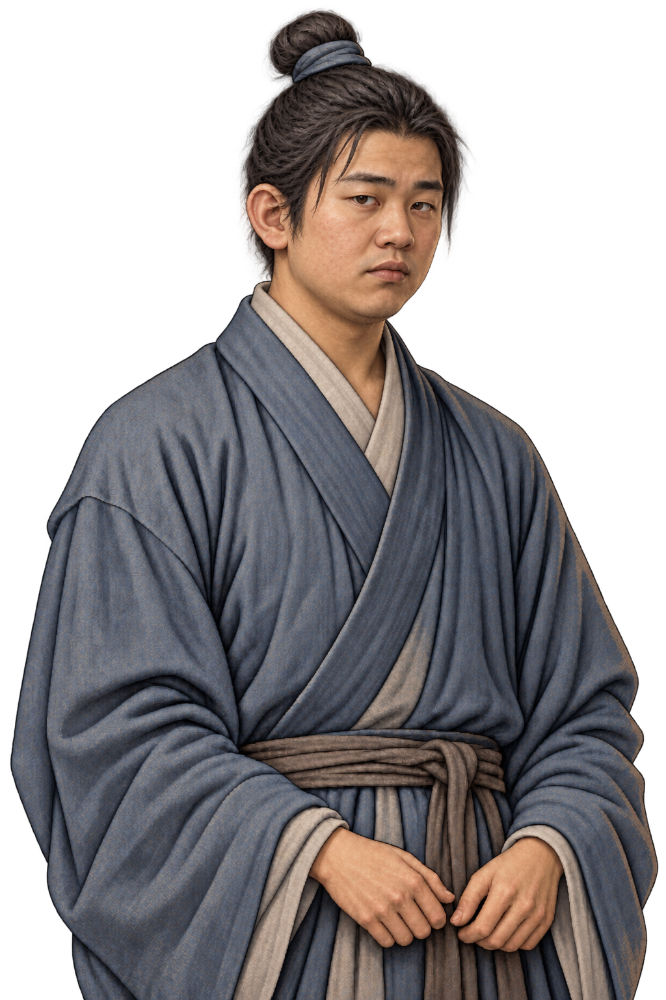
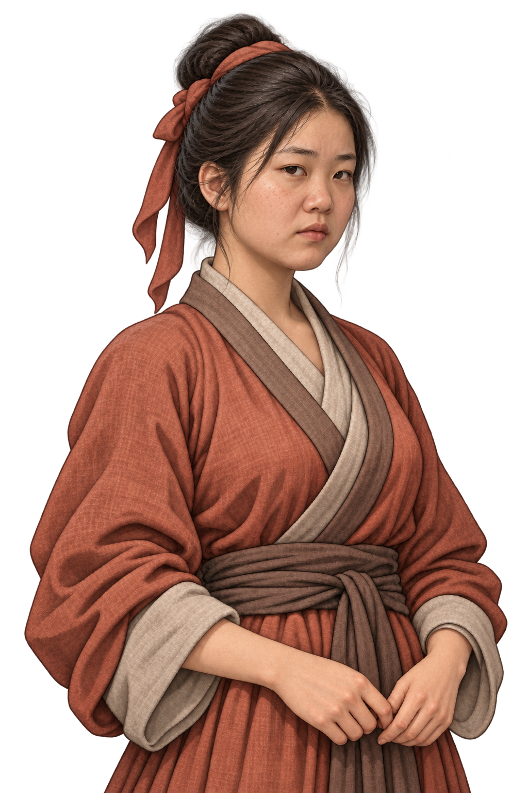
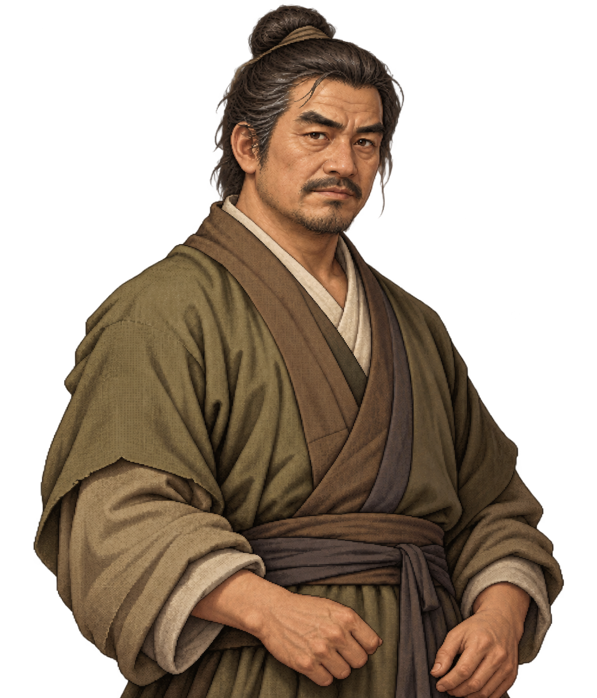
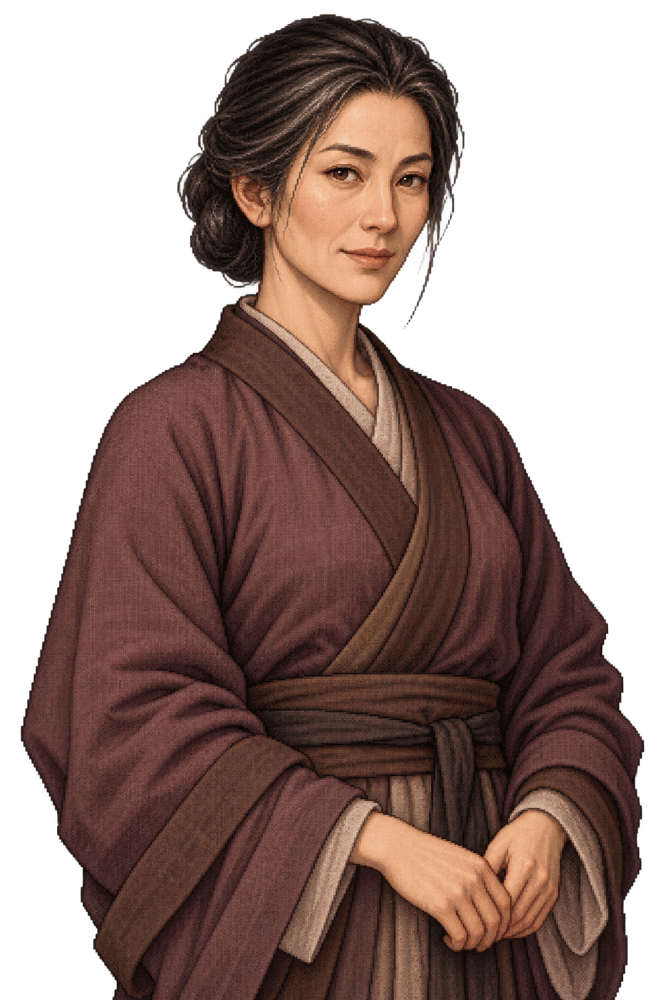
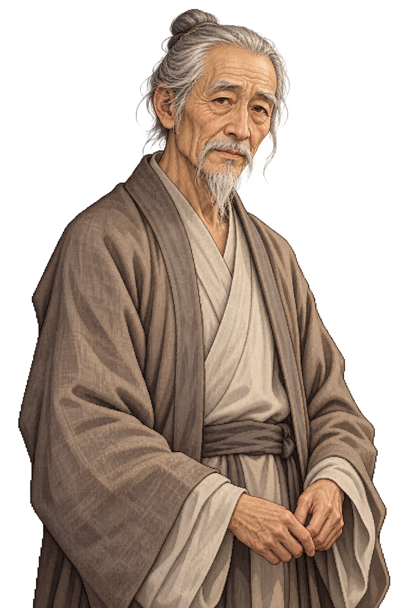
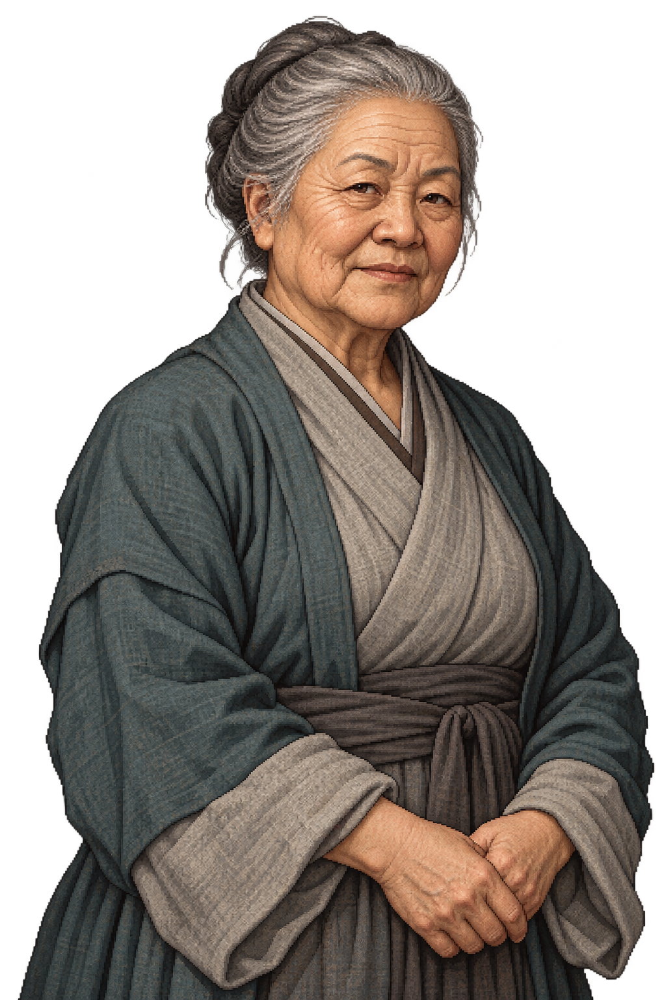
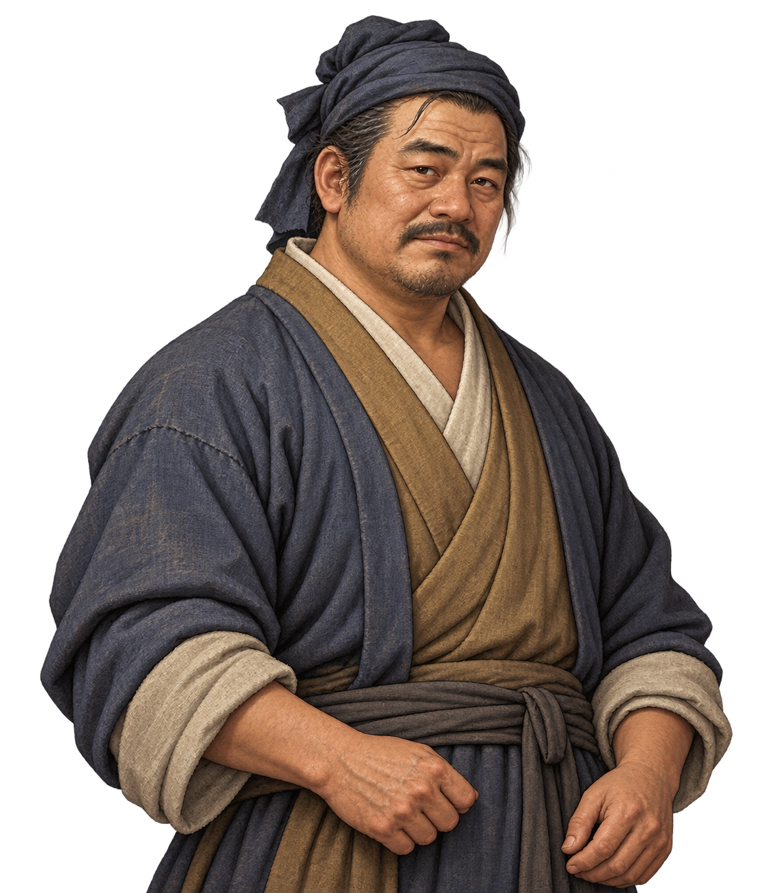
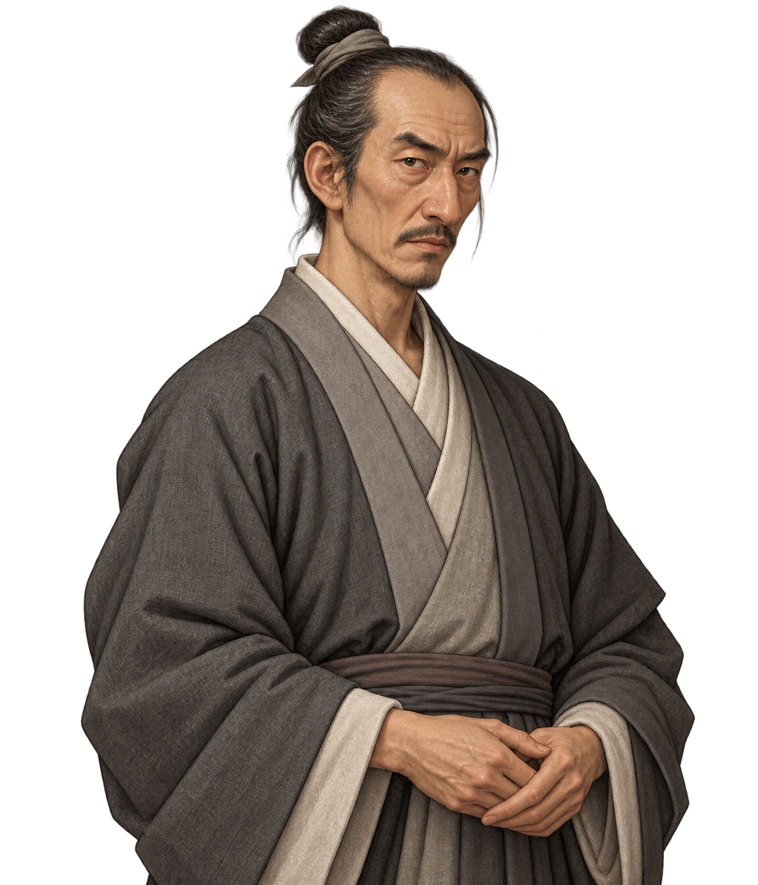
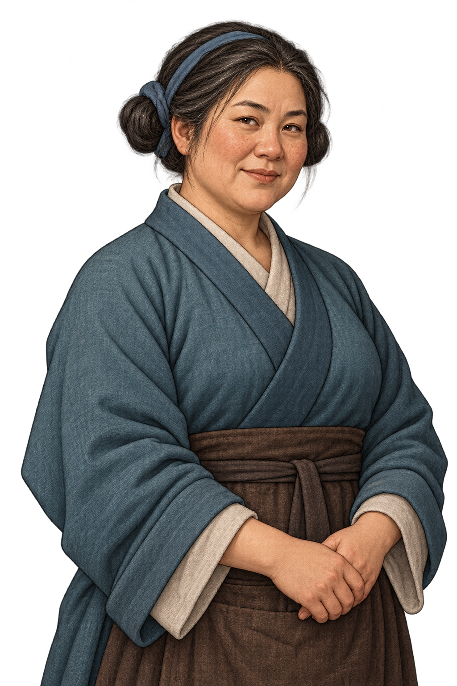
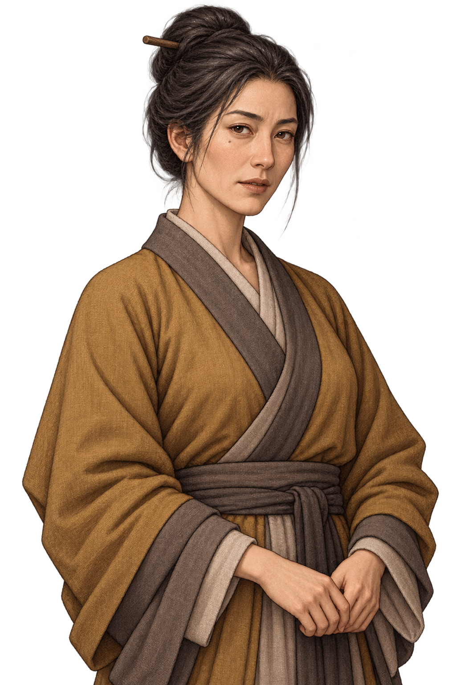

# 엑스트라 공용 대화 일러스트

명 초기 무협 배경의 일반 인물에게 반복 사용하는 투명 배경 PNG 10장이다. 특정 세력·직업이나 고유 인물을 의미하지 않으며, 성별·나이대는 초상화 선택용 분류이다. 청년은 성인이다. 인물별 전투 수치와 새 스토리는 추가하지 않았다.

| 연령대 | 남성 | 여성 |
| --- | --- | --- |
| 청년 |  |  |
| 중년 |  |  |
| 노인 |  |  |

기존 인물 초상화에 맞춘 도트 질감의 반신 일러스트이다. 각 연령대의 주름·체형·머리·얼굴형·평상복 색상을 달리하고, 모두를 미남·미녀로 통일하지 않는다. AI 이미지 생성 도구로 제작했다.

## Godot 대화 연결

`scripts/dialogue_portraits.gd`의 `ACTORS`에 인물 ID, 표시 이름, `extra` 분류를 등록한다. 전용 일러스트를 받으면 같은 항목에 `portrait: "res://...png"`를 넣는다. 로드할 수 있는 전용 초상화가 공용 분류보다 우선한다.

현재 0장에서는 육승에게 청년 남성, 서문길에게 중년 남성, 허만복에게 추가 남성 A, 진소옥에게 청년 여성을 임시 연결했다. 주인공은 [전용 초상화](../player/README.md)를 사용한다. 엑스트라 공용 그림 연결은 해당 인물의 전용 디자인을 확정한 것이 아니다. 다른 연령·성별 초상화도 즉시 사용할 수 있다.

대화 줄은 `[인물ID, 대사]` 형식이다. `say(대사목록, 종료콜백, 듣는인물ID목록)`에서 마지막 인수를 생략하면 주인공이 포함된다. 모든 발언자와 지정한 청자가 대화 처음부터 끝까지 함께 표시된다. 독백은 주인공 한 명만 표시된다. 발언 순서가 바뀌어도 자리와 그림은 유지되며, 발언자만 원래 밝기이고 나머지는 RGB 32%로 어두워진다. 한 대화에서는 서로 다른 인물에게 같은 공용 그림을 배정하지 않는다. 같은 분류가 겹치면 같은 성별의 다른 그림을 배정하며, 대화 도중 배정은 고정된다. 5명 이상은 여러 줄로 배치하며 대화 종료·전투 전환·재시작 시 모두 숨긴다.

공용 초상화만 추가한 것이므로 탐험용 도트 스프라이트의 외형과 걷기 애니메이션은 그대로이다.

## 남성 공용 얼굴 조정

청년·중년·노년 남성 공용3종의 얼굴을 조금 더 평범하고 생활감 있는 인상으로 수정했다. 청년은 둥근 얼굴과 부드러운 턱선·낮고 넓은 코·작은 눈, 중년은 무게감 있는 볼과 눈밑 피로·비대칭 표정 주름, 노년은 처진 눈꺼풀·자연스러운 잡티와 주름으로 개성을 구분한다. 그림의 해상도·질감은 낮추지 않으며 기존 복식과 자세는 유지한다.

육승은 청년, 정 포두와 일반 산적 등은 중년, 피해 농민은 노년 공용 그림을 사용한다. 포졸은 별도로 만든 [전용 초상화](../story/README.md)를 사용한다. 주인공의 전용 초상화 및 장인·교관·상인의 전용 초상화는 수정하지 않았다.

## 추가 공용 인물 — 2026-10-24

남성 2명과 여성 2명을 별도로 제작했다. 인물 설정이 확정된 것이 아니며, 얼굴형·머리·복식으로 구분하는 추가 공용 초상화다. 기존 그림은 보관한다.

| 남성 A | 남성 B | 여성 A | 여성 B |
| --- | --- | --- | --- |
|  |  |  |  |

허만복은 남성 A, 수령인은 남성 B를 기본 사용한다. 같은 대화의 다른 인물과 중복되면 공용 풀에서 빈 그림을 배정한다. [실제 대화 화면·검증](../../../../docs/systems/layered-city-and-conversation.md).

## 현재 기본 풀18장

이 폴더10장에 `../wuchang/`의8장을 합쳐 기본 NPC 이미지18장으로 지정했다. 일반 마을 NPC는 별도 지시 없이 이 풀을 재사용하며 새 그림을 자동 생성하지 않는다. 파일을 복사/이동하지 않고 `data/basic_npc_portraits.json`의 안정적인 ID로 참조한다. 인물 등록에는 `basic_portrait: "male_farmer"`처럼 지정할 수 있고 기존 `extra` 분류도 유지한다. [현재 제작 원칙](../../../../docs/characters/creation-guidelines.md).

## 공용 청년 남녀 교체 — 2026-10-25

기본 풀 갤러리4번 `male_young.png`와9번 `female_young.png`를 일반 주민에 맞는 평범한 인상으로 교체했다. 남성은 넓고 둥근 얼굴·짧은 턱·작은 눈·낮고 넓은 코·생활감 있는 피부, 여성은 둥근 볼·작은 눈·완만한 턱선·평범한 코와 입·자연스러운 피부 질감으로 구분한다. 청년 나이대, 기존 남색/적갈색 복식, 상반신 구도와 화풍은 유지한다.

같은 원본 경로를 교체했으므로 임소평·육승·고만복·조성우 등 남성 청년 공용 사용처, 진소옥·임소연 등 여성 청년 공용 사용처, 대화 중 중복 방지로 이 그림을 배정받는 일반 NPC에도 적용된다. 주인공·포졸·거래 인물의 별도 전용 그림은 변경하지 않았다. 기본 풀의18장 수와 저장의 인물ID/초상화ID는 유지한다. 기존 얼굴 프레이밍(눈높이/턱 길이)을 실제 대화 화면에서 확인한다.

대화창 비율 확인용 화면: [청년 남성](../../../screenshots/basic-npc-young-male-dialogue.png) · [청년 여성](../../../screenshots/basic-npc-young-female-dialogue.png). 화면 구성 검사이며 이야기의 인물 위치/진행은 변경하지 않는다. `basic_npc_portraits`, `dialogue`, `conversation_tools` 기존 검사를 통과했다.
