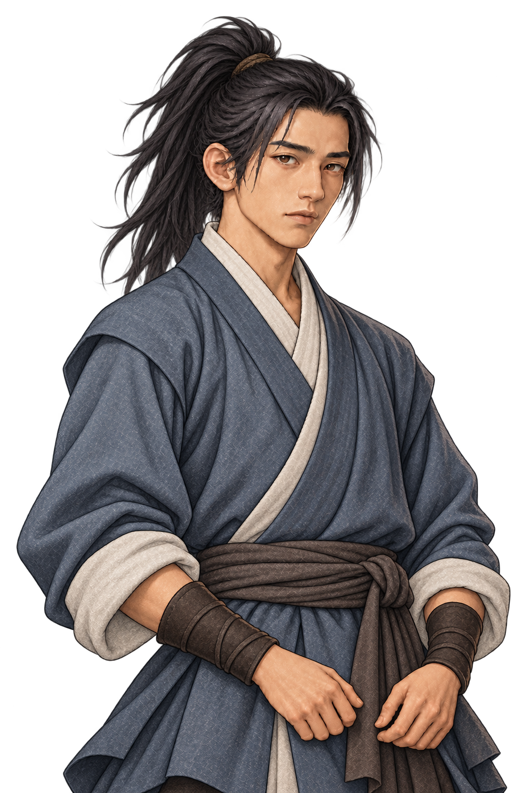

# 도원(陶遠) · 주인공 대화 일러스트

사용자 확정 이름은 도원(陶遠)이다. 내부 인물 ID는 `hero`를 유지한다.

사용자 지정 외형을 반영한 주인공/플레이어 전용 초상화이다.

- 젊은 남성, 기본 표정은 무표정.
- 향후 소속 없는 낭인이 될 주인공에 맞춰, 자유롭게 떠도는 여행자 분위기의 복식. 회청색 속옷 위에 느슨하게 걸친 짙은 겉옷과 어깨 천, 소박한 천 허리띠. 옷은 소탈하지만 해지거나 찢어지지 않는다.
- 넓은 챙의 삿갓을 살짝 뒤로 젖혀 착용하고, 대화 중 눈과 표정이 잘 보이게 한다. 삿갓 윗부분은 막힌 구조이며 상투는 모자 안으로 완전히 넣는다. 머리카락이 삿갓을 뚫고 올라오지 않는다.
- 무기는 플레이어가 추후 선택하므로 무기·칼집·장비를 그리지 않는다.
- 기존 대화 초상화와 어울리는 도트 질감 반신 일러스트, 투명 배경 PNG.

AI 이미지 생성 도구로 제작했다. `scripts/dialogue_portraits.gd`의 `hero.portrait`에 연결했으며 주인공에게 사용하던 공용 청년 남성 초상화를 대체한다. 발언 시 원래 밝기, 듣는 동안 어둡게 표시하는 규칙은 그대로 적용한다.

이 이미지는 대화용이다. 탐험·전투용 스프라이트는 별도로 유지하며 이름·성격·추가 배경·전투 수치를 확정하지 않는다.
