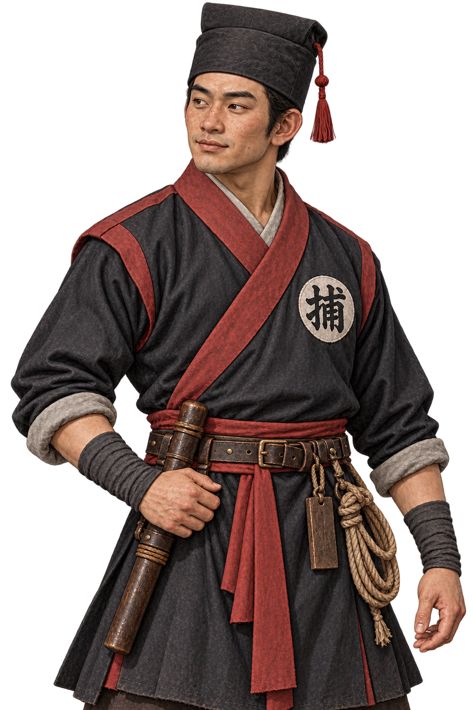
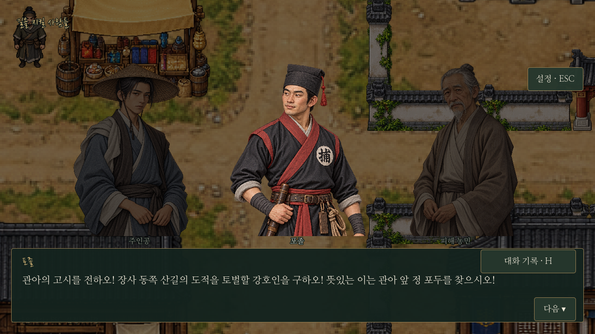

# 이야기 인물 대화 일러스트

## 포졸 · 현재 적용본

장사의 모집 소식을 전하고 토벌 집결·철수·귀환을 돕는 `bandit_messenger`의 현행 초상화다. 명 초기 관아 하급 차역의 실용적인 복식을 모티프로 검정·붉은색 관아 근무복을 디자인했다. 형태가 잡힌 검은 관모, 붉은 깃·어깨 테두리·허리띠, 가죽 장비띠와 단봉·포승줄·목제 패찰로 직무를 드러낸다. 가슴의 원형 ‘捕’ 표식은 게임에서 포졸을 빠르게 알아보기 위한 보조 표식이다. 청대 변발·관모나 조선 포졸의 모자, 고위 관원의 품계 흉배 대신 해당 인물의 낮은 직급에 맞춘 복식을 사용한다.

기존 얼굴의 투박하고 성실한 인상과 화풍을 유지하면서 일반 주민과 복식 차이를 키웠다. 이미지 생성 도구로 새 PNG를 제작했으며 픽셀 후처리는 하지 않았다. `data/portrait_framing.json`에 새 눈높이·얼굴 크기·왼쪽 기본 시선 기준을 등록해 주인공과 비율을 맞춘다. 기본 대화 방향으로 고개를 돌린 원본을 사용해 가슴 표식의 글자가 정방향으로 보인다.

`dialogue_portraits.gd`의 같은 인물ID가 새 파일을 가리키므로 기존 모집·집결·철수·귀환 대화 모두에 적용된다. 대사·진행·보상·전투 수치·주인공 그림은 바꾸지 않는다. 탐험 도트와 무창 포두 육정호의 그림은 기존 그대로다. 이전 `constable.png`도 원본 보관용으로 남겼다.

이 그림은 포졸 전용이며 기본 마을 NPC18장 목록에는 추가하지 않는다.

`tests/dialogue.gd`로 실제 새 이미지 연결·전체 프레이밍·좌우 시선·대화 저장 복원을 확인한다. `tests/basic_npc_portraits.gd`로 기본18장 구성을 확인하고 `tests/capture_constable_uniform.gd`로 기존 모집 대화를 캡처한다.
