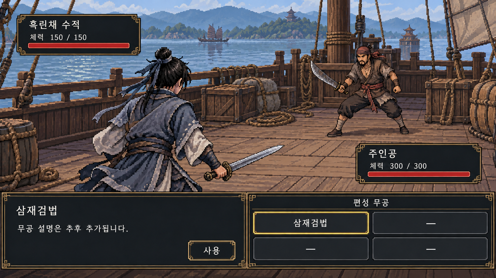

# 0장 전투 화면 프로토타입 v2

실행 가능한 게임이 아닌 전투 화면 구성 검토용 이미지입니다.

[원본 이미지 열기](chapter-00-battle-v2.png)

- 주인공: 왼쪽 아래, 등을 보이는 비스듬한 자세.
- 상대: 오른쪽 위에서 주인공과 대치.
- 오른쪽 아래: 사전에 편성하는 무공 슬롯 4개 (2×2).
- 초기 편성: 삼재검법 1개, 빈칸 3개. 빈칸은 사용할 수 없음.
- 습득 무공 중 전투 전에 4개를 편성하는 방식. 전투 중 교체 가능 여부는 미정.
- 시작 주인공: 다섯 스탯 각각10, 최대 체력300. 삼재검법의 방어 전 피해는 근력×3+기민×2.
- 화면의 튜토리얼 수적은 체력150의 초반 기준안을 사용함. 고정 네임드 인물의 수치가 아님.
- 각 전투는 최상의 컨디션으로 시작하며 체력은 전투 화면에서 표시함.

그림의 외형과 배경은 시안이며, 무공 비용·내력·행동 순서 등 미정 시스템은 표시하지 않았습니다.

## 무공 설명 확인

무공 슬롯을 클릭하면 즉시 공격하지 않고 왼쪽 패널에 해당 무공의 이름과 설명을 표시합니다. 다른 무공을 클릭하면 설명을 바꿔 확인할 수 있으며, 미리보기만으로 턴을 소모하지 않는 방향입니다. 빈 슬롯은 선택할 수 없습니다.

현재 시안은 왼쪽 설명 패널의 ‘사용’ 버튼을 눌러 실행하는 방식을 제안합니다. 별도의 실행 확정 조작은 검토용 제안이며, 구체적인 무공 효과와 미정인 비용·부가 효과를 추가하지 않았습니다. 설명은 ‘무공 설명은 추후 추가됩니다.’로 표시했습니다. 이 파일은 클릭 기능이 없는 이미지 시안입니다.

[이전 v1 이미지](chapter-00-battle-v1.png)
