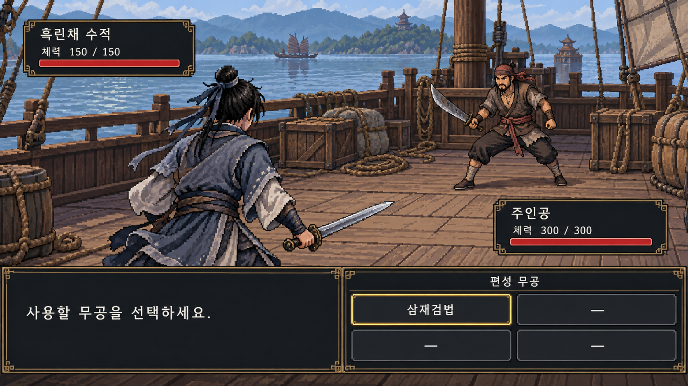

# 0장 전투 화면 프로토타입 v1

실행 가능한 게임이 아닌 전투 화면 구성 검토용 이미지입니다.

[원본 이미지 열기](chapter-00-battle-v1.png)

- 주인공: 왼쪽 아래, 등을 보이는 비스듬한 자세.
- 상대: 오른쪽 위에서 주인공과 대치.
- 오른쪽 아래: 사전에 편성하는 무공 슬롯 4개 (2×2).
- 초기 편성: 삼재검법 1개, 빈칸 3개. 빈칸은 사용할 수 없음.
- 습득 무공 중 전투 전에 4개를 편성하는 방식. 전투 중 교체 가능 여부는 미정.
- 시작 주인공: 다섯 스탯 각각10, 최대 체력300. 삼재검법의 방어 전 피해는 근력×3+기민×2.
- 화면의 튜토리얼 수적은 체력150의 초반 기준안을 사용함. 고정 네임드 인물의 수치가 아님.
- 각 전투는 최상의 컨디션으로 시작하며 체력은 전투 화면에서 표시함.

그림의 외형과 배경은 시안이며, 무공 비용·내력·행동 순서 등 미정 시스템은 표시하지 않았습니다.
