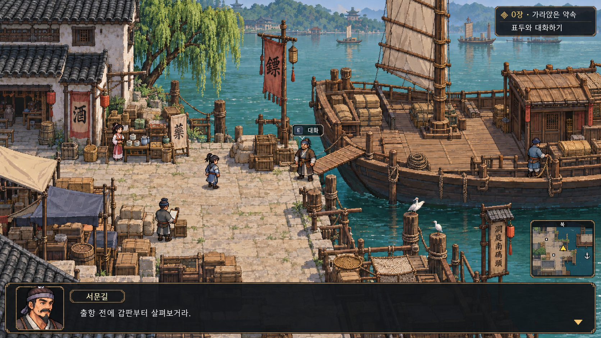

# 0장 탐험 화면 프로토타입

0장 「가라앉은 약속」의 출항 전 나루터 화면 시안입니다. 실제 실행 가능한 게임이 아닌, 화면 구성과 미술 방향을 검토하기 위한 이미지입니다.

[원본 PNG 열기](chapter-00-dock.png)

- 중앙: 주인공 이동, NPC와 호송선 상호작용 공간
- 우측 상단: 현재 목표
- 우측 하단: 미니맵
- 하단: 인물 초상화와 대화창

탐험과 별도의 턴제 전투 화면을 사용하는 구상입니다. 인물 외형·배경·문구는 시안이며 최종 게임 자산이 아닙니다.

## 전투 간 컨디션

각 전투는 최상의 컨디션으로 시작하며, 이전 전투의 체력 손실을 다음 전투로 이월하지 않습니다. 탐험 화면에는 체력을 표시하지 않고 전투 화면에서 표시합니다. 내력·상태 이상 등 세부 초기화 항목은 해당 시스템을 설계할 때 정합니다.
