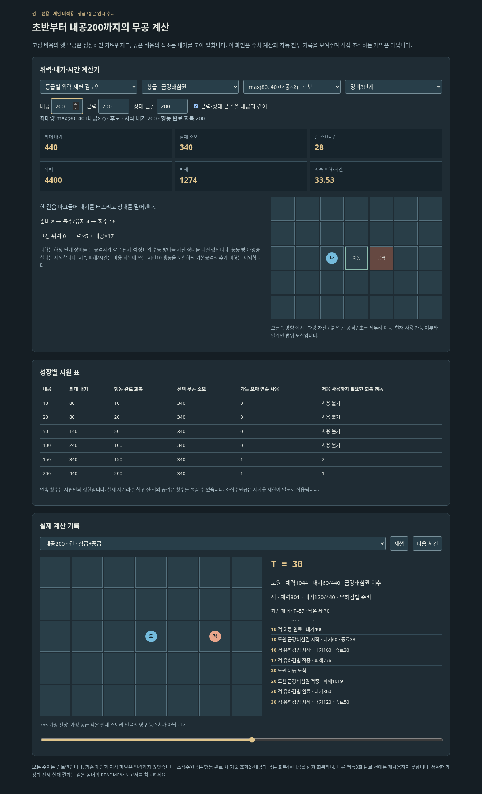

# 전 구간 무공·내기 성장 실험

**검토 전용. 기존 Godot 게임·저장·카탈로그를 변경하지 않는다.**

- [전체 계산·비용·위력·시간·전투 결과](../../docs/reviews/progression-combat-budget.md)
- `index.html`: 다운로드 후 브라우저로 연다. 내공0~200/근력/상대 근골/장비/상한식/무공을 바꿔 계산하고, 실제 기록을 재생한다. 직접 조작하는 게임은 아니다.
- `catalogue.json`: 기존16종 원본과 위력 재편 검토안, 테스트용 상급5종/절초2종. 기존 무공의 획득/전수 경로에 추가하지 않았다.
- `analytical.csv`: 단발 위력·피해·시간·비용·상한·충전·정확한 자원 순환 주기. 사거리 실패/능동 방어/회복용 기본공격의 추가 피해는 제외한다.
- `formula-results.csv`, `sensitivity-results.csv`, `crossmatch-results.csv`: 실패·동시 사망·시간초과를 포함한 모든 실행 결과.
- 각 `*-summary.json`: 사용/학습 불가 항목·집계·실행 코드 해시. `report-manifest.json`은 보고서 생성 당시 의존 엔진/결과의 해시다.



## 계산 가정

기준 후보는 `최대 내기=max(80,40+내공×2)`. 시작과 일반 행동 완료 회복은 내공 그대로다. 최대량은 양쪽 인물의 내공에서 각각 계산한다. 소모는 사용 시작에 지불한다. 무공별 가격은 고정이고 내공 상승 때문에 같은 기술의 비용이 올라가지는 않는다.

중급7종은 무림맹5종/쇄랑/조식을 포함한다. 테스트용 상급7종은 수치와 범위만 만들었으며 정식 습득 조건·미술·아이템·스토리·K편성 목록에 넣지 않았다. 실제 추가할 때 전용 미술/공통 범위 표시 규칙을 적용해야 한다.

기존 계수 유지안과 입문/하급/중급 계수 재편안을 따로 계산한다. 위력 재편은 **검토안이며 실제 하향 패치가 아니다.** 상급 창은 높은 고정 위력/낮은 성장 계수를 유지한다. 체력과 피해 방어식은 기존식을 유지한다.

기본공격·방어·이동은 비용0이며 행동 완료 때 내공만큼 회복한다. 대기는 회복하지 않는다. 조식은 행동 완료 때 기술 효과2×내공+공통 회복1×내공을 합친다. 다른 실제 행동3회 완료 후 재사용하며 대기는 재사용 진행에 세지 않는다. 이는 동시 시간 검토에서의 특수 효과 시점 해석이다.

최대량보다 비싼 기술이나 학습 조건이 안 맞는 하급 기술은 별도 잠금으로 기록한다. 절초 편성은 절초 자체 비용도 확인한다. 상급의 학습 경로는 미정이고 테스트 상태에만 주입했다. 초기0장/장사 외의 상대는 가상 동급 무인이다.

7×5/기본 이동3·5·2. 공격 방향 시작 시 고정, 일반 명중 경직/행동 취소/기민 보정/장애물 없음. 전진은 출수 첫2 후 공격, 후퇴는 출수 끝, 밀침은 명중 뒤 처리한다. 양쪽 같은 시각의 공격은 함께 적용한다. 검법의20% 수세는 출수부터 회수 끝까지, 기본방어/조식은 유지 구간에 적용한다.

자동 정책은 최적 탐색이 아니며 원래 검토의 왕복 추격 대기 보완을 양쪽에 사용한다. 권법의 일부 추격 교착은 원자료에 남았다. 고정 조건 승리 수를 사람의 승률/재미/최종 출시 균형으로 해석하지 않는다.

## 재현

Python3.10 이상, 외부 패키지 없이 저장소 루트에서:

```bash
python -m unittest discover -s prototypes/progression-combat-review -p test_progression.py -v
python prototypes/progression-combat-review/catalogue.py
python prototypes/progression-combat-review/benchmark.py --stage analytical
python prototypes/progression-combat-review/benchmark.py --stage formula
python prototypes/progression-combat-review/benchmark.py --stage sensitivity
python prototypes/progression-combat-review/benchmark.py --stage crossmatch
python prototypes/progression-combat-review/report.py
```

의존하는 앞선 두 검토 엔진은 별도 모듈로 읽어 메모리에서만 확장한다. 앞선 엔진 파일·기존 실험 결과·게임 데이터를 덮어쓰지 않는다. 테스트는 이 모듈 격리와 지원기 방어/회복/재사용 경계도 검사한다.
