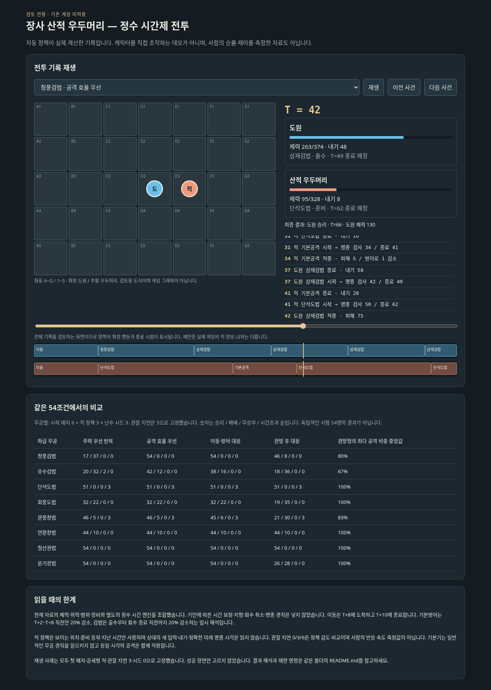

# 장사 우두머리 시간제 전투 검토

**검토용 독립 시뮬레이터다. 기존 Godot 게임에 새 전투를 적용하지 않는다.**

- [입력 조건·모든 결과·판단](../../docs/reviews/timed-combat-changsha.md)
- `index.html`: 다운로드한 뒤 브라우저로 연다. 설치·서버 없이 동작하는 실제 계산 기록 재생기다. 직접 조작하는 게임은 아니다.
- `results.csv`: 전체 시행의 승패·시간·체력·반복 비중. Excel로 열 수 있는 UTF-8 BOM 형식.
- `results.json`: 전체 결과·집계·원본 데이터/시뮬레이터 해시.
- `replays.json`: 고정된 대표 조건의 시간별 상태와 사건. 성공만 선별하지 않았다.



## 재현

저장소 루트에서 Python 3.10 이상으로 실행한다. 외부 패키지는 필요 없다.

```bash
python -m unittest discover -s prototypes/timed-combat-review -p test_simulate.py -v
python prototypes/timed-combat-review/simulate.py --suite
python prototypes/timed-combat-review/build_review.py
```

한 전투의 실제 사건만 출력:

```bash
python prototypes/timed-combat-review/simulate.py --art gwanpung --policy main_spam
```

## 임시 해석

- 시간은 정수 T. 준비/출수/회수를 겹쳐 계산한다. 동일 시각 양쪽의 입력은 같은 이전 상태를 보고 결정하며, 서로의 새 입력을 읽지 않는다.
- 현재 카탈로그 위력·공격 칸·전진/후퇴/밀침·장비·공통 체력/방어 공식을 Python으로 옮긴 검토 엔진이다. 기존 Godot 전투 엔진 자체를 실행한 결과와 구분한다.
- 일반 이동은 준비3/이동5/회수2, T+8 도착. 도착 후 명중 검사, 같은 시각의 공격은 함께 적용한다. 일반 피격은 준비를 자동 취소하지 않는다.
- 공격 방향은 사용 시작에 고정한다. 준비 중 추적·입력 취소·명중 경직·기민의 시간 보정·지형은 이번에 넣지 않았다.
- 청풍검법은 출수 첫2에 전진한 뒤 명중, 유수검법은 출수 시작에 명중하고 출수 끝에 후퇴한다. 진로가 도중에 막히면 이동만 실패한다. 같은 빈칸으로 동시에 진입하면 둘 다 이동하지 못한다.
- 기본방어는 준비2/유지6/회수2이며 유지 구간에만20% 감소. 검법의 기존20% 감소는 출수부터 자신의 회수 종료 직전까지 적용한다. 이 지속 방식은 검토용 추가 가정이다.
- 내기는 기존처럼 내공만큼 시작, 완료한 행동마다 내공만큼 회복, 최대500. 대기는 회복하지 않는다. 이동도 회복한다. 이것을 시간10마다 회복으로 바꾼 별도 민감도 검사도 포함한다.
- 자동 정책은 보이는 위치·준비/출수/회수 동작·방향·관찰한 경과 시간만 본다. 정확한 적 명중/종료 시간·내기·미래 이동 목적지·새 입력은 제공하지 않는다. 대응형은 빠른 동작/직선/회전 등 알려진 동작별 대표 준비 시간을 추정하며 완전 탐색 최적 정책은 아니다.
- 0/3/6의 관찰 지연은 자동 정책의 감도 검사다. 일시정지하며 플레이하는 사람의 반응 속도나 난이도와 동일하지 않다.
- 정책이 반복해서 이동하며 대치하는 경우 T=800에서 시간초과로 기록한다. 패배·무승부·교착도 제거하지 않는다.
- 관망형 정책은 적이 가까이에서 아직 행동을 시작하지 않았으면 시간2만큼 기다린 뒤 대응한다. 대기는 별도 무공이나 자원 회복 수단이 아니다. 적은 같은 관망·허초 정책을 사용하지 않으므로 관망형의 성적도 실제 사람의 난이도 보장이 아니다.

## 해석 주의

승리 수는 고정 조건의 결과이며 사람의 승률이 아니다. 다양한 행동 횟수도 재미 자체의 증거는 아니다. 같은 무공 반복이 유리한지, 방어를 선택할 이유가 생기는지, 교착이 발생하는지 점검하는 데 사용한다. 원본 수치를 결과에 맞춰 자동 조정하지 않는다.

다중 무공 비교는4칸 제한을 유지한다. 검은 삼재검법 칸을 유수검법으로 바꾸므로 단순히 다섯 번째 기술을 추가한 비교가 아니다. 도·창은 빈칸에 같은 무기의 다른 하급 무공을 넣는다. 맨손 두 무공 비교는 운기장법 학습 조건 때문에 내공 집중 분배로 바뀌므로 동일 능력치의 순수 기술 추가 효과로 해석하지 않는다. 두 번째 무공 비용350문은0장 귀물 보수500문을 받은 경우의 추가 지출로 본다.

기본방어 제외 검사는 **양측** 대응 정책에서 방어 선택만 제외하며 검법의 방어 효과는 남긴다. 체력2배 검사는 원인 분리용 가상 조건으로, 우두머리 체력을656으로만 바꾼다. 이 조건은 승인된 체력식을 의도적으로 벗어나며 본게임 변경 제안/확정이 아니다.
