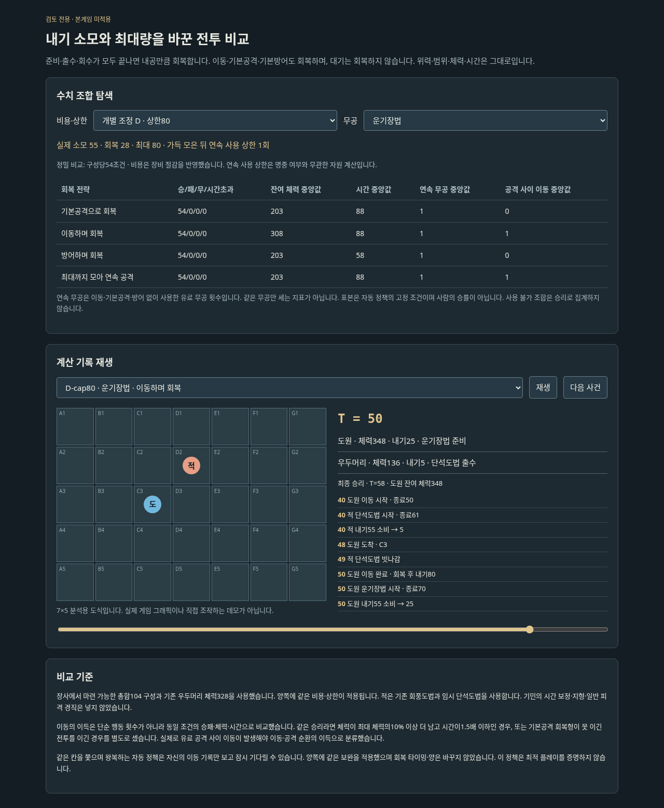

# 내기 비용·상한 실험

**검토용이다. 기존 게임의 무공·내기·적·저장은 변경하지 않는다.**

- [전체 검토 보고서](../../docs/reviews/timed-qi-budget.md)
- `index.html`: 다운로드 후 브라우저로 열면 비용·상한·무공을 바꾸며 결과를 비교하고, 실제 시간별 기록을 재생할 수 있다. 직접 조작하는 게임은 아니다.
- `coarse-results.csv` / `refined-results.csv`: 실패·동시 사망·시간초과를 포함한 모든 실행 결과. Excel용 UTF-8 BOM/LF 형식.
- `coarse-summary.json` / `refined-summary.json`: 입력 조합·사용 불가 항목·집계·비교 쌍·수식·원본/계산 코드 해시.
- `replays.json`: B/상한70과 D/상한80, 첫 배치·공세형·시드0의 고정 기록32개. 성공만 골라 담지 않는다.



## 그대로 둔 것

각 행동의 준비·출수·회수가 모두 끝날 때 내공만큼 회복한다. 이동도T+10에 회복하며 T+8 도착만으로 회복하지 않는다. 대기는 회복하지 않는다. 위력·체력·범위·장비 효과·공격 시간은 [이전 검토 엔진](../timed-combat-review/README.md)을 그대로 사용한다. 양쪽이 같은 가격표와 상한을 쓴다.

기본공격·기본방어·이동은 비용0이며 기존 회복을 받는다. 무공 비용은 시작 때 낸다. 내기는 내공만큼 시작하되 상한으로 제한한다. 기민 시간 보정·일반 피격 경직·지형은 미반영이다.

비교 전략은 기본공격 회복/이동 회복/방어 회복/최대까지 모은 뒤 연속 사용이다. 임의로1회씩 교대하도록 강제하지 않고 내기·사거리·진로에 따라 선택한다. 공격 종류 다양성보다 회복 방법의 손익을 검사한다.

## 추격 정책 보완

기존 검토의 자동 정책은 서로의 현재 위치에 맞추려 동시에 움직이며 같은 두 칸을 왕복할 수 있었다. 최근4회 이동에서2개 위치만 반복하면 확률적으로10만큼 기다려 상대의 접근이 끝나도록 했다. 양쪽/모든 수치 조합에 같은 보완을 적용했고, 상대의 미래 입력을 읽거나 대기에 내기를 지급하지 않는다. `legacy` 대조 검사에서는 이 보완을 끄고 원래 엔진 결과와 일치하는지 확인한다. 본 실험의 서로 다른 비용 조합끼리 비교하며, 이전 보고서 전체와의 승률 차이를 내기만의 효과로 주장하지 않는다.

## 이득 기준

같은 시작 위치·적 정책·난수 시드에서 이동형이 기본공격 회복형보다 이겼거나, 둘 다 이긴 경우 최대 체력의10% 이상 더 남고 소요시간은1.5배 이하이면 이득으로 센다. 유료 공격 사이에 실제 이동이 한 번 이상 있어야 이동/공격 순환의 이득으로 분류한다. 이 기준은 임시 분석 기준이며 사람의 재미/승률을 의미하지 않는다. 단순 중앙값끼리 빼서 비교하지 않고 실제 쌍을 비교한다.

양쪽의 능력치가 같다는 뜻은 아니다. 도원 내공20(운기는28), 우두머리 내공12다. 비용 인상이 적의 강공 빈도에도 영향을 준다.

## 재현

Python 3.10 이상, 외부 패키지 없이 저장소 루트에서 실행한다.

```bash
python -m unittest discover -s prototypes/timed-qi-review -p test_sweep.py -v
python prototypes/timed-qi-review/sweep.py --stage coarse
python prototypes/timed-qi-review/sweep.py --stage refined
python prototypes/timed-qi-review/report.py
```

일부 조합만 다시 계산하려면:

```bash
python prototypes/timed-qi-review/sweep.py --stage refined --configs D-cap75,D-cap80,D-cap85
```

이 명령은 해당 단계 결과 파일을 선택한 조합으로 다시 쓰므로 전체 보고서를 재생성하려면 기본 전체 명령을 다시 실행한다.

최대량M, 소모C, 회복R에서 두 번 연속 사용하려면 `M >= 2*C-R`. C>R일 때 꽉 채워 사용할 수 있는 횟수는 `1 + floor((M-C)/(C-R))`, C>M이면0이다. C<=R이면 사용 가능한 동안 자원상 연속 사용 횟수 제한이 없다. 사거리·적의 방해는 이 수식에 포함하지 않는다.
